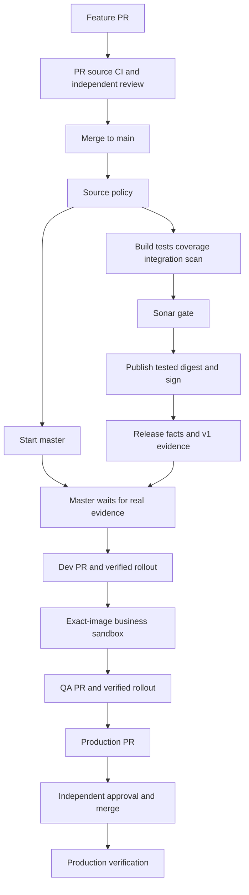

# Narx Commerce CI/CD — understand every GitHub Actions workflow

This guide explains the actual Narx local pipeline from a developer's PR to verified Production delivery. It is a code-reading and reasoning guide: what triggers each file, what it consumes, what it produces, what credentials it receives and why it can fail.

For installation, App/secret configuration, cluster setup, access and recovery commands, use [OPERATIONS.md](OPERATIONS.md). This file explains **how the automation works** rather than repeating that installation manual.

Scope: `Narx-Space-Prod`'s six local Commerce repos. No Jenkins or AWS provisioning is part of this delivery flow. One retained Terraform validation helper is described because infrastructure CI still calls it; it does not apply cloud resources.

Reviewed against current code on 7 November 2026. The full master previously completed CI, Dev, isolated business E2E, QA and approved Production verification. The newer separately named Production-approval node is implemented/tested in the code; this guide does not claim it has already been demonstrated in a fresh live release. A guide is not test evidence.

## Contents

1. [The one-change story](#1-the-one-change-story)
2. [Learn the Actions vocabulary](#2-learn-the-actions-vocabulary)
3. [Find the actual code version](#3-find-the-actual-code-version)
4. [The three service callers](#4-the-three-service-callers)
5. [The shared application graph](#5-the-shared-application-graph)
6. [Source policy and secret detection](#6-source-policy-and-secret-detection)
7. [Build, unit tests, coverage and runtime integration](#7-build-unit-tests-coverage-and-runtime-integration)
8. [Sonar source analysis](#8-sonar-source-analysis)
9. [Publish the exact image and sign it](#9-publish-the-exact-image-and-sign-it)
10. [Start delivery and record release facts](#10-start-delivery-and-record-release-facts)
11. [Versioned evidence between repositories](#11-versioned-evidence-between-repositories)
12. [The master CI-to-Production graph](#12-the-master-ci-to-production-graph)
13. [The two GitOps reusable helpers](#13-the-two-gitops-reusable-helpers)
14. [The isolated business composite action](#14-the-isolated-business-composite-action)
15. [GitOps PR validation and human approval](#15-gitops-pr-validation-and-human-approval)
16. [Recovery and rollback](#16-recovery-and-rollback)
17. [The remaining platform validation workflows](#17-the-remaining-platform-validation-workflows)
18. [Permissions, identities and trust boundaries](#18-permissions-identities-and-trust-boundaries)
19. [Concurrency, caching and performance](#19-concurrency-caching-and-performance)
20. [Read the Python control code](#20-read-the-python-control-code)
21. [Trace and diagnose a real run](#21-trace-and-diagnose-a-real-run)
22. [Change and extend the pipeline safely](#22-change-and-extend-the-pipeline-safely)
23. [Exercises and references](#23-exercises-and-references)

## 1. The one-change story

Imagine a developer changes a product-read route in `commerce-catalogue`.

1. They create a feature branch and open a PR.
2. The service's `.github/workflows/ci.yml` calls a reviewed shared application workflow.
3. That workflow runs source-policy/secret checks, builds/tests the component, tests the runtime, scans it and submits source/coverage to Sonar.
4. The PR cannot merge until required checks and independent review pass. It does not deploy or publish a release image.
5. After the merge, a **new main-branch CI run** begins. Its main-only intake starts a Commerce master run while builds continue.
6. The tested main image is published to private GHCR and signed. Source release records and machine-readable stage evidence are written.
7. The master verifies that evidence and complete source-CI success, discovers verified component releases and prepares an immutable Dev bundle.
8. A trusted bot Dev PR auto-merges after checks. Argo reconciles it and runs smoke checks; its independent observer publishes the result to GitHub.
9. The master tests the assembled images in a disposable business sandbox, then promotes the exact bundle to QA and waits for QA proof.
10. It creates a Production PR. An authorized independent person reviews and merges it.
11. The master verifies that merge and actual Production rollout/smoke results, then reports the release result.

What you follow:

| Question | View |
| --- | --- |
| Can my feature PR merge? | The source PR's required checks and review |
| What is happening to this main release? | `platform-gitops` → Actions → **Commerce CI/CD** |
| Which test or image scan failed? | The linked source CI job and artifacts |
| What did Kubernetes actually deploy? | Argo Application, Pod/Rollout state and trusted deployment evidence |
| How do I propose rollback? | GitOps **Recovery** |



There is one main release view, but it is not one enormous executable job. Source jobs execute in their own repositories; the master observes them and orchestrates GitOps. That preserves service ownership and restricted credentials while providing a coordinated view.

## 2. Learn the Actions vocabulary

### 2.1 Workflow, job, step, action and reusable workflow

| Term | Meaning in this project |
| --- | --- |
| Workflow | A YAML automation entry point or reusable definition under `.github/workflows` |
| Event | What starts it: PR update, push to main, repository dispatch, status, or manual recovery request |
| Run | One invocation of a workflow, with its own run ID |
| Attempt | A retry of that run; the ID can stay the same while attempt increases |
| Job | A runner allocation or a call to a reusable workflow |
| Step | A command/action inside a runner job |
| Action | A packaged step implementation, such as checkout or upload-artifact |
| Composite action | A group of steps executed within the caller's job |
| Reusable workflow | A `workflow_call` definition containing jobs, typed inputs and optional outputs/secrets |
| Runner | The machine executing a job; our application CI uses GitHub-hosted Ubuntu runners |
| Artifact | Files deliberately uploaded for later jobs/runs; not automatically a deployable image |
| Cache | Reusable performance data; never equivalent to a passing gate |

A reusable workflow is called at `jobs.NAME.uses`. A composite action is called at `jobs.NAME.steps[].uses`. Confusing the two produces invalid YAML or incorrect execution assumptions.

```yaml
# Teaching example: a job delegates to a reusable workflow.
jobs:
  build:
    uses: Narx-Space-Prod/platform-ci/.github/workflows/build.yml@REVIEWED_SHA
    with:
      component: catalogue
```

```yaml
# Teaching example: steps execute inside one runner job.
jobs:
  business:
    runs-on: ubuntu-24.04
    steps:
      - uses: actions/checkout@REVIEWED_SHA
      - uses: ./.github/actions/business
```

`REVIEWED_SHA` is explanatory notation, not a real Git object to paste into production.

GitHub requires reusable workflow files directly under `.github/workflows`. Subfolders there are not supported. Library display names begin `Reusable -`; GitOps helper filenames begin `reusable-`. The main source caller remains **Application CI**, not “Reusable”.

### 2.2 Read the YAML fields

| Field | What to inspect |
| --- | --- |
| `name` | Display label; not a security boundary |
| `run-name` | Particular run's label, often source repository/commit |
| `on` | Events or the reusable `workflow_call` interface |
| `permissions` | Maximum token authority for the applicable job/workflow |
| `jobs` | The graph's nodes |
| `needs` | Dependency edges and available predecessor outputs/results |
| `if` | Whether a job/step is eligible to execute |
| `runs-on` | Runner selection for executable jobs |
| `timeout-minutes` | Bound on job occupancy |
| `uses` | Action/reusable implementation, ideally pinned to reviewed content |
| `with` | Typed interface values, not secret inheritance |
| `secrets` | Explicit credential interface |
| `env` | Process environment; not a substitute for outputs between jobs |
| `outputs` | Values deliberately exported to callers/dependents |
| `concurrency` | Which operations must exclude or queue behind each other |

A job calling a reusable workflow does not also add arbitrary runner steps beside `uses`; the called definition owns its runner/steps. A runner allocated for one job does not share its filesystem or Docker daemon with a different job automatically.

### 2.3 Contexts and expression evaluation

- `github.repository`: repository whose workflow run is executing. In a source-called reusable workflow this is the **source repository**, not `platform-ci`.
- `github.sha`: revision associated with that event. In PR CI it can be the generated merge revision; after a squash merge, main has a different SHA.
- `github.ref`: ref such as `refs/heads/main` or a PR ref.
- `github.event_name`: distinguishes PR from push/dispatch/status.
- `github.run_id` and `github.run_attempt`: bind evidence to the actual execution/attempt.
- `inputs.*`: values supplied to a reusable definition.
- `vars.*`: non-secret repository/organization/environment configuration.
- `secrets.*`: credentials exposed only under their permitted scope.
- `needs.JOB.result` / `needs.JOB.outputs.*`: predecessor result and contract outputs.
- `steps.ID.outputs.*`: outputs of a step with that `id`, within the job.
- `runner.temp`: temporary job directory.

Use `${{ ... }}` for Actions expressions and ordinary `$VARIABLE` for the shell environment after the job starts. Avoid injecting untrusted event text directly into shell code; pass it through environment variables and validate it.

### 2.4 GitHub's special output files

```bash
# Illustrative step commands; these files are supplied by the Actions runner.
printf 'changed=true\n' >> "$GITHUB_OUTPUT"
printf 'IMAGE_REFERENCE=%s\n' "$IMAGE_REFERENCE" >> "$GITHUB_ENV"
printf '## Scan result\n\nSee the retained artifact.\n' >> "$GITHUB_STEP_SUMMARY"
```

`GITHUB_OUTPUT` makes a step value available for explicit job/workflow output mapping. `GITHUB_ENV` affects later steps in the same job, not another runner. `GITHUB_STEP_SUMMARY` writes readable Markdown; it does not create a passing check or approve a release.

Our build output crosses three layers:

```text
steps.changes.outputs.changed
  → jobs.build.outputs.changed
  → on.workflow_call.outputs.changed
  → needs.build.outputs.changed in the application wrapper
```

### 2.5 Why apparently simple conditions are long

GitHub normally applies an implicit success condition. A failed **or skipped** dependency can skip downstream jobs even when one direct predecessor is green. Frontend/Catalogue deliberately skip the optional Cart branch, so the graph must handle that without accepting failed builds.

```yaml
if: ${{ !cancelled() && needs.build.result == 'success' && (needs.cart.result == 'success' || needs.cart.result == 'skipped') }}
```

This means: do not proceed after cancellation; require the primary build; accept either a successful companion or a companion that does not apply. It does not mean “ignore Cart failures”.

Publication adds successful quality, protected-main event, activation and changed-runtime conditions. `always()` is reserved for reporting/cleanup or explicitly intended observation, not permission to publish after a failed quality gate.

## 3. Find the actual code version

### 3.1 Current repository main is not every run's implementation

The three source callers currently pin:

```text
platform-ci/.github/workflows/application.yml
@42e51ee5738bf9c9970ec277f2fb8edf0287fc44
```

The newer library-main labelling commit changes display names, not their active behavior. Don't infer that a service has adopted new shared code merely because the library's main branch contains it.

The pinned application wrapper resolves its local `./.github/workflows/build.yml`, `intake.yml`, `release.yml` and `evidence.yml` from **that shared-workflow commit**. It also deliberately calls these reviewed helpers:

| Dependency | Reviewed revision in the current application wrapper |
| --- | --- |
| Source policy `workflows.yml` | `666b596743c0fd43a0ba3ed1efb8dc7b89b7593e` |
| Sonar `sonar.yml` | `5c5e186e8b028a62ed002af36595281429505659` |
| Publisher `service.yml` | `35ff4ae9d506db00dbc2adc7ec027382bbe99db3` |
| Runtime integration composite | `bee471591c8b97eb389f91f5abfc95e09ee85a1d` from the build helper |

Different pins are deliberate, not automatically duplication. A workflow path/commit is part of the publisher certificate identity accepted by GitOps; changing it needs policy migration.

The GitOps master and its local reusable helpers resolve from the GitOps run's workflow revision. Control scripts are checked out at that revision; fresh environment release state is read separately from fetched Git. This avoids executing a different control script in each stage merely because main moved during the release.

### 3.2 How to inspect effective implementations

Assume the six repositories are siblings and start from their parent directory:

```bash
grep 'uses: Narx-Space-Prod/platform-ci' commerce-orders/.github/workflows/ci.yml
git -C platform-ci fetch origin main
git -C platform-ci show 42e51ee5738bf9c9970ec277f2fb8edf0287fc44:.github/workflows/application.yml
git -C platform-ci show 35ff4ae9d506db00dbc2adc7ec027382bbe99db3:.github/workflows/service.yml
```

`git show SHA:path` reads immutable source without switching branches or modifying the working tree. For an actual run, inspect its recorded revision and referenced workflows rather than assuming it used today's main.

All six repo mains and effective pins must be reviewed again when updating this guide. A historical successful release is evidence for that revision, not automatic proof that later code works.

## 4. The three service callers

Files:

- `commerce-frontend/.github/workflows/ci.yml`
- `commerce-catalogue/.github/workflows/ci.yml`
- `commerce-orders/.github/workflows/ci.yml`

They intentionally have the same thin structure. Only `application` differs. Orders selects `orders`; the shared wrapper knows that Cart is its companion with build context `cart/`.

The current caller shape is:

```yaml
name: 01 - Application CI
run-name: >-
  CI | ${{ github.event.pull_request.number && format('PR #{0}', github.event.pull_request.number) || github.sha }}
on:
  pull_request:
  push:
    branches: [main]
permissions:
  contents: read
concurrency:
  group: ci-${{ github.workflow }}-${{ github.event.pull_request.number || github.sha }}
  cancel-in-progress: ${{ github.event_name == 'pull_request' }}
jobs:
  pipeline:
    name: Application
    permissions:
      contents: write
      actions: read
      id-token: write
      packages: write
    uses: Narx-Space-Prod/platform-ci/.github/workflows/application.yml@42e51ee5738bf9c9970ec277f2fb8edf0287fc44
    with:
      application: orders
    secrets:
      SONAR_TOKEN: ${{ secrets.SONAR_TOKEN }}
      NARX_RELEASE_APP_PRIVATE_KEY: ${{ secrets.NARX_RELEASE_APP_PRIVATE_KEY }}
```

Read this carefully:

- Opening/updating a PR starts CI. A feature-branch push without a PR does not match the main-only push event.
- A push to main after merge starts another run, with main-release identity and publication eligibility.
- `run-name: >-` is a folded YAML scalar. It safely contains `PR #...`; an unquoted plain scalar containing a space before `#` can be truncated as a comment.
- The concurrency group is per workflow/PR or SHA **within the source repo**. A new PR commit cancels its older CI, not another developer's PR or another service's main run.
- Main uses commit identity and `cancel-in-progress: false`; it should not lose a publication midway merely because the next source change arrived.
- The pipeline caller grants the maximum needed by nested jobs. Child definitions reduce permissions for builds/analysis/evidence; the max is not an instruction to hand every child every credential.
- Only two named secret interfaces exist. This is not `secrets: inherit`.
- Environment-scoped release credentials are resolved in the actual main-only intake job. Ordinary PR jobs must not gain that key.

**Required source checks** include the policy, primary build and Sonar contexts; Orders additionally requires its Cart build. The final context includes the caller job names, e.g. `Application / 03 - Sonar quality gate / Source quality gate`. Changing a display/job name can therefore require a branch-protection migration, even though changing only a reusable workflow's top-level `name` does not rename these job IDs.

## 5. The shared application graph

File: `platform-ci/.github/workflows/application.yml`.

Interface: required `application` string and two explicit secret interfaces. Expected applications are frontend, catalogue and orders. The downstream build/publisher helpers bind that component to its expected source repository/context.

| Job ID | Needs / execution | Effect |
| --- | --- | --- |
| `validate` | First | Central lint and secret scan |
| `intake` | validate; main push and delivery enabled | Start the master while builds run |
| `build` | validate | Primary component test/build/integration/scan |
| `cart` | validate; Orders only | Cart component in parallel |
| `quality` | Primary success; Cart success or skipped | Combined repository Sonar gate |
| `publish` | Primary build + quality; changed protected-main runtime | Publish/sign primary image |
| `cart-publish` | Cart + quality; changed Orders companion | Publish/sign Cart image |
| `delivery` | Both publishers success/skipped; at least one success | Record published-image facts; no second master dispatch |
| `test-evidence` | Successful primary/eligible companion | Write tests/security contract artifact |
| `quality-evidence` | Successful quality | Write quality contract artifact |
| `publication-evidence` | Quality + publishers + recording success/skipped | Write publication or no-runtime-change contract |

`delivery` is a retained stable job ID; its display name now describes **recording release facts**. It is not the old extra deployment controller.

For Orders, primary and Cart builds run concurrently. Their publications may also run concurrently after the single combined quality gate. If only one runtime changed, only that image publishes. Tests/analysis may still export cached test-stage reports for both components so Sonar has the whole repository's coverage picture.

A tests evidence artifact can appear while Sonar is still running. A quality artifact can appear before publication. The master may therefore show completed early stages before source CI is entirely finished. **It cannot deploy on those early artifacts alone:** its publication gate also requires complete successful source CI.

Why not use one shell script for all of this? Separate jobs establish clear permission/runner boundaries, permit independent builds and retain meaningful status/artifact evidence. Reuse reduces copied logic; a single mega-script would hide those boundaries.

## 6. Source policy and secret detection

File: `platform-ci/.github/workflows/workflows.yml`.

- Trigger: reusable `workflow_call`, not an independent deployment event.
- Job: `validate`, displayed as Workflow lint.
- Runner/time: Ubuntu24.04, five minutes.
- Token: contents read.
- Interface: no application inputs and no custom secrets.

Steps:

1. Checkout the **caller repo**, with `persist-credentials: false` and full fetched history.
2. Download the reviewed actionlint release and check its SHA256 before extracting it.
3. Run actionlint against the caller's workflow definitions.
4. Download/check Gitleaks similarly.
5. Generate the centrally reviewed scanner configuration in the runner temp directory.
6. Scan fetched history with redaction and without allowing a candidate repository ignore file or inline allow comment to silently weaken the central policy.

`fetch-depth: 0` matters: a shallow checkout may hide an earlier leaked secret. Finding a historical secret does not mean deleting its current file is sufficient; revoke/rotate the credential and handle history through the organization's incident process.

A checksum failure, invalid workflow or detected secret fails source policy. No application build should proceed past that gate. Gitleaks is secret detection, not source semantic analysis; Sonar handles another category of checks.

GitOps has a precise actionlint configuration exception for the documented queue field unsupported by the pinned linter. It is file-specific, and tests enforce the intended queue shape. It is not a general suppression of invalid workflow syntax.

## 7. Build, unit tests, coverage and runtime integration

Read `platform-ci/.github/workflows/build.yml`, then the selected component's Dockerfile. The workflow owns orchestration; the Dockerfile owns language-specific build/test commands. A container build is therefore also a reproducible test environment, not just a packaging step.

### Inputs and change detection

`component` identifies one of `frontend`, `catalogue`, `orders`, `cart`; `context` selects its build directory. Cart is in `commerce-orders/cart`, not a fourth source repository. The workflow checks this repository/component/context mapping before doing work. An arbitrary caller cannot use this interface to publish another component's identity.

The change detector compares the PR base SHA or the push's `before` SHA against the current commit. A missing or all-zero base causes a conservative build. It excludes documentation-only paths; workflow/action changes remain relevant. Orders changes outside `cart/` and Cart changes inside it are assessed separately. Inspect the exact path conditions before introducing a new runtime directory: a new exclusion can accidentally suppress releases.

The `changed` output crosses three boundaries:

```text
steps.changes.outputs.changed
    → jobs.build.outputs.changed
    → on.workflow_call.outputs.changed
    → needs.build.outputs.changed in application.yml
```

Actions outputs are strings. The comparison is `== 'true'`, not an assumption that a nonempty string is a Boolean.

### Runtime build and analysis export

For a changed component, BuildKit builds and loads `narx-check-COMPONENT:SOURCE_SHA` into the runner's Docker daemon. It does not push. OCI labels identify the source repository and revision. Component-scoped GitHub Actions caches reduce repeated dependency downloads and unchanged Docker layers.

A separate Docker `analysis` target exports coverage and analysis files. It runs even when runtime publication is unnecessary, so source quality still has current reports. Shared Docker test stages can be reused from cache; this is not permission to replace a current report with an arbitrary old artifact.

The language reports are:

| Component | Report concept | What the workflow checks |
| --- | --- | --- |
| Frontend | LCOV | Nonempty report and line coverage summary |
| Catalogue | Go coverage profile | Nonempty report and statement coverage summary |
| Orders | JaCoCo XML plus Java analysis inputs | Nonempty report and line coverage summary |
| Cart | Python coverage XML | Nonempty report and line coverage summary |

The Dockerfile test stages execute these commands; read the corresponding source files to understand the assertions:

| File | Actual test/build entry point | Analysis export |
| --- | --- | --- |
| `commerce-frontend/Dockerfile` | `npm ci --ignore-scripts`, then `npm run test:coverage` | `coverage/lcov.info` |
| `commerce-catalogue/Dockerfile` | `gofmt` check, `go vet ./...`, `go test -count=1 -coverprofile=/coverage.out -covermode=atomic ./...` | `coverage.out` |
| `commerce-orders/Dockerfile` | Dependency stage, then `mvn -B verify` | JaCoCo, compiled classes and analysis dependencies |
| `commerce-orders/cart/Dockerfile` | Hash-checked dependency wheels, `python -m coverage run -m pytest`, then coverage XML | `coverage.xml` |

`FROM ... AS test/build` names a stage; `COPY --from=...` makes runtime/analysis stages depend on its output. A failing test command stops the Docker build. The `analysis` scratch stage exports files without becoming a runnable application. Runtime stages omit development/test tooling where configured and set a non-root user.

For a local reproduction, these commands **build images and execute test stages**, but do not publish or deploy. Run each from its named repository; Docker must be available and downloads consume local disk/network:

```bash
# In commerce-frontend:
docker build --target runtime -t narx-check-frontend:local .
# In commerce-catalogue:
docker build --target runtime -t narx-check-catalogue:local .
# In commerce-orders:
docker build --target runtime -t narx-check-orders:local .
docker build --target runtime -t narx-check-cart:local ./cart
# Example analysis export, from commerce-frontend:
docker build --target analysis --output type=local,dest=/tmp/narx-frontend-analysis .
```

Coverage asks which code tests executed; it does not prove that assertions were meaningful. Unit tests exercise small units of behavior. Runtime integration tests exercise the built service and its dependencies. The later business test exercises several services together. These are complementary layers.

`source.json` accompanies analysis exports and binds the report to repository, commit and component. The Sonar workflow validates that binding. Missing coverage fails rather than silently showing a misleading zero or stale report.

### Test the runtime image

The workflow rejects a runtime image whose configured user is empty, root or UID zero. This is one check on image configuration; Kubernetes security contexts provide additional restrictions.

The pinned `platform-ci/integration/action.yml` composite runs against the loaded runtime. Read its implementation in this order:

1. `integration/action.yml`: inputs, environment and entry command.
2. `integration/runner.py`: component selection, Docker/container lifecycle, assertions and JUnit reporting.
3. `integration/upstream.py`: supporting fixture/server behavior used by the harness.

The harness tests the built artifact rather than rebuilding a convenient substitute. Component-specific dependencies and protocol expectations belong here; application unit assertions belong with application source. JUnit results are retained as `integration-COMPONENT`, including failure paths when a report was produced.

### Vulnerability scan and transfer

The workflow verifies the downloaded Trivy binary checksum, restores its vulnerability database cache and scans the runtime image. `--scanners vuln` selects dependency/OS vulnerability scanning; Gitleaks and Sonar cover different concerns. HIGH/CRITICAL findings fail the gate, including unfixed findings under the current policy. A centrally generated empty exception file prevents a candidate repository ignore file from silently waiving the gate.

The JSON scan result is converted into a CycloneDX SBOM. An SBOM is a machine-readable dependency inventory, not a clean-security certificate. Scan results describe the vulnerability database and image at scan time; new vulnerabilities can appear afterward.

On an enabled main push only, the runtime is exported with `docker save` and uploaded. This transfers the already tested bytes to the privileged publisher; it avoids rebuilding after tests.

| Artifact | Purpose | Retention |
| --- | --- | --- |
| `analysis-COMPONENT` | Coverage/source binding and language analysis inputs | 1 day |
| `runtime-COMPONENT` | Exact runtime tar for publication | 1 day |
| `integration-COMPONENT` | JUnit runtime integration evidence | 14 days |
| `security-COMPONENT` | Vulnerability report and SBOM | 14 days |

These are Actions artifacts, not the long-term deployment registry. Expired short-lived artifacts can prevent a publisher-only rerun; rerunning a coherent source pipeline is safer than inventing replacement evidence.

## 8. Sonar source analysis

Read `platform-ci/.github/workflows/sonar.yml`. It receives the project key, organization and optional server URL, plus `SONAR_TOKEN`. It runs after successful build jobs so coverage exists before analysis.

The workflow checks out the caller's source with full history, downloads the primary analysis artifact into an explicit component directory and downloads Cart's report separately for Orders. This explicit layout matters: downloading one named artifact does not automatically add an artifact-name directory.

It validates repository identity, project/organization formats, supported Sonar server and each `source.json`. It then generates scanner settings in a runner temporary file. Candidate-owned scanner properties cannot silently redirect the trusted scan or disable its centrally defined coverage inputs.

| Source | Analysis arrangement |
| --- | --- |
| Frontend | `src`/`public`, tests under `tests`, LCOV |
| Catalogue | Go source with generated/vendor/test exclusions, Go coverage |
| Orders | Java source/tests, Java 21 classes and dependency inputs |
| Cart | Included in the Orders Sonar analysis with its Python XML coverage |

Cart XML source roots are normalized to `cart` to avoid matching a report path against the wrong source directory. Java bytecode inputs matter because some Java analysis requires compiled classes, not source alone.

The scanner uses `sonar.qualitygate.wait=true` and a 600-second gate timeout. Uploading analysis successfully is insufficient: the job waits for the server's quality-gate decision. A missing token fails closed. A failing quality gate blocks publishing.

The exact threshold is the configured Sonar project gate, not a universal percentage invented by this guide. New-code conditions and overall coverage are different measures. Diagnose the Sonar issue/coverage details before changing the gate; do not make it green by excluding real production source.

## 9. Publish the exact image and sign it

Read `platform-ci/.github/workflows/service.yml`. Its stable filename is part of the trusted publisher identity. Renaming it requires coordinated policy and caller changes.

### The privilege boundary

The publisher receives component and `changed`; it runs only for an enabled changed main release after tests and Sonar pass. Its job has package write and OIDC token permission. It does **not** check out and execute application source.

It downloads the tested runtime and matching security artifacts, loads the image, logs into GHCR using the job's short-lived `GITHUB_TOKEN`, and publishes:

```text
Source tag: ghcr.io/narx-space-prod/commerce-catalogue:SOURCE_COMMIT
Deployment identity: ghcr.io/narx-space-prod/commerce-catalogue@sha256:MANIFEST_DIGEST
```

A tag is a named reference; a digest identifies content. Kubernetes deployment uses the digest. Do not infer that a source commit hash itself is an image digest.

### Idempotent publication

If the source tag already exists, the publisher compares its image configuration digest to the tested local image. Matching content can be reused; different content fails. Only an actual missing-manifest result permits a new push. An authentication or network error must not be mistaken for absence.

After publication, it resolves the remote manifest digest and checks that the remote configuration still matches the tested local image. This guards a competing tag mutation between inspection and signing. It exports `image` and `digest` to the calling graph.

A rerun of the same commit can produce different bytes when an unpinned upstream OS package changes. The workflow intentionally refuses to overwrite that source tag. Investigate and use a new reviewed commit; do not weaken the immutability check to make a rerun pass.

### Signature and attestations

Cosign uses GitHub OIDC for keyless signing. No long-lived image-signing private key is stored in the source repository. The publisher signs the digest and attaches:

- A custom release attestation using predicate type `https://narx.space/attestations/release/v1`, binding repository, commit, component, run ID, source workflow and main ref.
- A CycloneDX SBOM attestation for the same image.

Verification checks both the predicate facts and the certificate's reviewed builder identity. A valid signature from an unrelated workflow is insufficient. These controls are useful supply-chain protections; they do not constitute a claim of formal SLSA certification.

Registry configuration is isolated and cleaned on exit. Build jobs do not inherit the publisher's package-write/OIDC privileges.

## 10. Start delivery and record release facts

Two workflows have different responsibilities. Their names are not interchangeable.

### `intake.yml`: start the master early

Once main source policy passes, intake can run alongside the build. In the protected `gitops-release` environment, it mints a short-lived dedicated release-App token scoped to `platform-gitops`. It sends `repository_dispatch` with event type `ci-started` and source repository, commit, run ID and evidence version.

This creates the master early enough to show CI progress. It is **not** proof that CI has passed and does not permit early deployment. The master authenticates the payload against GitHub's source-run API and waits for evidence.

A repository's normal `GITHUB_TOKEN` does not automatically have write authority in another repository. This is why a narrowly scoped App is used rather than a broadly privileged personal token.

### `release.yml`: record immutable source release facts

After publication, the workflow records a GitHub Release for each published component using tag `COMPONENT-SOURCE_SHA` and a `release.json` asset. It validates image/component/digest facts, adds source run identity and reuses an existing release rather than overwriting it.

This job's historical ID is `delivery`; its display name is **Record release metadata**. It no longer dispatches delivery or receives the App key. Its timing report is best-effort telemetry, not a deployment gate.

There are two different `release.json` concepts:

| Location | Meaning |
| --- | --- |
| Source GitHub Release asset | Facts about one published component |
| GitOps `environments/ENV/release.json` | Complete environment bundle, exact images and recovery predecessor |

The latter assembles verified component facts. Promoting an environment does not rebuild source or copy a mutable tag and hope it matches.

## 11. Versioned evidence between repositories

Read `platform-ci/.github/workflows/evidence.yml` and `platform-gitops/scripts/source_gate.py` together. One produces a contract; the other validates it. Job display names are for people and are not a reliable machine protocol.

The producer uploads a small `gate.json` artifact named:

```text
narx-ci-v1-tests-RUN_ATTEMPT
narx-ci-v1-quality-RUN_ATTEMPT
narx-ci-v1-publication-RUN_ATTEMPT
```

Fields bind schema version, gate, repository, commit, run ID, run attempt, success result and release list. Tests/quality evidence cannot contain release facts. Publication evidence validates unique allowed components and their expected image names/digests. An empty publication list means no deployable runtime changed.

`source_gate.py` performs these checks:

1. Allow only the three source repositories, a 40-character commit and a positive integer run ID.
2. Fetch the source run and require the expected repository, commit, `push`, main branch and `.github/workflows/ci.yml`.
3. Require the supported evidence version and current run attempt.
4. Find exactly the expected non-expired artifact and verify its owning run ID.
5. Bound archive size; accept exactly one small `gate.json`, without extracting uploaded executable files.
6. Validate exact schema fields/types and release facts. Boolean values cannot masquerade as numeric run IDs.
7. For publication, require **the entire source CI run** to conclude successfully before allowing promotion.

Tests and quality can appear progressively while the source run is still active. Publication is stricter because another late source job may still fail. A completed run with briefly unindexed artifacts gets a short indexing grace period, not an indefinite bypass. Failed/cancelled runs fail the observation. Unknown schemas and invalid evidence do not fall back to guessing job names.

An artifact is a declaration from a particular workflow run, not an image signature. The chain also depends on protected source main, trusted reusable pins, complete CI success and later image-signature verification.

A rerun increments `run_attempt`; an old green artifact must not satisfy a new failed attempt. This is why manually downloading any artifact with a similar name is not an equivalent gate.

## 12. The master CI-to-Production graph

Read `platform-gitops/.github/workflows/commerce.yml`. It starts on `repository_dispatch: ci-started`. Follow **Commerce CI/CD** in GitOps Actions for the release-level graph; follow linked source jobs for their logs.

| Node | Work and evidence required |
| --- | --- |
| Source tests | Validate source identity and current test artifact |
| Source quality | Validate quality artifact after test gate |
| Publication | Require complete successful CI and publication evidence |
| Dev | Discover verified facts and propose/auto-merge a Dev bundle |
| Verify Dev | Wait for matching trusted rollout/smoke evidence |
| Business validation | Exercise the assembled immutable bundle in a disposable sandbox |
| QA | Promote exactly that Dev bundle through a checked bot PR |
| Verify QA | Wait for matching QA rollout/smoke evidence |
| Production PR | Propose exactly the QA-verified bundle |
| Await Production approval and merge | Keep an explicit visible approval node active |
| Production rollout and smoke | Verify the approved bundle actually became healthy |
| Summary | Report actual results and links, including failures/skips |

The `needs` graph enforces this order. A QA mutation cannot run merely because Dev created a PR; verified Dev **and** business tests must succeed. Production is not green merely because someone clicked Approve. The PR must merge and the resulting environment must pass verification.

The approval node polls the exact Production PR in a read-only job. It validates its base, branch, internal repository, merged commit, changed path and full release ID. Closing without merge fails. It does not approve on the person's behalf. It is not GitHub's native yellow environment-approval UI: the Actions job remains running while the PR is pending and consumes runner time. The wait is bounded at one hour.

The final rollout node accepts the intentional skipped-approval case when an applicable PR is already merged; it still checks deployed evidence. Conditional `active`/`deploy` outputs also avoid pretending that a no-runtime-change commit deployed something.

The summary uses `always()` so a failed gate still produces a useful table. A successful summary job is not proof that all preceding jobs passed. Read their conclusions and the table.

## 13. The two GitOps reusable helpers

### `.github/workflows/reusable-verify.yml`

This is a read-only adapter around trusted observation code. Inputs select operation, environment, release ID, optional PR number and bounded timeout. It checks out the reviewed workflow revision and grants only repository/status/PR reads. It receives no release-App key and no kubeconfig.

Its operation routing is explicit:

| Operation | Implementation |
| --- | --- |
| `tests`, `quality`, `publication` | `scripts/source_gate.py` |
| `wait` | `scripts/delivery.py wait` |
| `wait-approval` | `scripts/delivery.py wait-approval` |
| `observe-production` | `scripts/delivery.py observe-production` |

Unknown operations fail. Longer approval/Production observations have a larger job timeout than ordinary gates. The reusable output `deploy` carries the publication decision to the master.

### `.github/workflows/reusable-release-stage.yml`

This is the mutation boundary. Inputs select the environment, operation and expected bundle. Outputs identify the bundle, whether work is active and the relevant PR number/URL. The protected environment provides the dedicated App credential.

The job checks out reviewed control code, logs into private GHCR read-only, installs pinned Cosign, mints an App token scoped to GitOps contents/PR writes, and invokes `delivery.py`. It handles normal stage promotion and recovery through the same mutation lock.

Concurrency group `release-state-mutation` uses `cancel-in-progress: false` and `queue: max`. This prevents two writers from updating GitOps release state at once and retains queued mutations instead of replacing the single pending job. The lock covers mutation jobs, not an hour-long human approval wait.

Serialization alone does not make stale decisions safe. The script refreshes main and rechecks upstream bundle and health while it holds the mutation slot. Registry credentials are removed even when the operation fails.

## 14. The isolated business composite action

Read `platform-gitops/.github/actions/business/action.yml`. Unlike a reusable workflow, this composite expands into steps of the existing master job and uses that runner's workspace and permissions.

It tests the complete Dev-verified bundle without accessing cluster databases:

1. Read the expected Dev release bundle and require its full release ID.
2. Generate disposable secrets in a mode-600 local environment file; use loopback port 18080.
3. Check out Orders fixtures at the exact source commit represented by the bundle.
4. Log into private GHCR with read-only package access.
5. Render the Compose configuration and replace all six runtime roles with the four immutable image digests. Publisher and worker use the Orders image.
6. Remove build entries so the test cannot rebuild a different artifact.
7. Start an isolated, uniquely named Compose project with `--no-build --wait`.
8. Run `local/test_local_stack.py` with local and queue test modes enabled.
9. On failure, show bounded service diagnostics; always remove that project's containers/volumes and temporary credentials.

The assertions cover customer/auth/admin boundaries, checkout idempotency, stock, payment proof acceptance/rejection, refunds, transactional outbox persistence, queue outage/replay, inbox deduplication, dead-letter handling and corrected replay.

The configured queue visibility timeout is 15 seconds, consistent with the worker's accepted minimum. A shorter fixture value previously caused a startup failure; that would be a test-environment configuration failure, not evidence that business assertions ran.

This is integration/E2E evidence against the assembled bundle. A local payment fixture does not prove real Razorpay settlement, live credentials or external provider availability. `down --volumes` here is deliberate cleanup of a disposable test project; it must not be copied into an operation against the persistent environment.

## 15. GitOps PR validation and human approval

### Ordinary GitOps CI

`.github/workflows/ci.yml` runs source policy, Helm/manifests and local preview/rule checks on PRs and main. It validates candidate changes with read-only permissions. It does not receive the release writer secret.

### Privileged release verification

`.github/workflows/release-verification.yml` uses `pull_request_target` so it can publish a required status. That event can be dangerous if it executes untrusted PR code. This implementation checks out **the base SHA**, reads candidate release JSON through GitHub's API, and executes reviewed base-branch verification code.

It restricts paths to the three environment release files, rejects deleted/renamed candidates, bounds file size and validates content. Lower-environment review exemptions require the exact dedicated bot identity and an internal branch; an arbitrary account named similarly is insufficient.

For each candidate, `delivery.py verify-candidate` checks canonical bundle contents, source releases, successful source CI, trusted signatures/SBOMs, upstream environment and rollback rules. The workflow publishes `narx/release-verification` on the PR head SHA. Its always-run status step reports failure if verification failed. Private-registry credentials are cleaned afterward.

The target workflow cannot validate a newly proposed change to its own verifier by executing that candidate. Ordinary PR CI and independent code review cover control-code changes; the trusted verifier continues to enforce the base policy until merge.

### Why Dev/QA and Production differ

Trusted bot Dev/QA release-only PRs can auto-merge after required checks. Production release changes require independent review. Other GitOps code/policy changes also require review. A broad classic review count of zero is **not** sufficient protection: this setup pairs release automation with path-scoped rules requiring the reviewer team outside the narrow lower-environment exception.

GitHub auto-merge means “merge when all applicable requirements are satisfied,” not “ignore checks.” The script retries bounded API visibility lag when enabling it. It does not auto-approve Production or treat a stale PR head as the current candidate.

## 16. Recovery and rollback

Read `.github/workflows/recovery.yml`, then the recovery functions in `scripts/delivery.py`.

Automatic recovery is based on trusted deployment failure statuses in QA/Production. The failure-only migration documented in OPERATIONS.md moves the initial filter into the local systemd dispatcher, which sends `recovery-requested` only after observing an actual trusted failure. The consumer PR removes the broad GitHub `status` trigger only after the producer timer is installed; until then, legacy status events remain the active path. It requires the expected observer account/context and current failed bundle. A stale failure cannot authorize rolling back a different healthy release. Dev has no automatic rollback; manual recovery supports all three environments.

Recovery uses the same serialized writer helper as promotion. It verifies the stored predecessor's facts, signatures and successful deployment evidence, then proposes a rollback PR. A rollback is an auditable GitOps change, not an invisible `kubectl set image` that Argo later reverses. Production review remains applicable.

A merged Production release PR also starts a read-only fallback observation. This supplements master observation if the original release-level run has ended; it does not publish a second release.

Important limits:

- No known healthy predecessor means no invented rollback target.
- Rolling back application images does not reverse a destructive database migration.
- Recovery proposals remove recursive predecessor history to avoid automatic rollback loops.
- A stalled controller, missing observer or insufficient host memory can prevent recovery from completing; a script cannot manufacture capacity.

Use the recovery procedure in OPERATIONS.md for approved manual commands. Diagnose the triggering failure before repeatedly proposing the same rollback.

## 17. The remaining platform validation workflows

These workflows validate the automation itself. They are not additional production deployment entry points.

### Shared library `.github/workflows/ci.yml`

PR/main changes in `platform-ci` run local workflow lint, publication-contract unit tests and an integration matrix for the four components. Matrix jobs use frozen application fixture commits, build fixture images and run the local integration composite. `fail-fast: false` preserves independent component results. Each matrix job has its own hosted runner.

Read the tests by contract:

| Test file | Concern |
| --- | --- |
| `tests/test_application_wrapper.py` | Wrapper graph, conditions and evidence wiring |
| `tests/test_ghcr_publish.py` | Registry publication and trusted boundary shape |
| `tests/test_coverage_contract.py` | Coverage exports and analysis bindings |
| `tests/test_integration_safety.py` | Integration harness safety assumptions |

Frozen fixtures test harness compatibility reproducibly; they do not replace per-commit application CI. A library PR cannot assume all services immediately consume its main branch: callers remain pinned until separately updated.

### Shared `helm.yml`

The helper installs reviewed Helm and checksum-verified Kubeconform, fetches pinned schemas once, then lints/renders environment configurations. Placeholder immutable images are rendering inputs, not published images. It validates custom Argo schemas, rejects a missing-image example and runs available chart/delivery fixture tests.

Helm lint checks chart structure/templates; rendering produces Kubernetes YAML; schema validation checks resource shape. None proves a controller can actually schedule the workload. The helper currently validates core Kubernetes schemas at 1.35 while the local cluster is 1.34; this mismatch is a known limitation, not a compatibility guarantee.

GitOps preview also validates Compose configuration without starting apps, compiles its local test helper, runs delivery-stage unit tests and checks Prometheus rule fixtures using a constrained pinned Prometheus container. Some fast delivery tests overlap helper checks; do not claim that absolutely no duplicated checks remain.

### Infrastructure `.github/workflows/ci.yml`

This runs shared source policy, two retained Terraform validations, and local platform checks. The local job compiles Python, renders the pinned Cilium chart for Kubernetes 1.34, renders observability using pinned GitOps data and runs `test_local_*.py` with the rendered output directory.

Rendering does not install a chart. This workflow does not create a cluster, start AWS infrastructure or mutate the running local environment.

### Shared `terraform.yml`

The helper formats Terraform, initializes without a backend, validates and runs mocked-provider tests. `-lockfile=readonly` prevents silently changing provider selections. Trivy configuration scanning fails HIGH/CRITICAL findings, with one narrowly documented bootstrap exception for the lab state encryption choice and an expiry.

There is no cloud login, plan/apply/destroy step here. The retained `bootstrap` and `delivery` roots are validated code, outside the active local delivery path. This guide does not authorize changing or operating the separate AWS project.

## 18. Permissions, identities and trust boundaries

A workflow's requested permission is not proof that organization policy grants it. A called workflow cannot elevate beyond its caller's available token permissions. Each job receives its own token; reusable calls do not create a permanent shared administrator session.

| Identity | Purpose | Must not become |
| --- | --- | --- |
| Source read-only job token | Checkout, analysis/artifacts | Cross-repository release writer |
| Publisher job token | GHCR package publication | GitOps approval identity |
| Publisher OIDC identity | Keyless image signing | Unrestricted AWS credentials |
| Release App | Dispatch master, create GitOps release PRs | Independent human reviewer |
| Observer App | Publish trusted deployment statuses | Source publisher or release writer |
| Code-S-12 reviewer | Independent protected review | A bot auto-approving its own change |
| Cluster image-pull secret | Pull private GHCR images | Package-write credential |

`SONAR_TOKEN` goes only to source-quality analysis. The release App private key is supplied only where cross-repository release operations need it. No master observation job needs Kubernetes administrator credentials: it consumes independently reported deployment evidence.

The source-caller job declares an upper bound for nested reusable permissions; sensitive jobs narrow permissions locally. Fork PRs normally cannot access repository secrets. This pipeline is designed around trusted organization development; accepting public forks would need an explicit untrusted-contributor analysis strategy, not simply granting those forks secrets.

A SHA pin protects against moving branch/tag references. It does not prove the pinned code is good; reviewers must inspect the update. Download checksums protect selected binary bytes. CODEOWNERS and enforced rules protect changes to these controls. All three serve different purposes.

## 19. Concurrency, caching and performance

Developers can push multiple times per day. An open PR's new push creates another PR CI run. Superseded PR checks can be cancelled; unrelated PRs can run concurrently. Merged main commits are separate release candidates and are not cancelled merely because another commit arrives.

Parallelism already exists:

- Intake and component builds after policy.
- Orders and Cart builds, followed by their independent publication jobs when eligible.
- Independent service repositories and independent PRs.
- Shared-library component fixture matrix jobs.

Ordering is intentional where evidence depends on prior work: Sonar needs coverage, publishing needs quality, QA needs verified Dev/business tests, Production needs verified QA and approval.

Three mechanisms prevent different races:

| Mechanism | Race addressed |
| --- | --- |
| Per-PR CI cancellation | Wasting runners on obsolete PR commits |
| GitOps mutation queue | Concurrent writers updating shared release state |
| Fresh state/ancestry/head validation | A serialized but stale candidate replacing a newer valid release |

Build caches are performance hints. A cache miss must still work; a cache hit must not skip required assertions through an unrelated condition. Image artifacts preserve tested runtime bytes, while digest promotion avoids rebuilding for each environment. Trivy database caching reduces downloads but does not turn an old scan into proof about future vulnerabilities.

The master wait jobs occupy hosted runners while polling. A fully event-driven durable orchestrator could reduce that cost, but would add correlation/state complexity. The current visible bounded waits trade some runner time for a single readable release graph. A self-hosted runner would add patching, isolation and untrusted-code responsibilities; it is not automatically faster or safer, especially on this memory-limited host.

Measure queue time, execution time and human approval time separately. “Pipeline took an hour” may mean one minute of work plus 59 minutes waiting for review. Do not weaken a security gate to optimize a number that is mostly waiting.

## 20. Read the Python control code

You need enough Python to understand validation, state transitions, API calls and failure behavior. You do not need to memorize every line. Read a function by asking: what input is trusted, what state is read, what is validated, what can change, and what happens on failure?

### `scripts/source_gate.py`

This is the source-run evidence reader described in section 11. Trace the entry point into payload identity validation, GitHub run lookup, artifact lookup/download, bounded ZIP parsing, schema checks and polling. It never executes source artifacts. Current evidence version is mandatory; removed legacy behavior should not be recreated as a silent fallback.

### `scripts/delivery.py`

Read these groups in order; use the function inventory command below to locate exact definitions:

| Group | Responsibility and invariant |
| --- | --- |
| Command/API helpers | Argument arrays, bounded timeouts/retries; retry reads, not blind mutations |
| Facts and canonical bundle validation | Known components/repos, exact digest format, deterministic release identity |
| Source release discovery | Successful protected-main run and correct component release asset |
| Image verification | Trusted builder certificate, source predicate and SBOM for exact digest |
| Deployment revision/status selection | Relevant GitOps revision and newest matching trusted observer state |
| Bundle construction | Exact component set, role aliases and validated predecessor |
| PR creation/auto-merge | Deterministic branch, safe reuse, fresh main, lower-env-only auto-merge |
| Candidate verification | Proposed bundle really derives from verified source/upstream state |
| Stage advancement | Recheck current state under writer lock, then propose one transition |
| Wait/approval observation | Bounded polling and exact bundle/PR correlation |
| Recovery | Current trusted failure plus verified healthy predecessor |
| CLI dispatch | Explicit operation allowlist, no arbitrary shell command interface |

Publisher and worker are Orders role aliases, not independently built fifth/sixth images. The bundle's release ID hashes canonical component facts; comparing a short branch prefix is insufficient when validating the full bundle.

The script compares Git ancestry rather than treating “finished last” as “newest source.” A slow older build must not overwrite a newer accepted release just because it completed later. Relevant deployment revisions include chart/environment/policy changes; only proven description/format-only AppProject differences can be ignored.

Status selection never skips a newer failure to find an older success. Signature-verification caching is positive and in-process, keyed by full identity/trusted builders; a failed verification cannot become a cached success.

Read-only API operations have bounded retries for transient transport/server/rate-limit failures. Authentication errors fail. Writes are not blindly retried because creating duplicate branches/PRs can produce inconsistent state. Existing deterministic branches/PRs are deliberately reconciled, and unexpected control-code conflicts fail rather than being automatically discarded.

```bash
# Run inside the GitOps clone. These commands only inspect code.
grep -n '^def ' scripts/source_gate.py scripts/delivery.py
python3 scripts/delivery.py --help
git log -5 --oneline -- scripts/delivery.py scripts/source_gate.py
```

### Tests and supporting code

`tests/test_delivery_stages.py` exercises workflow/control contracts and race/failure cases. Delivery fixture tests validate bundle construction/candidate rules. `local/test_local_stack.py` owns assembled business assertions, not release-PR authorization. Prometheus rule fixtures test alert expressions; they do not prove Slack transport works.

The integration Python in `platform-ci/integration/` owns disposable runtime harnesses. Infrastructure `local` helpers own cluster installation, observability, observer and operational plumbing; their setup/command-by-command explanation is in OPERATIONS.md. They support delivery but are not all executed by every Actions run.

## 21. Trace and diagnose a real run

Use one source commit and source run ID as your starting identity. Do not mix logs from several attempts. These commands are read-only unless explicitly noted.

### Find source CI

```bash
gh run list --repo Narx-Space-Prod/commerce-catalogue --workflow ci.yml --limit 10
gh run view SOURCE_RUN_ID --repo Narx-Space-Prod/commerce-catalogue
gh run view SOURCE_RUN_ID --repo Narx-Space-Prod/commerce-catalogue --log-failed
gh api repos/Narx-Space-Prod/commerce-catalogue/actions/runs/SOURCE_RUN_ID \
  --jq '{id,run_attempt,event,head_branch,head_sha,status,conclusion,path,html_url}'
```

Replace uppercase placeholders with real values; they are not shell variables. For Orders, inspect both primary and Cart jobs. A skipped publisher can be expected for a PR or a documentation-only change.

### Follow the master and exact jobs

```bash
gh run list --repo Narx-Space-Prod/platform-gitops --workflow commerce.yml --limit 10
gh run view MASTER_RUN_ID --repo Narx-Space-Prod/platform-gitops
gh api --paginate repos/Narx-Space-Prod/platform-gitops/actions/runs/MASTER_RUN_ID/jobs \
  --jq '.jobs[] | [.name,.status,.conclusion,.started_at,.completed_at,.html_url] | @tsv'
```

Match source repository/commit in the run's summary and links, not merely the most recent row. `needs` jobs may remain queued/skipped after an upstream failure; investigate the first failed gate.

### Inspect evidence without executing it

```bash
gh api repos/Narx-Space-Prod/commerce-catalogue/actions/runs/SOURCE_RUN_ID/artifacts \
  --jq '.artifacts[] | [.name,.expired,.size_in_bytes] | @tsv'
# Download into a fresh disposable directory, then read the JSON as data.
gh run download SOURCE_RUN_ID --repo Narx-Space-Prod/commerce-catalogue \
  --name narx-ci-v1-publication-RUN_ATTEMPT --dir /tmp/narx-evidence-inspection
cat /tmp/narx-evidence-inspection/gate.json
```

This manual inspection helps diagnose a run; it does not replace the verifier's ownership/size/schema checks. Do not execute scripts from downloaded artifacts.

### Inspect PR requirements and deployment statuses

```bash
gh pr view PR_NUMBER --repo Narx-Space-Prod/platform-gitops \
  --json url,state,headRefOid,baseRefName,reviewDecision,mergeStateStatus,statusCheckRollup
gh pr checks PR_NUMBER --repo Narx-Space-Prod/platform-gitops
gh api repos/Narx-Space-Prod/platform-gitops/commits/GITOPS_COMMIT/status \
  --jq '.statuses[] | [.context,.state,.creator.login,.target_url,.description] | @tsv'
```

The UI can display many statuses from history. The control code applies exact environment/revision/release/observer matching; a green status for a different revision is not equivalent.

| Symptom | Inspect first | Avoid |
| --- | --- | --- |
| PR has no CI | Event, branch, Actions enabled, workflow path | Assuming every feature push triggers main CI |
| Coverage missing | Docker analysis target, report path, source binding | Fabricating an empty report |
| Sonar fails | Scanner log and configured gate/new-code conditions | Disabling the gate |
| Publisher skipped | Main/enabled/changed and prerequisite results | Manually pushing an untested image |
| Master never starts | Intake, App installation scope/environment secret | Broadening a PAT to admin |
| Master source gate fails | Run identity, attempt, artifact schema, final source conclusion | Selecting an older green artifact |
| Dev/QA PR waiting | Required checks, auto-merge permission, current PR head | Bypassing required checks |
| Approval active | Exact Production PR, required reviewer and merge | Treating review approval alone as deployment |
| Rollout wait fails | Argo, observer, smoke evidence, host capacity | Posting a fake success status |
| Slack absent | Notification configuration and delivery logs | Assuming healthy Prometheus proves Slack |

Reruns are mutations of execution state: understand the failed gate first. Rerunning only a publisher after artifacts expire is not equivalent to rerunning the source pipeline. Never approve or merge merely to diagnose why a required check is absent.

## 22. Change and extend the pipeline safely

### Change application behavior

Create a feature branch in the relevant source repository, add behavior-focused unit tests, run its local tests, open a PR, resolve CI findings and request independent review. After merge, follow the master. Do not edit environment image tags manually.

### Change shared CI

1. Change `platform-ci` on a branch with appropriate contract/integration tests.
2. Review permissions, event conditions, artifact contracts and failure behavior, not just syntax.
3. Merge after protected review.
4. Pin callers to the reviewed merge commit. Nested workflow pins may need separate updates.
5. If the publisher identity changes, update GitOps trusted-builder policy through review before enabling its releases.
6. Validate a small release through the complete flow when authorized.

Updating only shared main does not update immutable service pins. Updating only the caller without trusted-builder policy can correctly make signature verification fail.

### Add a service

This is a design change, not copying one YAML file. Update source ownership/caller, repository-component allowlists, build/coverage/integration contracts, Sonar project, GHCR package access, signing identity policy, source evidence schema as necessary, bundle/component validation, Helm role values, business assertions, observer/smoke coverage and recovery compatibility. Avoid broad wildcards that silently trust any repository.

### Rename or remove workflows

Keep reusable workflow files directly in `.github/workflows`; GitHub does not support arbitrary reusable subfolders there. Use the **Reusable -** display-name convention and `reusable-` filenames where identity compatibility permits. Composite actions can live in `.github/actions/NAME/action.yml` because their execution model differs.

Before removing a file, search pinned callers, branch required contexts, trusted certificate workflow paths, fixture tests and manual entry points. A file that does not appear in the main graph may still protect PRs or provide recovery. Fewer files alone is not proof of a simpler or safer system.

### Definition of a successful change

A useful review checks behavior, unit/integration tests, coverage, vulnerability/secret/source gates, exact runtime transfer, signing identity, evidence, complete master behavior and rollback implications. Documentation should describe what was actually verified and disclose unexercised changes. This local single-node environment demonstrates production patterns but does not provide production availability, independent failure domains or off-host recovery by itself.

## 23. Exercises and references

Use these exercises to prove understanding before changing controls:

1. Draw the route from a Catalogue PR to a Production Pod. Mark every identity and trust boundary.
2. Explain why the PR image and main image are separate, but Dev/QA/Production images are the same digest.
3. Find the three levels of `changed` output and explain why `'false'` is not a safe Boolean condition by itself.
4. Locate an Orders run and trace its two coverage reports into one Sonar analysis.
5. Explain why publication evidence waits for complete source-CI success even if image signing already finished.
6. Find a GitOps PR and identify ordinary CI versus trusted-base release verification.
7. Explain what happens when a second main release arrives while the first waits for Production review.
8. Show how a stale observer success is rejected and why a new failure must not fall back to it.
9. Describe a rollback that is safe for images but unsafe for a destructive database migration.
10. Identify which changes require a new publisher trust pin and which merely change a display label.

For each answer, point to the code and one real run/artifact where available. Reading is preparation; diagnosing failures, reviewing changes and performing controlled recovery builds operational skill.

Primary references for GitHub/Argo behavior:

- [Reusable workflows and configuration](https://docs.github.com/en/actions/reference/workflows-and-actions/reusing-workflow-configurations): caller context and permission boundaries.
- [Workflow syntax](https://docs.github.com/en/actions/reference/workflows-and-actions/workflow-syntax): events, jobs, needs, permissions and outputs.
- [Expressions and status functions](https://docs.github.com/en/actions/reference/workflows-and-actions/expressions): implicit success checks and skipped/cancelled behavior.
- [GitHub job token](https://docs.github.com/en/actions/concepts/security/github_token): job-scoped credentials.
- [Concurrency](https://docs.github.com/en/actions/how-tos/write-workflows/choose-when-workflows-run/control-workflow-concurrency): groups, cancellation and queue behavior.
- [Deployment environments](https://docs.github.com/en/actions/concepts/workflows-and-actions/deployment-environments): native protection semantics, distinct from this PR observation job.
- [GHCR authentication and packages](https://docs.github.com/en/packages/working-with-a-github-packages-registry/working-with-the-container-registry): package access and tokens.
- [Argo automated synchronization](https://argo-cd.readthedocs.io/en/stable/user-guide/auto_sync/): Git reconciliation after merge.

The repository code and its pinned revisions define Narx's implementation. These references explain platform semantics; they do not prove this project's live state or imply every company uses an identical pipeline.
