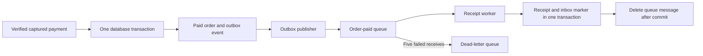

# Narx Commerce: build and operate the project

This is the single project guide. Repository READMEs explain only their own entry point.
The project models application teams delivering a commerce system and a platform team
providing CI, infrastructure and GitOps. Team memberships represent a learning scenario;
they do not mean a company or real delivery team operates this environment.

## Current status

The six foundation PRs are merged and their post-merge checks passed. They introduced
ownership, reusable workflow validation, Terraform state storage and a shared Helm chart.
The application repositories provide the commerce source, container builds and tests;
the GitOps repository provides an integrated local Docker preview. Kubernetes
deployments, release automation and AWS infrastructure remain pending.
The order outbox, publisher and receipt worker now run against local ElasticMQ;
real AWS SQS integration and queue alerting remain pending. No AWS resources have been provisioned.

The organisation uses GitHub Free and the repositories are private by choice. PRs and
CODEOWNERS record the intended review process, but GitHub cannot enforce protected
branches and required reviews for these private repositories until the organisation
upgrades to GitHub Team. Do not describe the current review policy as enforced.

## Repository map and ownership

| Repository | Owning team | Boundary |
| --- | --- | --- |
| `commerce-frontend` | Frontend | Customer storefront and admin interface |
| `commerce-catalogue` | Catalogue | Public product read API; reads the commerce core over HTTP |
| `commerce-orders` | Orders | Accounts, inventory, checkout, payments, orders, cart, outbox and receipt worker |
| `platform-ci` | Platform | Versioned reusable GitHub Actions workflows |
| `platform-infrastructure` | Platform | Terraform and this project guide |
| `platform-gitops` | Platform/release | Helm, Argo CD, environment releases and platform add-ons |

Each runtime component builds independently. The cart source is in `commerce-orders/cart`
and produces its own Python image. Orders API, outbox publisher and receipt worker
share one Java image, selected by `DELIVERY_ROLE=api|publisher|worker`. They run as
separate processes and can scale independently without rebuilding the application.
The three application repositories still produce four runtime images. Shared CI
workflows prevent copying whole pipelines into every repository. Existing
`Local-Narx-Space` repositories remain untouched.

The source application keeps stock reservation and order insertion atomic in the
orders commerce core's PostgreSQL transaction. The migration deliberately retains
that boundary. The Go catalogue is a read facade, not an independent inventory database.
Splitting inventory into its own transactional service would require a reservation
protocol and compensation; it is not achieved merely by making another repository.

Developer: `subhankar12-spec`. Intended independent reviewer: `Code-S-12` through
the `code-reviewers` team. Service teams receive write access to their repositories;
the platform team receives write access to the platform repositories. Organisation
owners retain their GitHub administrative rights. A single person's multiple accounts
do not establish genuine independent review; the exercise models the control.

## Target environments

| Environment | Location | Purpose |
| --- | --- | --- |
| dev | Local Kubernetes | Fast integration feedback |
| qa | Local Kubernetes, isolated namespace and data | Release verification |
| production | AWS EKS during scheduled learning sessions | Cloud delivery and operations exercises |

EKS control-plane subnets span two AZs as AWS requires. Worker capacity and RDS will
be in one AZ for cost control. This is not AZ-resilient production availability.
Use the same immutable image digest through all environments. Local nodes must be
able to run the selected image architecture; confirm this before choosing Graviton.

Proposed AWS services: VPC, EC2-backed EKS, ECR, ALB, ACM, RDS PostgreSQL Single-AZ,
SQS with a dead-letter queue, IAM, Secrets Manager, S3, CloudWatch and AWS Budgets.
Evaluate NAT versus endpoint/network costs before choosing the network layout;
private nodes require an intentional outbound connectivity design. Use the existing
DNS provider unless a Route 53 hosted zone is needed.

The commerce core owns PostgreSQL products, stock, accounts, orders and payments.
Catalogue reads products through HTTP and cart owns Redis keys. Services do not query
each other's databases. The core has not been decomposed into database-per-domain
microservices; any later split must be an explicit, tested architecture change.

## Target delivery flow

1. Developer branches from `main` and opens a PR in the service repository.
2. Hosted GitHub Actions runners run unprivileged tests, lint and security checks.
   PR validation receives no deployment secrets and no AWS deployment permissions.
3. An independent reviewer approves; required checks pass; the PR is squash-merged.
4. The trusted main workflow builds one image, scans it and pushes it to ECR using
   a narrowly scoped AWS IAM role via GitHub OIDC. Each image is identified by digest.
5. Release automation changes the dev image digest through a GitOps PR. Argo CD
   running locally pulls the approved desired state and deploys it.
6. After dev verification, a QA promotion PR carries the same digest. The target
   policy is automatic merge for eligible QA promotions after required checks.
7. After QA verification, a production promotion PR requires human approval.
8. The EKS Argo CD instance reconciles the approved production configuration. Health
   and smoke tests verify the release. Failure handling must update desired state
   so Argo does not repeatedly restore a failed release.

Current application CI validates workflow syntax and builds runtime images through
their test stages. BuildKit caches avoid separate test-image builds and duplicate
test wrappers. PRs have read-only tokens and no AWS credentials. ECR publishing,
security scanning, signing and release promotion are still pending.

The numbered release flow is the target, not the current implementation. GitHub-hosted runners do
not directly access the local cluster. Local Argo CD pulls changes; trusted smoke
tests will run inside the local cluster. Do not expose an unauthenticated local
deployment endpoint or give an untrusted PR a self-hosted runner with cluster access.

Automatic QA promotion requires a trusted, narrowly scoped review/merge policy for
verified release changes. A blanket human-review rule would also block QA automation.
Design and test that exception before enabling auto-merge; do not grant a release bot
unrestricted bypass of production approval. No bot approval or merge exception exists yet.

Image pulls from private ECR require explicit authentication in local Kubernetes;
short-lived registry credentials will need automated refresh. EKS uses scoped node
permissions for image pulls. CI uses OIDC and application AWS access uses Pod Identity.
These mechanisms must be implemented and tested before claiming end-to-end delivery.

Reusable workflows are pinned by commit SHA. Each caller names the approved revision.
Callers use the merged `platform-ci` main revision. Squash merging changes the commit
SHA: do not leave callers pinned to a deleted candidate branch commit. Merge shared
workflow changes first, then update callers to that merged revision through PRs.

## Order events, receipts and queue recovery

Payment confirmation remains synchronous. A verified provider capture, checked by
checkout verification or a signed webhook, updates the order to paid/confirmed and
inserts `order_outbox` in the **same PostgreSQL transaction**. A browser redirect alone
never confirms payment. The queue is not called in that transaction, so a queue outage
delays receipt generation while payment confirmation continues.



The event contains `eventId`, `type=order.paid`, `version=1`, `orderId`, `amount`,
`currency=INR` and `paymentId`. It contains no customer name, address, email, card,
password or session token. `V5__order_delivery.sql` creates the outbox, inbox and
receipt tables. Existing paid orders are not backfilled; newly confirmed captures
create events. Payment/webhook retries do not create a second event for an order.

The worker creates an internal payment acknowledgement in `payment_receipts`, not
a tax invoice, email, shipment or fulfilment transition. Authenticated order detail
includes a `receipt` field when ready; it is null beforehand. The existing storefront
does not yet render that field. A later refund retains the original receipt as a
historical payment acknowledgement; refund status remains on the order.

| Process | Responsibility | Queue outage behaviour |
| --- | --- | --- |
| `api` (default) | Payment/order transaction and outbox insert | API stays ready if its database is ready |
| `publisher` | Send one due event, then mark published | Retry with exponential delay, capped at 60 seconds; never discard unsent events |
| `worker` | Validate event, create receipt and inbox marker, then delete message | Failed messages become visible again; queue redrives after five failed receives |

Publisher replicas select rows with `SKIP LOCKED`. Each send has a bounded SDK timeout;
a row lock is held during that send. This simple approach suits current throughput.
Higher-volume production systems should evaluate batches or a lease-based publisher
rather than holding database connections during remote sends. A crash after send but
before marking published can send the same event again. That is expected.

The worker validates the message against the canonical outbox event. Inbox uniqueness
and receipt creation commit together, so a crash after commit but before SQS deletion
causes a harmless duplicate. A database failure rolls both writes back. The receipt's
unique order/event constraints add another guard. This guarantee covers these database
writes; external email/shipping calls would need their own idempotency mechanism.

Default message visibility is 60 seconds. Processing uses a 10-second database
transaction timeout; the worker receives one message per poll and only acknowledges
after commit. `DELIVERY_VISIBILITY_SECONDS` must be at least 15 and at most 43200;
15 is used only to shorten the local retry exercise. Production should retain an
appropriate margin and add visibility extension before introducing slower work.

The local Compose stack uses ElasticMQ 1.7.1 pinned by digest. Its H2 queue storage
survives container restarts in `queue-data`; PostgreSQL survives in `database`.
A one-shot init service gives the queue volume to UID 10001; the queue itself runs
non-root. Neither SQS nor database ports are published. An explicit `DELIVERY_LOCAL=true`
permits dummy credentials only against the local endpoint. Without that flag, the
SDK uses its default credential chain and requires an HTTPS queue URL. EKS Pod Identity
and narrowly scoped queue IAM permissions still need provisioning and verification.

All three Java roles expose `/health/live`, `/health/ready` and `/actuator/prometheus`.
Background-role readiness checks the database and queue; liveness does not require
either dependency. Use those custom health paths in Helm. Worker/publisher HTTP ports
must remain internal and should not receive storefront traffic.

Publisher metrics include `commerce_outbox_pending`, `commerce_outbox_oldest_seconds`
and `commerce_outbox_publish_total{result="sent|failed"}`. Worker metrics include
`commerce_queue_consume_total{result="processed|duplicate|failed"}` and
`commerce_queue_poll_total{result="failed"}`. Outbox gauges refresh every 30 seconds.
Logs correlate event/order IDs without logging message bodies or credentials.
Prometheus alert rules, DLQ-depth and queue-age alarms, and dashboards are still pending.
An empty poll is normal; repeated processing failures or growing backlog need attention.

### Local failure exercise

Use a fresh disposable Compose project. This exercise stops/restarts only that project's
queue and worker, creates test accounts/orders and injects temporary database constraints.
It requires the queue-aware GitOps branch and the matching orders image. It is intentionally
separate from the ordinary customer-flow test; never run it on a shared database.

```bash
# From platform-gitops, after building the four application images.
DELIVERY_VISIBILITY_SECONDS=15 docker compose --project-name narx-events-validation \
  --env-file local/.env -f local/compose.yaml up --no-build -d --wait
NARX_LOCAL_TEST=1 NARX_QUEUE_TEST=1 NARX_COMPOSE_PROJECT=narx-events-validation \
  python3 -m unittest discover -s tests -v
# Remove this disposable exercise's database AND queue data when finished.
docker compose --project-name narx-events-validation --env-file local/.env \
  -f local/compose.yaml down --volumes
```

The test proves atomic payment/outbox rollback, payment success during a queue outage,
publication after recovery, duplicate publisher replay, atomic consumer rollback,
visibility retry, poison-message DLQ redrive and corrected replay without duplicate
receipts. It also retains the existing customer/admin/refund checks. ElasticMQ implements
a subset of SQS: these checks do not prove AWS IAM, encryption, retention or real-provider
behaviour. AWS integration tests remain required before cloud rollout.

### Recovery decisions

1. If outbox backlog grows, inspect publisher health/logs and queue reachability/permissions.
   Restore the dependency; due events retry automatically. Do not delete pending rows.
2. If receipts lag but outbox is clear, inspect the worker, queue age and DLQ.
   A worker restart recovers unacknowledged messages after the visibility timeout.
3. Inspect a DLQ message and its event ID under restricted operator access. Fix its schema,
   application or data failure first. Replay only trusted events, preserving `eventId`.
   Copy successfully before removing the DLQ message; retain operational evidence.
   Native SQS redrive will be tested on AWS; the local test explicitly copies/deletes.
4. If a queue was irrecoverably lost, an operator can replay a reviewed outbox event by
   clearing `published_at` and setting `next_attempt_at=CURRENT_TIMESTAMP` for that exact
   event ID. Receipts already created remain deduplicated. Do not mass-reset the table.
5. If an exercise fails, inspect logs, then remove its disposable volumes to clear injected
   constraints and test state. Regular `down` preserves data and does not reset the exercise.

Outbox/inbox/receipt history is retained for now. A retention/archival policy must be agreed
before real production traffic; do not prune canonical events while replay is still possible.
Dev/QA Kubernetes deployments will use isolated queues/data. They are not deployed yet.

## Application source and local preview

The migration preserves the existing storefront, accounts, cart, admin, order history,
Razorpay test-mode integration, refunds and INR pricing. Source provenance and licenses
are recorded in the application READMEs. It does not import Jenkinsfiles, per-service
Helm copies or Jenkins report-converter scripts.
Checkout now requires authentication and delivery information. The old anonymous demo
path that created confirmed orders without payment is removed from the migrated app.

| Component | Source | Runtime port | Metrics |
| --- | --- | --- | --- |
| Frontend | `commerce-frontend/src` and `public` | 8080 | `/metrics` |
| Catalogue | `commerce-catalogue/*.go` | 8081 | `/metrics` |
| Orders/core | `commerce-orders/src` | 8083 | `/actuator/prometheus` |
| Cart | `commerce-orders/cart` | 8082 | `/metrics` |

All services expose `/health/live` and `/health/ready`. Catalogue refuses to return
the old hard-coded USD demo data if `COMMERCE_URL` is absent. Its readiness follows
the commerce dependency; liveness does not. Production Helm values will need each
component's real port and resources rather than the chart's generic defaults.

The Docker Compose preview is a developer convenience, not the Kubernetes dev/QA
delivery path. Clone the application repositories and `platform-gitops` as siblings:

```bash
mkdir -p narx-commerce
cd narx-commerce
gh repo clone Narx-Space-Prod/commerce-frontend
gh repo clone Narx-Space-Prod/commerce-catalogue
gh repo clone Narx-Space-Prod/commerce-orders
gh repo clone Narx-Space-Prod/platform-gitops
cd platform-gitops
# When reviewing an unmerged change, check out the corresponding PR branches in all four repos.
umask 077
python3 - <<'PY'
from pathlib import Path
import secrets
keys = ['DATABASE_PASSWORD', 'SESSION_SECRET', 'FIXTURE_PAYMENT_SECRET', 'FIXTURE_WEBHOOK_SECRET']
with Path('local/.env').open('x') as output:
    output.write(''.join(f'{key}={secrets.token_hex(32)}\n' for key in keys))
    output.write('PUBLIC_ORIGIN=http://localhost:18080\nAPP_PORT=18080\nAPP_BIND_ADDRESS=127.0.0.1\n')
PY
docker compose --parallel 1 --env-file local/.env -f local/compose.yaml build
docker compose --env-file local/.env -f local/compose.yaml up --no-build -d --wait
```

The secret-generation command refuses to overwrite an existing file. Open
`http://localhost:18080`. From a different computer, forward that port over SSH:

```bash
ssh -L 18080:127.0.0.1:18080 your-linux-user@your-linux-host
```

Then use `http://localhost:18080` on the computer running the browser. For deliberate
LAN exposure, change `APP_BIND_ADDRESS`, `APP_PORT` and `PUBLIC_ORIGIN` together in
the local env file. `PUBLIC_ORIGIN` must exactly match the browser's scheme, host and
port; otherwise state-changing requests correctly fail the origin check.

The preview uses a local payment simulator and says so in the browser confirmation.
It makes no Razorpay transaction. It verifies the application's signature checks,
state changes and refund handling but does not verify the real Razorpay sandbox.
Actual provider tests will use backend-only Razorpay test credentials in Kubernetes.
Fixture flags and fixture keys must never appear in AWS production configuration.

Register your own customer account; there is no default admin password. An operator
can grant that account admin access only in this local preview, using the exact email
registered above and a reviewed SQL command inside the PostgreSQL container. Do not
make the first registrant an administrator or add a public role-assignment endpoint.
For a local operator, open a SQL prompt and replace the example email with the account
you registered (there is no fixed admin account/password):

```bash
docker compose --env-file local/.env -f local/compose.yaml exec postgres psql -U commerce -d commerce
```

```sql
UPDATE customers SET role='admin' WHERE email='your-admin@example.com';
```

Then type `\q` to exit and sign in with that account at `/admin`.
The integration test promotes only its generated throwaway account, then exercises
customer/admin separation, product version conflicts, order processing and refunds.

```bash
NARX_LOCAL_TEST=1 NARX_COMPOSE_PROJECT=narx-commerce python3 -m unittest discover -s tests -v
docker compose --env-file local/.env -f local/compose.yaml down
# Only for intentionally discarding this local preview's database and queue data:
# docker compose --env-file local/.env -f local/compose.yaml down --volumes
```

The test mutates its named local stack. Do not point it at a shared or production
database. PostgreSQL and queue data survive ordinary `down`; carts and simulator records do
not. Stopping and restarting the payment simulator does not constitute a provider
recovery test and can leave its old local orders needing a fresh checkout.

Migration verification: all four runtime Docker builds passed their application tests.
The opt-in full-stack test passed against an isolated local project, including denied
guest checkout, required delivery, customer/admin separation, INR product data, stock
reservation, idempotent checkout, invalid payment signature rejection, payment retries,
order isolation, product version conflicts, fulfilment and refund retries. This evidence
does not cover the real payment provider, Kubernetes releases or AWS. The separate
queue exercise above covers local message processing and recovery.

## Infrastructure workflow

Infrastructure PRs will run formatting, validation, mock tests, a security scan and
an AWS-backed plan when scoped credentials exist. The foundation only implements
formatting, validation and mocked state-security tests. It has no apply permission.

Before any deployment, select the AWS account and region, review a regional estimate,
and configure budget alerts. The target is INR 1,000/month through limited runtime;
this is not an enforced billing cap. EKS, worker nodes, ALB, RDS, storage, networking,
logs, taxes and retained resources all contribute. Scaling workers to zero does not
stop EKS cluster fees. EKS must be destroyed to stop its cluster-hour charges.

The eventual apply workflow must use a reviewed plan from the same commit, verify
the target AWS account, serialize state-changing operations, and require approval.
Destroy is a separate manual workflow with environment/account confirmation. It
must remove workloads and AWS load balancers before deleting the cluster and retain
the intentionally persistent state, images and database backup data. Include retained
storage costs in the estimate and test recovery into a newly created cluster.

## Commands available in this foundation

Clone the repositories you need:

```bash
gh repo clone Narx-Space-Prod/platform-infrastructure
gh repo clone Narx-Space-Prod/platform-gitops
gh repo clone Narx-Space-Prod/platform-ci
```

Use Terraform 1.16.x. The committed provider lock file pins the tested AWS provider.
The following checks use mocked AWS calls and do not create cloud resources:

```bash
cd platform-infrastructure
terraform fmt -check -recursive
terraform -chdir=bootstrap init -backend=false -input=false -lockfile=readonly
terraform -chdir=bootstrap validate
terraform -chdir=bootstrap test
```

The bootstrap root defines a private, versioned, encrypted state bucket and rejects
HTTP access. It deliberately prevents bucket destruction. Its tests use `mock_provider`
even though their command is named `apply`; this is not a real AWS apply.

After account/region/cost approval, a platform operator can bootstrap the bucket:

```bash
cp bootstrap/bootstrap.example.tfvars bootstrap/session.tfvars
# Edit session.tfvars with the selected region and a globally unique bucket name.
aws sts get-caller-identity
terraform -chdir=bootstrap plan -var-file=session.tfvars -out=bootstrap.tfplan
# Review account, region and the plan before the next command.
terraform -chdir=bootstrap apply bootstrap.tfplan
```

The root starts with local state to break the circular dependency of creating its
own backend. Keep that local state secure. After the bucket exists, add a reviewed
`backend "s3" {}` block inside `terraform {}` and run `terraform init -migrate-state`
with `bucket`, `region`, `key=bootstrap/terraform.tfstate` and `use_lockfile=true`.
Future roots use different keys, such as `production/terraform.tfstate`. S3 locking
requires `.tflock` object permissions; no DynamoDB lock table is needed. Never delete
bootstrap state while destroying a learning session. State lifecycle cleanup is a
separate operator decision, not part of session teardown.

Helm checks, with dummy image references only:

```bash
cd ../platform-gitops
# Dummy digest for rendering only; this image must never be deployed.
validation_digest="sha256:$(printf '%064d' 0)"
helm lint --strict charts/commerce-service -f environments/dev/values.yaml \
  --set image.repository=registry.invalid/validation-only/catalogue --set "image.digest=$validation_digest"
helm template catalogue charts/commerce-service -n commerce-dev -f environments/dev/values.yaml \
  --set image.repository=registry.invalid/validation-only/catalogue --set "image.digest=$validation_digest"
```

Environment values are chart validation fixtures, not application releases.
They cannot be used to deploy the app until CI publishes real images and GitOps
release records identify their repository and digest.

## Remaining implementation milestones

1. Foundation PRs are merged. Upgrade GitHub Team before enforcing private-repo
   branch protection. Required reviewers, no self-review, no force pushes, resolved
   conversations, passing checks and restricted workflow changes must be verified.
2. The application migration and local unit/integration checks are complete. Review the
   outbox/worker changes and local retry/DLQ evidence. Existing application runtimes and
   ownership remain; real payment-provider and AWS SQS integration are still pending.
3. Implement image security scanning/signing/publishing and release promotion.
4. Establish isolated local dev/QA, Argo CD, registry authentication, queue and data
   stores; verify releases through GitOps without Jenkins or direct CI cluster access.
5. Produce a regional cost estimate and Terraform VPC/EKS/ECR/RDS/SQS/IAM modules.
   Configure scoped identity, state, secrets and the gated plan/apply/destroy workflows.
6. Add production ingress/TLS, Prometheus/Grafana/Alertmanager, CloudWatch logs,
   service metrics, backup/restore, release notifications and recovery runbooks here.
7. Verify a full release, failed rollout, queue retry/DLQ, restore and complete teardown.
   Record evidence, measured cost and remaining limitations in this guide.

## References

- [GitHub private-repository protection availability](https://docs.github.com/en/repositories/configuring-branches-and-merges-in-your-repository/managing-protected-branches/about-protected-branches)
- [Terraform S3 state and native lockfile](https://developer.hashicorp.com/terraform/language/backend/s3)
- [Terraform provider mocks](https://developer.hashicorp.com/terraform/language/tests/mocking)
- [GitHub OIDC for AWS](https://docs.github.com/en/actions/how-tos/secure-your-work/security-harden-deployments/oidc-in-aws)
- [EKS subnet requirements](https://docs.aws.amazon.com/eks/latest/userguide/network-reqs.html)
- [SQS delivery semantics](https://docs.aws.amazon.com/AWSSimpleQueueService/latest/SQSDeveloperGuide/standard-queues-at-least-once-delivery.html)

- [ElasticMQ configuration and delivery limits](https://github.com/softwaremill/elasticmq)
- [SQS visibility timeout](https://docs.aws.amazon.com/AWSSimpleQueueService/latest/SQSDeveloperGuide/sqs-visibility-timeout.html)
- [AWS Java SDK default credential chain](https://docs.aws.amazon.com/sdk-for-java/latest/developer-guide/credentials-chain.html)
