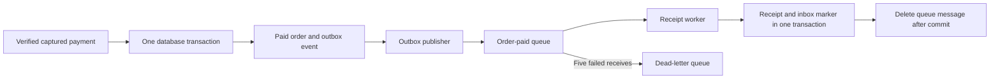

# Narx Commerce: build and operate the project

This is the single project guide. Repository READMEs explain only their own entry point.
The project models application teams delivering a commerce system and a platform team
providing CI, infrastructure and GitOps. Team memberships represent a learning scenario;
they do not mean a company or real delivery team operates this environment.

## Verified operating checkpoint — 6 November 2026

Narx Commerce runs locally on its dedicated `kind-narx-commerce` cluster. Only the
existing Argo CD control plane in `kind-mega-local` is shared with Original Boutique.
The Jenkins Boutique project and standalone `commerce-aws` project remain separate.
Kubernetes v1.34.0, Cilium 1.20.4 and CoreDNS are healthy. A live disposable traffic
exercise verified that network policies allow selected peers and block other namespaces.

All three environments are deployed and active. At the final recovery checkpoint they
were Synced/Healthy at GitOps revision `d37e87cd756d21051b348e23877103c1e1183b1c`,
with successful PostSync operations. All six workload roles retain the immutable release
bundle `d375c7795cc6c837` (identifier prefix); promotions did not rebuild or retag images.
Frontend HPA is live in QA and production. An isolated fixture verified blue-green
traffic recovery; an actual second-release/full-bundle GitOps rollback remains separate.

The dedicated observer App published real deployment-success statuses for all three
environments. Argo's notification logs confirmed sends through the dedicated Narx Slack
webhook, with no corresponding notification errors. Success requires a completed
PostSync smoke hook for the synced revision; an empty bootstrap, stale result or partial
self-heal cannot report success. Optional Argo image-summary fields are not used as proof.

Release and observer Apps have separate roles. All four private GHCR packages grant
GitOps Actions Read access. Publishing uses ephemeral GITHUB_TOKEN credentials;
verification checks source-bound signed provenance and signed SBOMs. Source callers pin
the reviewed shared builder `666b596743c0fd43a0ba3ed1efb8dc7b89b7593e`. Release App
keys exist only in main-only `gitops-release` environments; repository-level copies were
removed. The cluster has a separate read-only pull credential in each namespace.
GitOps delivery is enabled and its real reconciliation and promotion runs succeeded.

Main requires one approving review, code-owner review, approval of the latest push,
strict checks and administrator enforcement. Dev/QA native auto-merge waits for review
and checks; production is merged explicitly. Fully unattended lower-environment promotion
is not enabled. A zero-generic-review configuration was withdrawn after live GitHub
verification showed it did not enforce the intended code-owner gate. All paths are owned.

Original Boutique's app/monitoring workloads and Jenkins remain paused with user
approval; shared Argo and its management cluster remain running. The saved settings
and PVC identities are retained. Narx monitoring and bounded HPA are live. The QA HPA
exercise passed 15,401 requests with zero failures and scaling 1 → 2 → 1. The isolated
Rollouts recovery drill and QA database restore also passed; their temporary namespaces
were removed and Dev was restored afterward.

These recovery checks used an explicitly approved temporary Dev-client pause for host
headroom. On the 7.5 GiB machine, the five-minute Metrics API check with all environments
active had five unhealthy samples out of 21. With Dev clients paused it passed all 21
samples. The metrics-server update stopped the observed probe-driven restarts, but it
does not solve physical host pressure. The operating budget is fixed at 7.5 GiB;
all environments remain active and the management topology is unchanged. No RAM upgrade
is planned. Sustained Metrics API availability remains unresolved; repeat the full-profile
stability check after an agreed capacity improvement. A healthy snapshot is not proof
of sustained capacity.

Operator HTTPS, Kubernetes checkout/provider/queue failure drills and a real GitOps
bundle rollback remain unfinished. This is a delivery and operations learning setup,
not a high-availability or production-capacity claim. Inactive Terraform roots create
no AWS resources.

The organisation uses GitHub Free and all six repositories are public. GitHub now
enforces `main` branch protection: PRs, one CODEOWNER approval, the repository's CI
checks, an up-to-date branch, resolved conversations and linear history are required.
New commits dismiss stale approvals, the latest push needs approval from someone
other than its pusher, and administrators follow these rules too. Force pushes and
branch deletion are blocked; no PR-approval bypass users, teams or apps are configured.
Organisation/repository administrators can still edit the settings; this is not an
immutable control against the organisation owner.

`code-reviewers` contains only `Code-S-12` and is named in every CODEOWNERS file.
Review approval and merge are separate actions: an authorised writer can merge only
after all required controls pass. PR authors cannot approve their own PR. Workflow
execution for PRs from external forks requires maintainer approval; organisation
members' ordinary PR checks run automatically. Execution approval does not approve
the code for merging. Default Actions tokens remain read-only and cannot approve PRs.

Before the visibility change, all Git refs including closed PR heads were scanned
with Gitleaks 8.30.1, along with 42 available Actions-run log archives and 22 build
artifacts; no secrets were detected. Two failed workflow runs had no job logs.
The tracked PEM is the public RDS CA bundle, and the tracked env file is only an
example. Generated local `.env` credentials remain ignored and were not published.
Public visibility also exposes Git history and Actions logs: never commit secrets,
real customer records or Terraform state. Future changes still need secret scanning;
this review is not a guarantee that later commits are safe.

## Repository map and ownership

| Repository | Owning team | Boundary |
| --- | --- | --- |
| `commerce-frontend` | Frontend | Customer storefront and admin interface |
| `commerce-catalogue` | Catalogue | Public product read API; reads the commerce core over HTTP |
| `commerce-orders` | Orders | Accounts, inventory, checkout, payments, orders, cart, outbox and receipt worker |
| `platform-ci` | Platform | Versioned reusable GitHub Actions workflows |
| `platform-infrastructure` | Platform | Terraform and this project guide |
| `platform-gitops` | Platform/release | Helm, Argo CD, environment releases and platform add-ons |

Each runtime component builds independently. The cart source is in `commerce-orders/cart`
and produces its own Python image. Orders API, outbox publisher and receipt worker
share one Java image, selected by `DELIVERY_ROLE=api|publisher|worker`. They run as
separate processes and can scale independently without rebuilding the application.
The three application repositories still produce four runtime images. Shared CI
workflows prevent copying whole pipelines into every repository. Existing
`Local-Narx-Space` repositories remain untouched.

The source application keeps stock reservation and order insertion atomic in the
orders commerce core's PostgreSQL transaction. The migration deliberately retains
that boundary. The Go catalogue is a read facade, not an independent inventory database.
Splitting inventory into its own transactional service would require a reservation
protocol and compensation; it is not achieved merely by making another repository.

Developer: `subhankar12-spec`. Intended independent reviewer: `Code-S-12` through
the `code-reviewers` team. Service teams receive write access to their repositories;
the platform team receives write access to the platform repositories. Organisation
owners retain their GitHub administrative rights. A single person's multiple accounts
do not establish genuine independent review; the exercise models the control.

## Target environments

| Environment | Location | Purpose |
| --- | --- | --- |
| dev | Local Kubernetes | Fast integration feedback |
| qa | Local Kubernetes, isolated namespace and data | Release verification |
| production | Dedicated local Narx Kubernetes cluster | Reviewed promotion, rollout and recovery exercises |

All three environments use separate namespaces and data on `kind-narx-commerce`.
The shared Argo CD runs in `kind-mega-local` and reaches only the registered Narx
namespaces. This is environment isolation within one Narx cluster, not independent
production infrastructure or high availability. Use the same immutable image digest
through all environments. AWS learning belongs to the separate `commerce-aws` project;
this local migration must not provision AWS services.

The commerce core owns PostgreSQL products, stock, accounts, orders and payments.
Catalogue reads products through HTTP and cart owns Redis keys. Services do not query
each other's databases. The core has not been decomposed into database-per-domain
microservices; any later split must be an explicit, tested architecture change.

## CI and CD: what happens after a push

An image is the sealed output of a tested build. Its digest identifies its contents.
Dev, QA and production receive the same image; rebuilding per environment would create
a different release and invalidate earlier verification. The GHCR migration is prepared
but delivery remains off until reviewed builder pins, package access and Apps are ready.

1. A developer opens a feature PR. Workflow lint/secret scanning run first. Component
   Docker builds run service tests through the runtime target, verify the non-root user,
   scan dependencies and generate an SBOM. Unfixed HIGH/CRITICAL findings also block.
   PR build jobs have contents:read only; no registry publication or release App key.
2. CODEOWNER approval and required checks are needed before merging to protected main.
   The merged commit is checked again. Changed components build; Orders/cart can run in
   parallel. Documentation-only changes skip image work while reporting the required check.
3. With DELIVERY_ENABLED=true, a main-only publisher downloads that run's exact tested
   image artifact. Its short-lived GITHUB_TOKEN receives packages:write and publishes
   `ghcr.io/narx-space-prod/commerce-COMPONENT:COMMIT`. It does not rebuild. It refuses
   a commit tag pointing to another image, reuses a matching image, and checks the final
   manifest config against the tested image. Authentication/outages fail closed.
4. GitHub OIDC gives Cosign a signing identity; it is not an AWS login. The publisher
   signs the digest and attests source provenance plus SBOM. Temporary registry login
   files are removed. GHCR permits tag mutation at the registry level, so deployment
   identity and verification use the digest, never a mutable tag such as latest.
5. The caller publishes a source release record only after its component jobs succeed.
   A separate release App requests GitOps reconciliation; scheduled reconciliation can
   recover a missed dispatch. Incomplete/failed main CI records do not qualify.
6. The GitOps verifier accepts only four exact Narx GHCR image paths, verifies source
   main CI, approved shared builder SHA, source commit, signature/provenance/SBOM and
   digest binding. All four components form the initial bundle. It opens a dev PR;
   it does not write directly to main. Trusted PR verification executes base code only
   and treats candidate release JSON as data.
7. After human review/merge, shared Argo CD applies dev on the separately registered
   Narx cluster and waits for health plus its PostSync smoke Job. A status-only observer
   App reports narx/deploy-dev for that GitOps revision. This evidence is needed before
   proposing QA with the same digests, then production after verified QA.
8. Dev, QA and production release PRs all require review under current protection. No
   automatic approval/bypass is configured. Production now targets commerce-production
   on narx-local, not AWS. QA/production frontend analysis protects the traffic switch.
   Failed desired state can propose a reviewed rollback; it never reverses database data.

Main image-transfer artifacts live one day and security evidence fourteen days. BuildKit
caches avoid duplicate test-image builds. Separate main-commit concurrency groups avoid
cancelling an earlier publication when a newer commit arrives.

Reusable workflows and actions are pinned by SHA. Merge platform-ci first, then pin
service callers and policy/builders.json to its reviewed main revision. Do not trust an
unmerged builder branch. The GitOps candidate verifier does not check out PR scripts,
even though pull_request_target has privileges to publish its status.

### Rollback and failure behaviour

A healthy deployment records the previous environment bundle and the GitOps revision
with trusted successful evidence. A QA/production failure proposes a rollback PR to
that recorded bundle. The reviewer approves, checks pass, and Argo applies the merged
rollback. This is automatic detection/proposal with reviewed recovery, not unattended
rollback execution. Dev does not automatically propose recovery. A first deployment
has no previous verified release to restore. Rollback never reverses SQL migrations,
refunds, stock changes or persistent data; migrations must remain backward compatible.
A failed rollback cannot repeatedly toggle releases because its previous pointer is empty.

Smoke tests check six readiness endpoints, INR catalogue data and the frontend response.
They do not prove a real checkout/payment transaction. Local integration tests cover
customer/admin/refund and queue-recovery behaviour using a simulator. A real provider
sandbox test and a controlled Kubernetes rollout failure remain activation checks.

If CI fails, inspect the failed job and fix through a PR. If Argo fails, inspect its
operation and hook Job before changing desired state. Never manually retag an image or
edit a Deployment behind GitOps to hide a failed rollout.

### What the Python code does

You do not need to memorise each line, but an operator should understand its inputs,
permissions, decisions and failure modes. `platform-gitops/scripts/delivery.py` is the
single release-policy entry point. `validate` checks bundle structure; `fixtures` makes
temporary CI-only image data; `reconcile` discovers signed builds and proposes release
or promotion PRs; `verify-candidate` applies trusted policy to PR data; `rollback`
proposes the recorded previous healthy bundle. External commands use argument lists,
and candidate files are never imported as Python. Unit tests mock GitHub/registry
responses; a temporary real Git remote also tests updating an existing PR branch.

`platform-infrastructure/local/bootstrap.py` handles local operator setup: namespace
and initial credentials for all three environments, restricted remote registration,
private GHCR pull credentials, and observer/notification configuration. It does not provision AWS. The existing
`tests/test_local_stack.py` exercises the complete disposable app. These scripts have
different trust boundaries and are kept separate rather than being copied into jobs.

Local verification of release policy and the full chart is available without AWS:

```bash
cd platform-gitops
python3 -m unittest discover -s tests -p 'test_delivery*.py' -v
python3 scripts/delivery.py validate
helm dependency build --skip-refresh charts/commerce
python3 scripts/delivery.py fixtures /tmp/commerce-validation.json
helm lint --strict charts/commerce -f environments/dev/runtime.yaml \
  -f /tmp/commerce-validation.json
helm template commerce charts/commerce -n commerce-dev \
  -f environments/dev/runtime.yaml -f /tmp/commerce-validation.json
# The generated images are fictional and must never be applied.
cd ../platform-infrastructure
terraform -chdir=delivery init -backend=false -input=false -lockfile=readonly
terraform -chdir=delivery validate
terraform -chdir=delivery test
```

The delivery root uses mocked plans only. The disposable full integration run on the
patched Orders, cart and catalogue images passed in 167.8 seconds, including queue
outage, duplicate, worker transaction rollback and DLQ recovery. Local image scans
reported zero HIGH/CRITICAL findings at that run; vulnerability databases change, so
CI scans again. This evidence does not replace live GHCR/signature or Argo tests.

### GitHub Apps and activation settings

Narx Commerce now has its own release and observer identities. The steps below also
serve as a rebuild runbook; do not create duplicate Apps when these already exist. The installed App named
`narx-commerce-release` (ID 5541020) is already used by the separate commerce-aws project;
its key must not be repurposed for this project. Create/install separate Apps for these
repositories, with webhooks disabled because dispatch/polling and Argo notifications
already supply the necessary communication paths.

| Identity | Installed App | Repository permissions | Private-key destination |
| --- | --- | --- | --- |
| Release automation | narx-local-commerce-release (App 5613524, installation 178600148) | Contents read/write, Pull requests read/write, Metadata read | NARX_RELEASE_APP_PRIVATE_KEY in the main-only gitops-release environment of the three app repos and GitOps |
| Deployment evidence | narx-local-commerce-observer (App 5613724, installation 178604312) | Commit statuses read/write, Metadata read | argocd-notifications-secret/narx-github-privateKey via the helper |

Install on platform-gitops only while source repositories remain public. Private source
repositories would need explicitly scoped source Contents/Actions read access as well.
The release App can open/update PRs but cannot approve its own PR or bypass main rules.
The observer cannot modify code or open PRs. Store private keys outside repositories;
enter Actions secret values directly in GitHub or use gh secret set from the private
file. Never paste PEM contents in chat. App ID, installation ID and bot login are public
identifiers; the key is secret.

| Repositories | Variables and secrets |
| --- | --- |
| Three application repos | NARX_RELEASE_APP_ID, NARX_RELEASE_APP_PRIVATE_KEY secret, DELIVERY_ENABLED=false until ready |
| platform-gitops | Same release App ID/key, NARX_DEPLOYMENT_BOT_LOGIN for the observer, DELIVERY_ENABLED=false until ready |

The active boundary uses a main-only `gitops-release` environment for the App key.
Both source notification jobs and the GitOps reconciler use it. Image publication uses
only the ephemeral GITHUB_TOKEN and a main-only job guard; read-only trusted verification
uses only its package token. Neither needs an AWS-era deployment environment. The initial runs used the older
registry-release gate and eventually completed. The shared boundary fix is reviewed;
caller upgrades and the credential cutover are complete, and the new path is active.

An App key at repository scope can be referenced by same-repository PR workflows.
Protected environment scope prevents that: select only main in deployment branch rules,
store NARX_RELEASE_APP_PRIVATE_KEY in that environment, and remove its repository copy
after the new caller is active. A caller must pass the **same secret name**; the job in
the reusable workflow declares the environment and receives its value. Passing an empty
repository-level expression is supported when the matching environment secret exists.
Do not alias it to a different name or pass every repository secret with inherit.

Callers grant packages:write to the reusable service job; its build job overrides that
with contents:read only. The main publisher receives packages:write and signing
id-token:write. Trusted verification receives packages:read and never executes candidate
PR code. No AWS account ID, role or ECR login is needed by these delivery workflows.

#### GHCR package permissions and local pulls

The selected setup uses private GHCR packages. First GHCR publication defaults to
private even when the repository is public; retain that visibility for all four images.
The four image packages are commerce-frontend, commerce-catalogue, commerce-orders and
commerce-cart under Narx-Space-Prod. The source label links each image to its source
repository, including cart to commerce-orders. An existing package created under a
different owner/repository must grant the publishing repository access explicitly.

For each private package, grant **platform-gitops** Read access in package Settings ->
Manage Actions access. This permits its ephemeral GITHUB_TOKEN to verify images and
Cosign evidence. Installation tokens from the release App are not registry credentials.
CI can publish with GITHUB_TOKEN; do not create a write:packages PAT for CI.

Kubernetes has no GitHub workflow token. Create a separate classic PAT with only
read:packages using a Narx-authorized operator identity, an intentional expiry and no
write/delete package permissions. Store it in a mode-600 private file outside all
repositories. This is a local registry pull credential, distinct from the release App
key, GitHub signing identity and environment database passwords. The helper transfers
it to the dedicated Narx cluster's ghcr-pull Secret via stdin without printing it.

```bash
# Supply the actual owner/file path. Do not put the token in command arguments.
python3 local/bootstrap.py refresh-registry --context kind-narx-commerce --environment dev \
  --registry-user YOUR_GITHUB_LOGIN --registry-token-file /secure/path/narx-ghcr-read-token
python3 local/bootstrap.py refresh-registry --context kind-narx-commerce --environment qa \
  --registry-user YOUR_GITHUB_LOGIN --registry-token-file /secure/path/narx-ghcr-read-token
python3 local/bootstrap.py refresh-registry --context kind-narx-commerce --environment production \
  --registry-user YOUR_GITHUB_LOGIN --registry-token-file /secure/path/narx-ghcr-read-token
```

Rotate before token expiry; update all three Secrets and verify a new pod can pull before
revoking the previous token. The file permission check prevents accidentally reading a
world/group-readable token file, but the operator must choose its actual scope correctly.
Revoking a token does not remove already cached images or stop running pods.

First-time private package setup has a deliberate sequence:

1. Merge/pin the reviewed workflows and configure dedicated release/observer identities.
   Keep GitOps DELIVERY_ENABLED=false so an incomplete first bundle cannot deploy.
2. Enable DELIVERY_ENABLED=true in the three application repositories. Merge a reviewed
   caller change or explicitly rerun current trusted main CI. This builds/scans the real
   runtime, publishes/signs it, and records source releases; it does not need a live cluster.
3. Once all four private packages exist, grant platform-gitops Actions Read access to
   each package. Package access cannot be configured before the package is created.
4. Verify the source workflows fully succeeded, four source release records exist, and
   private pull credentials work. Enable GitOps DELIVERY_ENABLED=true and reconcile.
5. Review the real dev release PR, merge only after checks, and verify the deployment.
   Trusted dev status permits QA, then verified QA permits a reviewed production PR.

A flag change alone does not publish older completed runs. A main CI rerun is an explicit
publication operation; no fake application change is needed. Do not describe image
signatures/private pulls as tested merely because lint or mocked tests passed. At this
checkpoint all three source flags and GitOps delivery are enabled. Package Actions access
and the protected-key caller cutover are verified; all three deployment smoke hooks passed.

The delivery/ Terraform root still contains ECR/IAM scaffolding from the retired AWS
plan. It is inactive reference code and is not applied for this local architecture.
AWS infrastructure learning belongs to commerce-aws, not Narx Commerce.

### Dedicated local cluster and shared Argo CD

The agreed target is three independent projects. Narx Commerce runs dev, QA and
production on its own kind cluster, `narx-commerce`, with context
`kind-narx-commerce`. The existing Argo CD in `kind-mega-local` is the shared
management plane. Sharing Argo CD does not share application databases, namespaces,
monitoring storage, runtime credentials or release pipelines.

This migration is staged. The old commerce-dev/qa namespaces still exist in
kind-mega-local without app pods/PVCs. The three Argo Applications are now retargeted
to the separate Narx cluster and have passed their real release smoke hooks. The dedicated Narx monitoring stack is now live; the earlier Boutique integration
remains a separate cleanup audit and is not the Narx monitoring backend. No old resources are deleted by the bootstrap helper.

| Item | Target | Activation status |
| --- | --- | --- |
| Cluster | One dedicated kind node, pinned Kubernetes v1.34.0 image | Created and Ready; Cilium/CoreDNS healthy |
| Argo CD | Existing installation in `kind-mega-local` | Already running; keep its host cluster on |
| Workload AppProject | `narx-commerce-local`, Narx GitOps repository only | Applied to shared Argo CD |
| Registered destination | `narx-local`, only three commerce namespaces | Registered; positive workload and negative cluster/system-secret RBAC checks passed |
| Environments | `commerce-dev`, `commerce-qa`, `commerce-production` | Real workloads Ready; isolated runtime/pull secrets, databases and queues |
| Publishing/verification | Private GHCR with ephemeral CI tokens | Private artifacts, source CI, provenance/SBOMs and protected-key cutover verified |
| Monitoring | Dedicated Narx stack on the Narx cluster | Live; dedicated storage/credentials, Grafana/datasource verified and 55/55 scrape targets Up at the final checkpoint |
| Notifications | Separate observer key in shared Argo | Real GitHub success and dedicated Slack send confirmations for all three environments |

The 7.5 GiB laptop cannot safely run both complete projects and three full Narx
environments at once. The cluster definition uses a single node to limit control-plane
overhead. It does not provide high availability or bound total host RAM. Before creating
it, check `free -h` and `docker stats --no-stream`. Free capacity by scheduling inactive
workloads through their owning configuration; keep the existing Argo CD cluster running.
Do not turn on all release files merely because namespace quotas exist.

#### 1. Create and inspect the dedicated cluster

Run from the reviewed `platform-infrastructure` main revision. Docker must be available,
port 16443 must be free, and `kind`, `kubectl`, Python and Helm must be installed.
The pinned node image reuses the known Kubernetes version; only the new node is created.
Kind may select the new context as current, so every operation below names its context.

```bash
free -h
docker stats --no-stream
kind get clusters
# Run once if narx-commerce does not already exist. No AWS service is contacted.
kind create cluster --name narx-commerce --config local/kind.yaml --wait 0s
kubectl --context kind-narx-commerce get nodes -o wide
kubectl --context kind-narx-commerce get storageclass
```

The API host port listens only on loopback. Both local clusters use Docker's kind
network, allowing Argo CD to reach `https://narx-commerce-control-plane:6443` by
stable container DNS rather than the laptop's changing LAN IP. Independent clusters
can use overlapping pod/service CIDRs here because only their API endpoints are crossed.
This arrangement is for one host; it is not routing between production VPCs.

The definition disables kindnet so Cilium can be installed as the policy-enforcing CNI.
The node and CoreDNS are expected to remain NotReady/Pending until the next step;
kind creation must not wait for network readiness before installing the network plugin.
The Cilium configuration keeps kind's kube-proxy and Kubernetes pod CIDR allocation,
uses one operator replica, and disables optional Hubble/Envoy DaemonSets for capacity.
Cluster separation does not isolate the shared Docker host. NetworkPolicy enforcement
must still be verified live against the actual application rules before activation.

#### 2. Install platform prerequisites on the remote cluster

Platform bootstrap is an operator action with an explicit Narx kube context. The
shared Argo workload credential cannot install the CNI, CRDs or ClusterRoles. Cilium
is version-pinned and the downloaded chart archive is checksum-verified in CI and here.
No cluster changes occur during the CI lint/template checks.

```bash
mkdir -p /tmp/narx-cilium
helm pull oci://quay.io/cilium/charts/cilium --version 1.20.4 --destination /tmp/narx-cilium
printf '%s  %s\n' \
  505abff8385811df1a949776fc42e9f10697989a332acc86d6e8933efcb855ed \
  /tmp/narx-cilium/cilium-1.20.4.tgz | sha256sum --check --strict
helm upgrade --install cilium /tmp/narx-cilium/cilium-1.20.4.tgz \
  --kube-context kind-narx-commerce --namespace kube-system \
  -f local/cilium-values.yaml --wait --timeout 5m
kubectl --context kind-narx-commerce wait --for=condition=Ready nodes --all --timeout=180s
kubectl --context kind-narx-commerce -n kube-system rollout status deployment/coredns --timeout=180s
kubectl --context kind-narx-commerce -n kube-system exec daemonset/cilium -- cilium-dbg status --brief
```

These status checks prove basic networking readiness, not application policy behavior.
Verify that allowed service dependencies work and unauthorized cross-environment traffic
fails before enabling releases. Do not uninstall the CNI on a live workload cluster;
change its reviewed values/version and use the upgrade procedure.

Install Rollouts CRDs as an operator before deploying QA/production. The release manifest
is checksum-locked in the GitOps repository; do not install its cluster-wide controller
because the application chart owns namespace-scoped controllers.

```bash
python3 -m pip install PyYAML==6.0.3
curl --fail --silent --show-error --location \
  https://github.com/argoproj/argo-rollouts/releases/download/v1.10.1/install.yaml \
  --output /tmp/narx-rollouts-install.yaml
printf '%s  %s\n' \
  149148429a6f8258b789003ffb9bc6698a526d611ecb1b185624217cf51bae7f \
  /tmp/narx-rollouts-install.yaml | sha256sum --check --strict
python3 - <<'PYTHON' | kubectl --context kind-narx-commerce apply --server-side -f -
import json, yaml
with open('/tmp/narx-rollouts-install.yaml') as source:
    resources = [doc for doc in yaml.safe_load_all(source)
                 if doc and doc.get('kind') == 'CustomResourceDefinition']
assert resources, 'No CRDs in the verified release'
print(json.dumps({'apiVersion':'v1','kind':'List','items':resources}))
PYTHON
kubectl --context kind-narx-commerce get crd rollouts.argoproj.io analysisruns.argoproj.io
```

Live Cilium/policy verification, metrics-server for any enabled HPAs, and independently
owned monitoring remain platform activation tasks. Linting/rendering Cilium in CI does
not install it or prove enforcement on the laptop.

#### 3. Register only Narx workload namespaces in shared Argo CD

```bash
python3 local/bootstrap.py prepare --context kind-narx-commerce --environment dev
python3 local/bootstrap.py prepare --context kind-narx-commerce --environment qa
python3 local/bootstrap.py prepare --context kind-narx-commerce --environment production
python3 local/bootstrap.py register-cluster \
  --context kind-narx-commerce --management-context kind-mega-local
# Check the remote identity has only the intended namespace access.
kubectl --context kind-narx-commerce auth can-i create deployments \
  -n commerce-dev --as system:serviceaccount:narx-system:argocd-manager
kubectl --context kind-narx-commerce auth can-i create clusterroles \
  --as system:serviceaccount:narx-system:argocd-manager
kubectl --context kind-narx-commerce auth can-i get secrets -n kube-system \
  --as system:serviceaccount:narx-system:argocd-manager
# Expected: yes, no, no. Confirm existing Applications still have no app pods/PVCs
# before retargeting; if data appeared meanwhile, stop and plan its migration.
kubectl --context kind-mega-local -n commerce-dev get pods,pvc
kubectl --context kind-mega-local -n commerce-qa get pods,pvc
kubectl --context kind-mega-local apply --server-side \
  --field-manager=narx-platform-bootstrap \
  -f ../platform-gitops/applications/local/commerce.json
kubectl --context kind-mega-local -n argocd get applicationsets,applications
```

The helper creates a dedicated service account in `narx-system`, and an administrative
Role/RoleBinding in each of the three **Narx workload namespaces only**. Its namespace
permissions include secrets and namespaced RBAC, as needed by an Argo namespace manager;
it cannot administer other namespaces or cluster-scoped resources. AppProject policy is
an additional control: it allows only the Narx repository, three explicit destinations
and the chart's permitted resource kinds. It does not grant Kubernetes permissions.

For this non-cloud cluster, Argo authenticates with a manually provisioned service-account
token. Kubernetes stores the token in the Narx cluster; the helper transfers it directly
in memory to the shared Argo cluster Secret via stdin, with CA validation enabled.
No token, kubeconfig private key or generated password is committed or printed. This
persistent credential is a lab choice, not a short-lived cloud workload identity. Limit
access to the shared `argocd` namespace. To rotate it, delete only
`narx-system/argocd-manager-token` on the Narx cluster and rerun registration immediately.
That briefly interrupts reconciliation and must be done in an operations window.

Registration is project-scoped and sets `clusterResources=false` plus the exact namespace
list. The helper refuses the Boutique cluster as a workload target or the same cluster
as both target and manager. It does not change the AppProject/ApplicationSet itself.
The separate platform/monitoring application will require reviewed platform credentials;
never widen this workload token to cluster-admin to work around a missing CRD.

Applications are bounded to a fixed dev/QA/production list. Resource preservation and
`applicationsSync=create-update` prevent an ApplicationSet list edit from silently
cascading application deletion. The release bundle remains non-deployable until real
verified images are published. Do not claim a working deployment from an empty sync.
If shared Argo CD is down, existing Narx pods continue running, but reconciliation,
GitHub deployment evidence and Argo notifications pause.

#### 4. Configure independent Narx notification credentials

Create a Narx webhook in the chosen Slack workspace/channel and place it in a private
file outside every repository, with mode 600. Do not reuse or extract Boutique's Secret.
The helper reads the provided file and merges only Narx notification settings into the
shared Argo CD. It sends no manual test message. A conflicting global webhook service
needs review; it will not be silently replaced.

```bash
python3 local/bootstrap.py configure-delivery-notifications --context kind-mega-local \
  --notifications-file ../platform-gitops/applications/notifications.json \
  --slack-webhook-file /secure/path/narx-slack-webhook
python3 local/bootstrap.py configure-observer --context kind-mega-local \
  --app-id 123456 --installation-id 12345678 \
  --private-key-file /secure/path/narx-deployments.pem \
  --notifications-file ../platform-gitops/applications/notifications.json
```

Use actual numeric Narx App identifiers. These are examples, not installed identities.
The observer App needs only commit-status publishing permissions on Narx GitOps.
The release App separately needs Contents and Pull requests write. Keys must be supplied
privately before delivery can be enabled; no Bootstrap command invents these credentials.

## Local monitoring and progressive delivery

Dev uses ordinary Deployments. QA and local production use frontend blue-green Rollouts
with pre/post functional analysis. Backends use ordinary rolling updates. Failed preview
analysis keeps the existing frontend active; failed post-switch analysis restores stable
traffic. A reviewed Git rollback proposal separately restores desired Git state.
Database migrations, refunds and orders are never reversed by image rollback.

`monitoring/local-values.yaml` supplies the Narx-specific scrape jobs, dashboard and
alert rules to the independently installed Narx monitoring stack. Prometheus, Grafana,
Alertmanager and the blackbox exporter use Narx-owned storage and credentials. Loki/Alloy
remain deferred for capacity. Platform Helm releases have operator bootstrap ownership;
the restricted workload Argo credential cannot install cluster-scoped monitoring resources.

Do not apply the old Boutique multi-source monitoring Application as a Narx bootstrap
step. After independent Narx monitoring is healthy, remove only its earlier integration
from the Boutique monitoring desired state through that repository's own reviewed PR.
Keep Boutique monitoring, data and workloads. Before deleting old Narx namespaces,
recheck resources and agree retention if any data appeared since this migration audit.

### Inspect deployments, alerts and logs

```bash
# Workload commands target the separate Narx cluster.
kubectl --context kind-narx-commerce -n commerce-qa get rollouts,analysisruns,jobs,pods
kubectl --context kind-narx-commerce -n commerce-qa describe rollout commerce-frontend
kubectl --context kind-narx-commerce -n commerce-qa get service commerce-frontend commerce-frontend-preview -o yaml
kubectl --context kind-narx-commerce -n commerce-qa logs deployment/narx-rollouts --tail=100
# Argo CD resources stay on the management cluster.
kubectl --context kind-mega-local -n argocd get applications
# After real delivery, forward just the environment you are using.
kubectl --context kind-narx-commerce -n commerce-dev port-forward service/commerce-frontend 18080:80
# QA: namespace commerce-qa, local port 18081. Production: commerce-production, 18082.
```

Use loopback port-forwards and SSH forwarding for headless previews. The local profile
uses HTTP and `cookieSecure=false`; this is a lab access choice, not production TLS.
HTTPS/ingress setup remains a later explicit platform task. A local production namespace
teaches promotion/approvals and recovery; its single laptop/node is not highly available.

Existing monitoring queries use `project="narx-commerce"` to avoid mixing projects.
The new stack must preserve that identity and include production in namespace discovery.
Prometheus verifies operational health; functional Analysis Jobs remain the frontend
rollout gates. Real paid checkout/provider sandbox and firing/resolved Slack delivery
still need separate live verification after credentials and publishing are configured.

The disposable Rollouts fixture can be run against the dedicated cluster after CRDs
are installed. It uses a throwaway namespace and a local fixture image, not a release:

```bash
cd ../platform-gitops
helm dependency build --skip-refresh charts/commerce
NARX_ROLLOUT_TEST=1 NARX_KUBE_CONTEXT=kind-narx-commerce \
  python3 -m unittest discover -s tests -p test_rollout_local.py -v
```

### Session stop and restart

`kind delete cluster` destroys the node and its local-path database volumes; it is not
pause/resume. Retain a verified backup before deleting a cluster with real data. To
pause only Narx without deleting its volumes, `docker stop narx-commerce-control-plane`;
to resume, `docker start narx-commerce-control-plane`, then verify node readiness, Argo
reconciliation and application health. Argo will report the cluster unreachable while
stopped. Keep the shared Argo host cluster running for other projects.


## Order events, receipts and queue recovery

Payment confirmation remains synchronous. A verified provider capture, checked by
checkout verification or a signed webhook, updates the order to paid/confirmed and
inserts `order_outbox` in the **same PostgreSQL transaction**. A browser redirect alone
never confirms payment. The queue is not called in that transaction, so a queue outage
delays receipt generation while payment confirmation continues.



The event contains `eventId`, `type=order.paid`, `version=1`, `orderId`, `amount`,
`currency=INR` and `paymentId`. It contains no customer name, address, email, card,
password or session token. `V5__order_delivery.sql` creates the outbox, inbox and
receipt tables. Existing paid orders are not backfilled; newly confirmed captures
create events. Payment/webhook retries do not create a second event for an order.

The worker creates an internal payment acknowledgement in `payment_receipts`, not
a tax invoice, email, shipment or fulfilment transition. Authenticated order detail
includes a `receipt` field when ready; it is null beforehand. The existing storefront
does not yet render that field. A later refund retains the original receipt as a
historical payment acknowledgement; refund status remains on the order.

| Process | Responsibility | Queue outage behaviour |
| --- | --- | --- |
| `api` (default) | Payment/order transaction and outbox insert | API stays ready if its database is ready |
| `publisher` | Send one due event, then mark published | Retry with exponential delay, capped at 60 seconds; never discard unsent events |
| `worker` | Validate event, create receipt and inbox marker, then delete message | Failed messages become visible again; queue redrives after five failed receives |

Publisher replicas select rows with `SKIP LOCKED`. Each send has a bounded SDK timeout;
a row lock is held during that send. This simple approach suits current throughput.
Higher-volume production systems should evaluate batches or a lease-based publisher
rather than holding database connections during remote sends. A crash after send but
before marking published can send the same event again. That is expected.

The worker validates the message against the canonical outbox event. Inbox uniqueness
and receipt creation commit together, so a crash after commit but before SQS deletion
causes a harmless duplicate. A database failure rolls both writes back. The receipt's
unique order/event constraints add another guard. This guarantee covers these database
writes; external email/shipping calls would need their own idempotency mechanism.

Default message visibility is 60 seconds. Processing uses a 10-second database
transaction timeout; the worker receives one message per poll and only acknowledges
after commit. `DELIVERY_VISIBILITY_SECONDS` must be at least 15 and at most 43200;
15 is used only to shorten the local retry exercise. Production should retain an
appropriate margin and add visibility extension before introducing slower work.

The local Compose stack uses ElasticMQ 1.7.1 pinned by digest. Its H2 queue storage
survives container restarts in `queue-data`; PostgreSQL survives in `database`.
A one-shot init service gives the queue volume to UID 10001; the queue itself runs
non-root. Neither SQS nor database ports are published. An explicit `DELIVERY_LOCAL=true`
permits dummy credentials only against the local endpoint. Without that flag, the
SDK uses its default credential chain and requires an HTTPS queue URL. EKS Pod Identity
and narrowly scoped queue IAM permissions still need provisioning and verification.

All three Java roles expose `/health/live`, `/health/ready` and `/actuator/prometheus`.
Background-role readiness checks the database and queue; liveness does not require
either dependency. Use those custom health paths in Helm. Worker/publisher HTTP ports
must remain internal and should not receive storefront traffic.

Publisher metrics include `commerce_outbox_pending`, `commerce_outbox_oldest_seconds`
and `commerce_outbox_publish_total{result="sent|failed"}`. Worker metrics include
`commerce_queue_consume_total{result="processed|duplicate|failed"}` and
`commerce_queue_poll_total{result="failed"}`. Outbox gauges refresh every 30 seconds.
Logs correlate event/order IDs without logging message bodies or credentials.
Prometheus rules and the dashboard cover outbox age and processing/polling failures.
Direct queue/DLQ depth and oldest-message instrumentation still need separate verification;
application failure counters are not substitutes for those queue measurements.
An empty poll is normal; repeated processing failures or growing backlog need attention.

### Local failure exercise

Use a fresh disposable Compose project. This exercise stops/restarts only that project's
queue and worker, creates test accounts/orders and injects temporary database constraints.
It requires the queue-aware GitOps branch and the matching orders image. It is intentionally
separate from the ordinary customer-flow test; never run it on a shared database.

```bash
# From platform-gitops, after building the four application images.
DELIVERY_VISIBILITY_SECONDS=15 docker compose --project-name narx-events-validation \
  --env-file local/.env -f local/compose.yaml up --no-build -d --wait
NARX_LOCAL_TEST=1 NARX_QUEUE_TEST=1 NARX_COMPOSE_PROJECT=narx-events-validation \
  python3 -m unittest discover -s tests -p test_local_stack.py -v
# Remove this disposable exercise's database AND queue data when finished.
docker compose --project-name narx-events-validation --env-file local/.env \
  -f local/compose.yaml down --volumes
```

The test proves atomic payment/outbox rollback, payment success during a queue outage,
publication after recovery, duplicate publisher replay, atomic consumer rollback,
visibility retry, poison-message DLQ redrive and corrected replay without duplicate
receipts. It also retains the existing customer/admin/refund checks. ElasticMQ implements
a subset of SQS: these checks do not prove AWS IAM, encryption, retention or real-provider
behaviour. AWS integration tests remain required before cloud rollout.

### Recovery decisions

1. If outbox backlog grows, inspect publisher health/logs and queue reachability/permissions.
   Restore the dependency; due events retry automatically. Do not delete pending rows.
2. If receipts lag but outbox is clear, inspect the worker, queue age and DLQ.
   A worker restart recovers unacknowledged messages after the visibility timeout.
3. Inspect a DLQ message and its event ID under restricted operator access. Fix its schema,
   application or data failure first. Replay only trusted events, preserving `eventId`.
   Copy successfully before removing the DLQ message; retain operational evidence.
   Native SQS redrive will be tested on AWS; the local test explicitly copies/deletes.
4. If a queue was irrecoverably lost, an operator can replay a reviewed outbox event by
   clearing `published_at` and setting `next_attempt_at=CURRENT_TIMESTAMP` for that exact
   event ID. Receipts already created remain deduplicated. Do not mass-reset the table.
5. If an exercise fails, inspect logs, then remove its disposable volumes to clear injected
   constraints and test state. Regular `down` preserves data and does not reset the exercise.

Outbox/inbox/receipt history is retained for now. A retention/archival policy must be agreed
before real production traffic; do not prune canonical events while replay is still possible.
All three Kubernetes environments now use isolated database volumes, queue volumes and runtime credentials. Kubernetes queue-failure/replay and restore exercises remain to verify.

## Application source and local preview

The migration preserves the existing storefront, accounts, cart, admin, order history,
Razorpay test-mode integration, refunds and INR pricing. Source provenance and licenses
are recorded in the application READMEs. It does not import Jenkinsfiles, per-service
Helm copies or Jenkins report-converter scripts.
Checkout now requires authentication and delivery information. The old anonymous demo
path that created confirmed orders without payment is removed from the migrated app.

| Component | Source | Runtime port | Metrics |
| --- | --- | --- | --- |
| Frontend | `commerce-frontend/src` and `public` | 8080 | `/metrics` |
| Catalogue | `commerce-catalogue/*.go` | 8081 | `/metrics` |
| Orders/core | `commerce-orders/src` | 8083 | `/actuator/prometheus` |
| Cart | `commerce-orders/cart` | 8082 | `/metrics` |

All services expose `/health/live` and `/health/ready`. Catalogue refuses to return
the old hard-coded USD demo data if `COMMERCE_URL` is absent. Its readiness follows
the commerce dependency; liveness does not. Production Helm values will need each
component's real port and resources rather than the chart's generic defaults.

The Docker Compose preview is a developer convenience, not the Kubernetes dev/QA
delivery path. Clone the application repositories and `platform-gitops` as siblings:

```bash
mkdir -p narx-commerce
cd narx-commerce
gh repo clone Narx-Space-Prod/commerce-frontend
gh repo clone Narx-Space-Prod/commerce-catalogue
gh repo clone Narx-Space-Prod/commerce-orders
gh repo clone Narx-Space-Prod/platform-gitops
cd platform-gitops
# When reviewing an unmerged change, check out the corresponding PR branches in all four repos.
umask 077
python3 - <<'PY'
from pathlib import Path
import secrets
keys = ['DATABASE_PASSWORD', 'SESSION_SECRET', 'FIXTURE_PAYMENT_SECRET', 'FIXTURE_WEBHOOK_SECRET']
with Path('local/.env').open('x') as output:
    output.write(''.join(f'{key}={secrets.token_hex(32)}\n' for key in keys))
    output.write('PUBLIC_ORIGIN=http://localhost:18080\nAPP_PORT=18080\nAPP_BIND_ADDRESS=127.0.0.1\n')
PY
docker compose --parallel 1 --env-file local/.env -f local/compose.yaml build
docker compose --env-file local/.env -f local/compose.yaml up --no-build -d --wait
```

The secret-generation command refuses to overwrite an existing file. Open
`http://localhost:18080`. From a different computer, forward that port over SSH:

```bash
ssh -L 18080:127.0.0.1:18080 your-linux-user@your-linux-host
```

Then use `http://localhost:18080` on the computer running the browser. For deliberate
LAN exposure, change `APP_BIND_ADDRESS`, `APP_PORT` and `PUBLIC_ORIGIN` together in
the local env file. `PUBLIC_ORIGIN` must exactly match the browser's scheme, host and
port; otherwise state-changing requests correctly fail the origin check.

The preview uses a local payment simulator and says so in the browser confirmation.
It makes no Razorpay transaction. It verifies the application's signature checks,
state changes and refund handling but does not verify the real Razorpay sandbox.
Actual provider tests will use backend-only Razorpay test credentials in Kubernetes.
Fixture flags and fixture keys must never appear in AWS production configuration.

Register your own customer account; there is no default admin password. An operator
can grant that account admin access only in this local preview, using the exact email
registered above and a reviewed SQL command inside the PostgreSQL container. Do not
make the first registrant an administrator or add a public role-assignment endpoint.
For a local operator, open a SQL prompt and replace the example email with the account
you registered (there is no fixed admin account/password):

```bash
docker compose --env-file local/.env -f local/compose.yaml exec postgres psql -U commerce -d commerce
```

```sql
UPDATE customers SET role='admin' WHERE email='your-admin@example.com';
```

Then type `\q` to exit and sign in with that account at `/admin`.
The integration test promotes only its generated throwaway account, then exercises
customer/admin separation, product version conflicts, order processing and refunds.

```bash
NARX_LOCAL_TEST=1 NARX_COMPOSE_PROJECT=narx-commerce python3 -m unittest discover -s tests -p test_local_stack.py -v
docker compose --env-file local/.env -f local/compose.yaml down
# Only for intentionally discarding this local preview's database and queue data:
# docker compose --env-file local/.env -f local/compose.yaml down --volumes
```

The test mutates its named local stack. Do not point it at a shared or production
database. PostgreSQL and queue data survive ordinary `down`; carts and simulator records do
not. Stopping and restarting the payment simulator does not constitute a provider
recovery test and can leave its old local orders needing a fresh checkout.

Migration verification: all four runtime Docker builds passed their application tests.
The opt-in full-stack test passed against an isolated local project, including denied
guest checkout, required delivery, customer/admin separation, INR product data, stock
reservation, idempotent checkout, invalid payment signature rejection, payment retries,
order isolation, product version conflicts, fulfilment and refund retries. This evidence
does not cover the real payment provider, Kubernetes releases or AWS. The separate
queue exercise above covers local message processing and recovery.

## Infrastructure workflow (inactive legacy AWS scaffolding)

Do not apply this scaffolding for the local-only architecture. AWS work belongs to
the standalone commerce-aws project. These sections explain retained code only.

Infrastructure PRs run formatting, validation, provider-mocked tests and a blocking
HIGH/CRITICAL Terraform security scan for both bootstrap and delivery roots. AWS-backed
plan/apply/destroy workflows still require scoped identities and the cloud cost review.
No current workflow can apply infrastructure. The existing lab state bucket uses SSE-S3;
its customer-managed-KMS scanner finding has a narrowly scoped exception expiring
2027-01-20 and must be reviewed before production state activation.

Before any deployment, select the AWS account and region, review a regional estimate,
and configure budget alerts. The target is INR 1,000/month through limited runtime;
this is not an enforced billing cap. EKS, worker nodes, ALB, RDS, storage, networking,
logs, taxes and retained resources all contribute. Scaling workers to zero does not
stop EKS cluster fees. EKS must be destroyed to stop its cluster-hour charges.

The eventual apply workflow must use a reviewed plan from the same commit, verify
the target AWS account, serialize state-changing operations, and require approval.
Destroy is a separate manual workflow with environment/account confirmation. It
must remove workloads and AWS load balancers before deleting the cluster and retain
the intentionally persistent state, images and database backup data. Include retained
storage costs in the estimate and test recovery into a newly created cluster.

## Commands for inactive AWS scaffolding (reference only)

Do not execute AWS provisioning commands for the local Narx migration. The active
local bootstrap commands are in Dedicated local cluster and shared Argo CD above.

Clone the repositories you need:

```bash
gh repo clone Narx-Space-Prod/platform-infrastructure
gh repo clone Narx-Space-Prod/platform-gitops
gh repo clone Narx-Space-Prod/platform-ci
```

Use Terraform 1.16.x. The committed provider lock file pins the tested AWS provider.
The following checks use mocked AWS calls and do not create cloud resources:

```bash
cd platform-infrastructure
terraform fmt -check -recursive
terraform -chdir=bootstrap init -backend=false -input=false -lockfile=readonly
terraform -chdir=bootstrap validate
terraform -chdir=bootstrap test
```

The bootstrap root defines a private, versioned, encrypted state bucket and rejects
HTTP access. It deliberately prevents bucket destruction. Its tests use `mock_provider`
even though their command is named `apply`; this is not a real AWS apply.

After account/region/cost approval, a platform operator can bootstrap the bucket:

```bash
cp bootstrap/bootstrap.example.tfvars bootstrap/session.tfvars
# Edit session.tfvars with the selected region and a globally unique bucket name.
aws sts get-caller-identity
terraform -chdir=bootstrap plan -var-file=session.tfvars -out=bootstrap.tfplan
# Review account, region and the plan before the next command.
terraform -chdir=bootstrap apply bootstrap.tfplan
```

The root starts with local state to break the circular dependency of creating its
own backend. Keep that local state secure. After the bucket exists, add a reviewed
`backend "s3" {}` block inside `terraform {}` and run `terraform init -migrate-state`
with `bucket`, `region`, `key=bootstrap/terraform.tfstate` and `use_lockfile=true`.
Future roots use different keys, such as `production/terraform.tfstate`. S3 locking
requires `.tflock` object permissions; no DynamoDB lock table is needed. Never delete
bootstrap state while destroying a learning session. State lifecycle cleanup is a
separate operator decision, not part of session teardown.

Helm checks, with dummy image references only:

```bash
cd ../platform-gitops
# Dummy digest for rendering only; this image must never be deployed.
validation_digest="sha256:$(printf '%064d' 0)"
helm lint --strict charts/commerce-service -f environments/dev/values.yaml \
  --set image.repository=registry.invalid/validation-only/catalogue --set "image.digest=$validation_digest"
helm template catalogue charts/commerce-service -n commerce-dev -f environments/dev/values.yaml \
  --set image.repository=registry.invalid/validation-only/catalogue --set "image.digest=$validation_digest"
```

The dummy image references in this example are chart validation fixtures, never
application releases. Live deployments use the reviewed environment `release.json`
records containing real repositories and immutable digests.

## Independent local monitoring bootstrap

The installed platform uses upstream metrics-server 3.14.0, kube-prometheus-stack
92.7.0 and prometheus-blackbox-exporter 11.20.3 Helm charts. The first full-stack install
rolled back after Grafana exceeded its startup budget. The reviewed correction was
installed successfully: Grafana has a 512 MiB limit and a ten-minute startup probe;
CoreDNS scraping has scoped TCP 9153 access; shared Argo controller metrics have scoped
TCP 8082 ingress from the Docker bridge. Existing policies were preserved.

Prometheus, Alertmanager and Grafana are running with three retained, Bound PVCs.
Grafana health, the Narx dashboard and the Prometheus datasource were verified. At the
final checkpoint all 55 scrape targets were Up, readiness probes succeeded and real
Alertmanager notifications had confirmed Slack delivery. Monitoring pods being Ready
alone is insufficient: verify target health and `probe_success` too. Host pressure can
still interrupt the separate Metrics API used by HPA; see its reliability section below.

Kube-state-metrics collectors are limited to workload/platform health resources, excluding
Secrets and ConfigMaps from its read permissions. Its ServiceMonitor explicitly preserves
resource namespace labels and adds Narx project/environment labels, so project-filtered
Kubernetes alerts and dashboards can see the observed application metrics.
Chart archives are checksum-verified from `local/observability-charts.json`. This pins
chart contents; upstream platform image version tags are not a claim of digest pinning.

Argo still owns the application releases. The cluster-wide platform Helm releases are
operator bootstraps, like Cilium, with values and lifecycle commands tracked here. The
workload Argo credential does not gain cluster administration or monitoring ownership.
The monitoring namespace, credentials and storage belong only to Narx. A dedicated
NodePort Service exposes the shared Argo controller's metrics on the Docker network;
Prometheus keeps only the three Narx Applications. No laptop IP is embedded.

Prometheus retains six hours/up to 1 GB with a 2 GiB PVC. Grafana and Alertmanager each
have a 1 GiB PVC. Grafana credentials are generated once and preserved on re-runs;
Alertmanager reads Slack through a mounted Secret file. No webhook/password is passed
as a Helm value or command argument. Workload namespaces remain restricted. Monitoring
permits host mounts for the upstream node exporter; this exception is confined to its
namespace. Network policies restrict scraping, API and kubelet access by namespace/role.
Admission certificate jobs receive API access before running.

The local profile requests roughly half a GiB across the steady platform components;
limits and actual peak usage can be higher. Installation refuses less than 900 MiB host
MemAvailable. Existing-release upgrades require 300 MiB. These checks are guards, not a
capacity guarantee: watch working sets, restarts and swap after activation. Loki/Alloy
are not added in this first memory-limited phase. Add logging after measured capacity.

Metrics-server uses a serving certificate and CA bundle so the aggregated API connection
is verified. Helm creates a one-year serving certificate and reuses it on upgrades;
inspect its expiry and renew it before expiration. The kind-only values use `--kubelet-insecure-tls` because the existing kind
node has a self-signed kubelet serving certificate. This is a documented local exception;
a production cluster needs trusted kubelet serving certificates. The tool accepts only
the named local context and cannot provision AWS or apply these values to EKS.

To validate the reviewed monitoring configuration from platform-infrastructure:

```bash
python3 local/observability.py --context kind-narx-commerce \
  --integration-values ../platform-gitops/monitoring/local-values.yaml \
  --cache ../.tools/platform-charts --render-dir ../.tools/platform-render
```

This command lints/renders only and makes no cluster changes. Render files are private
because upstream templates generate temporary TLS keys. Do not commit/upload the files.
CI reuses the render output for contract tests instead of rendering each chart twice.
The CI integration checkout is immutable data only; its scripts are never executed.
Use the merged GitOps integration when installing:

```bash
python3 local/observability.py --context kind-narx-commerce \
  --management-context kind-mega-local \
  --integration-values ../platform-gitops/monitoring/local-values.yaml \
  --slack-webhook-file /home/subhankar/boutique-credentials/narx-slack-webhook \
  --install
helm list --kube-context kind-narx-commerce -A
kubectl --context kind-narx-commerce -n monitoring get pods,pvc
kubectl --context kind-narx-commerce top nodes
kubectl --context kind-narx-commerce top pods -A
```

Helm waits and rolls back a failed release with `--atomic`. This is not one transaction
across all charts: earlier successful releases remain installed. Namespaces, credentials
and retained CRDs/PVCs can remain after a failure; inspect them before retrying. The tool
refuses to replace a metrics API belonging to another release. It never deletes data.

Open dashboards through local port forwards (use an SSH tunnel from another computer):

```bash
kubectl --context kind-narx-commerce -n monitoring port-forward svc/narx-monitoring-grafana 13000:80
kubectl --context kind-narx-commerce -n monitoring port-forward svc/narx-monitoring-prometheus 19090:9090
kubectl --context kind-narx-commerce -n monitoring port-forward svc/narx-monitoring-alertmanager 19093:9093
```

Grafana: http://localhost:13000; Prometheus: http://localhost:19090;
Alertmanager: http://localhost:19093. Read the generated Grafana password only in your
own terminal; never paste it into chat or commit it:

```bash
kubectl --context kind-narx-commerce -n monitoring get secret narx-monitoring-grafana \
  -o jsonpath='{.data.admin-password}' | base64 --decode
```

For activation or troubleshooting, verify the metrics API is Available, scrape targets
cover all environments, readiness probes and Argo series exist, rules load, PVCs are Bound
and resources fit. Delivery Slack proof alone does not prove Alertmanager delivery; the
current stack has separate real Alertmanager delivery evidence. For cleanup,
inspect `helm list`, uninstall each named release explicitly and decide separately which
retained data/CRDs to delete. Preserve monitoring data during normal upgrades.

### Metrics API reliability and Argo health

An HPA needs both its target's scale subresource and CPU metrics from `metrics.k8s.io`. A healthy frontend does not prove that autoscaling works. If `ScalingActive=False` reports `FailedGetResourceMetric`, investigate the Metrics API before changing Argo health rules. `AbleToScale=True` only confirms access to the scale target; it does not confirm access to CPU measurements.

During the 2026-11-06 investigation, both QA and production HPA conditions reported an unavailable Metrics API. Metrics-server events confirmed liveness-driven restarts after one-second HTTPS probe timeouts; the previous process logs showed graceful shutdown, not an observed out-of-memory failure. The installed reliability profile reserves 100m CPU, allows a 500m CPU burst, retains the 32Mi/128Mi memory request/limit, gives `/livez` a two-minute startup delay and allows five seconds per health check. `/readyz` continues to remove an unhealthy metrics-server from service. The pinned metrics-server chart does not render a dedicated `startupProbe`; the supported `livenessProbe.initialDelaySeconds` supplies this startup grace. The reviewed update was installed and its serving CA verified. Metrics-server remained at zero restarts during observation. The full-profile window still had kubelet scrape failures under host pressure; the reduced-load window passed. CPU/probe settings cannot compensate for insufficient physical host capacity.

```bash
kubectl --context kind-narx-commerce get apiservice v1beta1.metrics.k8s.io
kubectl --context kind-narx-commerce get --raw /apis/metrics.k8s.io/v1beta1/nodes
kubectl --context kind-narx-commerce -n commerce-qa describe hpa commerce-frontend
kubectl --context kind-narx-commerce -n commerce-production describe hpa commerce-frontend
kubectl --context kind-narx-commerce -n kube-system describe pod -l app.kubernetes.io/name=metrics-server
kubectl --context kind-narx-commerce -n kube-system logs deployment/narx-metrics-server --previous
```

Check that `AbleToScale` and `ScalingActive` are true, metrics are fresh, and the metrics-server restart count stays unchanged over multiple HPA evaluation cycles. `ScalingLimited=True` at a configured minimum or maximum is a separate condition to interpret against the configured bounds. Preserve serving-certificate verification on the aggregated API; the existing kubelet self-signed certificate exception is specific to this local kind profile. See the [upstream Metrics Server requirements](https://github.com/kubernetes-sigs/metrics-server#requirements).


## Bounded frontend HPA verification

Frontend HPA is activated through reviewed GitOps configuration. QA is bounded to
1–2 replicas and production to 2–3 at
70% CPU request utilization. HPA uses metrics-server, not Prometheus. Scale-up adds at
most one pod/minute; scale-down waits five minutes before removing at most one/minute.
Dev and the other services remain fixed. These are laptop learning bounds, not measured
production throughput requirements. Production's two frontend replicas share one node.

HPA targets the Argo Rollout scale subresource. Git omits frontend replicas when HPA
is active; the ApplicationSet ignores only that named Rollout replica field while
retaining image/pod-template drift checks. Apply the reviewed ApplicationSet before
relying on autoscaling so Argo does not overwrite HPA decisions.

For a bounded manual QA exercise after checking host headroom:

```bash
kubectl --context kind-narx-commerce -n commerce-qa get hpa commerce-frontend
kubectl --context kind-narx-commerce -n commerce-qa describe hpa commerce-frontend
kubectl --context kind-narx-commerce -n commerce-qa get rollout commerce-frontend
kubectl --context kind-narx-commerce apply -f ../platform-gitops/tests/kubernetes/hpa-load.yaml
kubectl --context kind-narx-commerce -n commerce-qa logs -f job/narx-hpa-load
kubectl --context kind-narx-commerce -n commerce-qa get hpa,pods -w
```

The manual test Job is outside the application chart and runs only in QA. It uses a
verified immutable frontend artifact as a Node runtime and performs read-only /metrics
requests for 90 seconds, capped at four concurrent requests and 200 attempts/second.
It has CPU/memory limits, a 120-second deadline and automatic cleanup. It creates no
users/orders/payments and is an HPA mechanics exercise, not a capacity benchmark.

Verify actual scale-up, healthy replicas and Argo remaining Synced. Stop/clean up with
`kubectl --context kind-narx-commerce -n commerce-qa delete job narx-hpa-load --ignore-not-found`.
Observe CPU falling and eventual scale-down after stabilization. Missing metrics,
quota exhaustion or unchanged replica count is not a passed test. Keep production
free of this synthetic load. A five-minute cooldown is intentional.

## Validated recovery drills

The 2026-11-06 isolated Rollouts fixture verified three distinct cases: failed preview
analysis retained stable traffic; failed post-switch analysis restored stable traffic
after the bad candidate was actually observed serving; a healthy candidate passed both
analyses and promoted. Its namespace was confirmed deleted. [GitOps PR #26](https://github.com/Narx-Space-Prod/platform-gitops/pull/26) records the
repeatable harness and its generation/candidate checks. This proves Rollouts mechanics,
not full application/payment recovery or reviewed rollback of an entire GitOps bundle.

A private QA custom-format PostgreSQL archive was restored into a fresh disposable
PostgreSQL 16 pod. The pod used ephemeral storage, a restricted namespace, no service
account token, default-deny networking and a loopback-only listener. The restored data
matched row counts and sorted-data hashes for all 11 tables and sequence values. The
live database was not modified; the disposable namespace was removed. The private local
archive remains available to the operator. This was a manual restore drill, not a
scheduled or off-host backup service.

From platform-infrastructure, these commands create and inspect a private QA backup:

```bash
umask 077
NARX_BACKUP_DIR=../.tools/backups
mkdir -p "$NARX_BACKUP_DIR"
chmod 700 "$NARX_BACKUP_DIR"
NARX_BACKUP_FILE="$NARX_BACKUP_DIR/commerce-qa-$(date -u +%Y%m%dT%H%M%SZ).dump"
if kubectl --context kind-narx-commerce -n commerce-qa exec commerce-postgres-0 -- \
  pg_dump --no-password -U commerce -d commerce --format=custom --no-owner --no-acl \
  > "$NARX_BACKUP_FILE.partial"; then
  mv "$NARX_BACKUP_FILE.partial" "$NARX_BACKUP_FILE"
  sha256sum "$NARX_BACKUP_FILE" > "$NARX_BACKUP_FILE.sha256"
else
  rm -f "$NARX_BACKUP_FILE.partial"
  echo 'Backup failed; no complete archive was retained.' >&2
fi
# This reads the archive, not the live database, and does not restore anything.
kubectl --context kind-narx-commerce -n commerce-qa exec -i commerce-postgres-0 -- \
  pg_restore --list < "$NARX_BACKUP_FILE"
```

Archive checksums detect file changes; successful restore plus data comparison verifies
recoverability. Restore only into an explicitly provisioned disposable destination for
practice. Never send an exercise archive to `commerce-dev`, `commerce-qa` or
`commerce-production` as a restore target. Backups contain application data and must
remain private and outside Git. A recovery-point objective describes acceptable lost
changes; a recovery-time objective describes acceptable outage duration. One passing
manual drill does not establish either ongoing objective.

## Planning persistent kind node addresses

The 2026-11-06 reboot changed the Narx Docker node address from `172.18.0.4` to
`172.18.0.3`. Kubernetes updated the node address, but fourteen Cilium endpoint records
retained old host/pod addresses. Restarting the Cilium agent repaired the observed
incident: all current readiness probes and all 55 scrape targets recovered. That
operational repair does not reserve addresses for the next reboot.

The bootstrap helper can generate a read-only reservation plan for the four existing
kind node containers. It checks container ownership, both explicit Kubernetes contexts,
bridge membership, subnet bounds, Ready nodes and matching Docker/Kubernetes addresses.
The plan preserves current IPv4/IPv6 addresses, DNS aliases, container IDs and Kubernetes
node UIDs. It refuses foreign bridge members and an existing output file. Host-specific
plans stay private and outside the repository.

```bash
python3 local/bootstrap.py plan-node-addresses \
  --context kind-narx-commerce --management-context kind-mega-local \
  --node-plan-file ../.tools/node-addresses-plan.json
python3 -m json.tool ../.tools/node-addresses-plan.json
```

Planning does not disconnect containers, change network policies, stop environments or
alter storage. The generated disconnect/connect pairs are maintenance commands for
operator review, not commands executed by the helper. Applying them briefly interrupts
the relevant node network. Revalidate the stored network/container/node identities and
current addresses before execution; reconnect and verify one node before touching the
next. Preserve both the plan and a connectivity recovery command. No cluster, container,
network or PVC needs to be deleted to reserve its existing address.

Docker reapplies an explicitly configured address when the same container restarts;
address conflicts cause startup failure instead of silently selecting a new address.
See [Docker network address persistence](https://docs.docker.com/reference/cli/docker/network/connect/#network-implications-of-stopping-pausing-or-restarting-containers).
All four nodes share this bridge, so their addressing must be reviewed together. Future
containers must not claim these addresses. Container/network recreation invalidates the
saved identities and requires a new plan; this is a local kind lifecycle measure, not an
EKS networking prescription.

Validation so far covers eight planning/ownership safeguards and a real disposable Docker
stop/start test preserving an explicit IPv4 address and alias. The disposable container
and network were removed. The actual cluster reservation commands have **not** been
applied. A subsequent user-initiated reboot must verify the complete cluster recovery;
the isolated Docker test alone is not that end-to-end proof.

## Remaining implementation milestones

1. Resolve Metrics API/HPA stability within the fixed 7.5 GiB host budget and repeat
   the full three-environment observation window. All environments and the management
   layout currently remain active; further capacity changes have not been selected.
2. Verify a real second release and full GitOps bundle rollback through the protected
   review workflow; preserve database/queue data and distinguish traffic recovery from
   reverting desired Git state.
3. Complete operator HTTPS and remaining runtime-access hardening.
4. Verify checkout/provider sandbox, queue retries/DLQ and replay in Kubernetes. Existing
   local/Compose tests are not environment evidence.
5. Audit removal of the earlier Narx integration from Boutique through that repository's
   reviewed workflow. Add centralized logging only after measured capacity is available.

AWS provisioning belongs to the separate `commerce-aws` project. The retained Terraform
roots and ECR explanations are historical inactive code, not local activation commands.

## References

- [GitHub branch-protection availability](https://docs.github.com/en/repositories/configuring-branches-and-merges-in-your-repository/managing-protected-branches/about-protected-branches)
- [Terraform S3 state and native lockfile](https://developer.hashicorp.com/terraform/language/backend/s3)
- [Terraform provider mocks](https://developer.hashicorp.com/terraform/language/tests/mocking)
- [GitHub OIDC for AWS](https://docs.github.com/en/actions/how-tos/secure-your-work/security-harden-deployments/oidc-in-aws)
- [EKS subnet requirements](https://docs.aws.amazon.com/eks/latest/userguide/network-reqs.html)
- [SQS delivery semantics](https://docs.aws.amazon.com/AWSSimpleQueueService/latest/SQSDeveloperGuide/standard-queues-at-least-once-delivery.html)

- [ElasticMQ configuration and delivery limits](https://github.com/softwaremill/elasticmq)
- [SQS visibility timeout](https://docs.aws.amazon.com/AWSSimpleQueueService/latest/SQSDeveloperGuide/sqs-visibility-timeout.html)
- [AWS Java SDK default credential chain](https://docs.aws.amazon.com/sdk-for-java/latest/developer-guide/credentials-chain.html)

- [Argo CD GitHub deployment statuses](https://argo-cd.readthedocs.io/en/stable/operator-manual/notifications/services/github/)
- [GHCR authentication and package access](https://docs.github.com/en/packages/working-with-a-github-packages-registry/working-with-the-container-registry)
- [Cilium installation on kind](https://docs.cilium.io/en/stable/installation/kind/)
- [Protected environment secrets in reusable workflows](https://docs.github.com/en/actions/how-tos/reuse-automations/reuse-workflows)
- [Argo CD declarative cluster registration](https://argo-cd.readthedocs.io/en/stable/operator-manual/declarative-setup/#clusters)
- [Cosign container signing](https://docs.sigstore.dev/cosign/signing/signing_with_containers/)


## Standalone Narx Argo CD and paused Boutique management cluster

Narx now hosts Argo CD v3.5.3 in its own `argocd` namespace. The three `mega-local` Docker node containers are stopped, preserving their Kubernetes state and volumes. Narx uses its existing `narx-commerce-local` AppProject and ApplicationSet and the scoped `narx-local` cluster registration. No database or queue volumes were recreated. Argo notifications retain the dedicated Narx GitHub observer and Slack credentials.

The pinned upstream installation URL and checksum are recorded in `local/argocd.json`. Install it in the explicit `kind-narx-commerce` context using server-side apply after verifying the downloaded SHA256. `local/bootstrap.py register-cluster` supports using `kind-narx-commerce` for both workload and management context; use the same context for observer and delivery notification configuration. Credentials remain private bootstrap inputs. Apply `platform-gitops/applications/local/commerce.json` into this context.

Inspect and access the dedicated Argo instance:

```bash
kubectl --context kind-narx-commerce -n argocd get pods,applications,applicationsets
kubectl --context kind-narx-commerce -n argocd port-forward svc/argocd-server 8080:443
docker ps -a --filter label=io.x-k8s.kind.cluster=mega-local
```

Migration source snapshots, including credentials, are private in `../.tools/standalone-argocd-migration/`; never commit or share them. The old Narx ApplicationSet was placed into orphan deletion during handover. Before resuming the old management cluster, ensure its old Narx applications and ApplicationSet cannot resume reconciling Narx. For rollback, first stop the new Argo application and ApplicationSet controllers, then restore the saved source objects and start the old nodes. Never run both Argo instances as active owners of the same Narx workloads. Resume of Boutique requires that ownership check before re-enabling its management cluster.


## Cloudflare Tunnel origin for dedicated Argo CD

`argocd.narx.space` routes through the existing host cloudflared service to `https://127.0.0.1:8080`. The dedicated Argo server is a ClusterIP service, so the host needs a loopback port-forward. Install the tracked systemd unit to restart forwarding when the connection exits and after host boot:

```bash
sudo install -m 0644 local/narx-argocd-forward.service /etc/systemd/system/narx-argocd-forward.service
sudo systemctl daemon-reload
sudo systemctl enable --now narx-argocd-forward.service
systemctl status narx-argocd-forward.service --no-pager
curl -kI https://127.0.0.1:8080/
curl -I https://argocd.narx.space/
```

The unit explicitly selects the Narx context and binds only loopback. It reads this host's existing private root kubeconfig; adapt that path/User for a different operator installation. The cache is confined to its private runtime directory. Cloudflare credentials remain in the existing tunnel service, outside Git. No new tunnel, DNS route or router port forwarding is created. Keep TLS trust handling scoped to the loopback origin; use Cloudflare Access for the administration hostname. For permanent origin certificate verification, configure a trusted Argo serving certificate/CA rather than disabling verification globally.

Diagnose a 502 using `journalctl -u cloudflared -u narx-argocd-forward --since '10 minutes ago' --no-pager`. Connection refused on 127.0.0.1:8080 means the origin forward is down. Certificate errors mean origin TLS settings need attention. Stop only the bridge with `sudo systemctl disable --now narx-argocd-forward.service`; cluster workloads are unaffected.


## Persistent browser access for every Narx service

`local/access.json` maps the approved hostnames to loopback ports and Kubernetes services. `local/narx-access@.service` runs one restartable forwarding instance per mapping. Existing Argo access stays in `narx-argocd-forward.service`. These host services add roughly 115 MiB for the six new forwards in the measured session. They use the explicit Narx context and never bind a LAN/public interface. The host and Narx node must be running for access to work.

Install the forward template and generated environment files on this lab host:

```bash
sudo install -m 0644 local/narx-access@.service /etc/systemd/system/narx-access@.service
sudo install -d -m 0755 /etc/narx-access
sudo python3 - <<'PYTHON'
import json
from pathlib import Path
for name, entry in json.loads(Path('local/access.json').read_text()).items():
    path = Path('/etc/narx-access') / (name + '.env')
    path.write_text('NAMESPACE={namespace}\nSERVICE={service}\nLOCAL_PORT={localPort}\nSERVICE_PORT={servicePort}\n'.format(**entry))
    path.chmod(0o644)
PYTHON
sudo systemctl daemon-reload
sudo systemctl enable --now narx-access@{dev,qa,production,grafana,prometheus,alertmanager}.service
systemctl list-units 'narx-access@*' --no-pager
```

In the existing Cloudflare tunnel add published application routes using the hostnames in `local/access.json`, HTTP service type and `127.0.0.1:<localPort>` as origin. Only Argo uses the existing HTTPS origin on port 8080. Protect administration/monitoring hostnames with Cloudflare Access restricted to authorized identities before publishing them. Keep normal Argo/Grafana login enabled as well; Prometheus and Alertmanager need the Access boundary because their local endpoints have no user login. Do not configure a cache-everything rule for application API routes.

Public browser URLs are `https://narx-dev.narx.space`, `https://narx-qa.narx.space`, `https://narx-prod.narx.space`, `https://argocd.narx.space`, `https://narx-grafana.narx.space`, `https://narx-prometheus.narx.space` and `https://narx-alerts.narx.space`. DNS/tunnel routes are configured in Cloudflare; enabling the local units does not create public DNS. Storefront GitOps values must use those exact HTTPS origins and secure cookies. A checksum on the frontend template ensures origin/cookie changes are loaded into its process; unrelated service templates remain unchanged. Local HTTP forwards are useful for health checks but login uses the HTTPS public origins once that GitOps configuration is deployed.

Monitor with `journalctl -u narx-access@dev -n 30 --no-pager`. Restart one forward with `sudo systemctl restart narx-access@dev.service`; stop one with `sudo systemctl disable --now narx-access@dev.service`. Removing forwarding does not delete workloads or volumes.

Argo's externally visible URL is set with:

```bash
kubectl --context kind-narx-commerce -n argocd patch cm argocd-cm --type merge -p '{"data":{"url":"https://argocd.narx.space"}}'
```

Monitoring Helm values set Grafana root URL and secure cookies plus Prometheus/Alertmanager external URLs. Apply the reviewed monitoring configuration with `local/observability.py` after merge; data volumes and existing credentials are retained.
