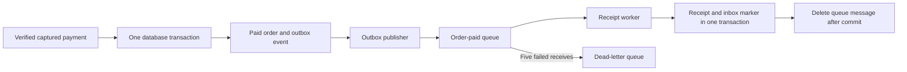

# Narx Commerce: build and operate the project

This is the single project guide. Repository READMEs explain only their own entry point.
The project models application teams delivering a commerce system and a platform team
providing CI, infrastructure and GitOps. Team memberships represent a learning scenario;
they do not mean a company or real delivery team operates this environment.

## Current status

The foundation and application migrations are merged. The local Docker preview
exercises customer/admin flows and reliable order events using ElasticMQ. The delivery
changes add reusable security checks, disabled-by-default ECR publishing, signed release
records, reviewed promotion, Argo manifests and deployment smoke tests. Merging this code
prepares delivery; it does not activate AWS or create Kubernetes applications.

No AWS resources have been provisioned. No new Argo application is installed. ECR
publishing remains disabled until identities, registry access and environment settings
are configured. Real AWS SQS, payment-provider integration, cloud infrastructure and
queue alerting still require live verification. The older Local-Narx-Space cluster
applications are separate and are not managed by these repositories.

The organisation uses GitHub Free and all six repositories are public. GitHub now
enforces `main` branch protection: PRs, one CODEOWNER approval, the repository's CI
checks, an up-to-date branch, resolved conversations and linear history are required.
New commits dismiss stale approvals, the latest push needs approval from someone
other than its pusher, and administrators follow these rules too. Force pushes and
branch deletion are blocked; no PR-approval bypass users, teams or apps are configured.
Organisation/repository administrators can still edit the settings; this is not an
immutable control against the organisation owner.

`code-reviewers` contains only `Code-S-12` and is named in every CODEOWNERS file.
Review approval and merge are separate actions: an authorised writer can merge only
after all required controls pass. PR authors cannot approve their own PR. Workflow
execution for PRs from external forks requires maintainer approval; organisation
members' ordinary PR checks run automatically. Execution approval does not approve
the code for merging. Default Actions tokens remain read-only and cannot approve PRs.

Before the visibility change, all Git refs including closed PR heads were scanned
with Gitleaks 8.30.1, along with 42 available Actions-run log archives and 22 build
artifacts; no secrets were detected. Two failed workflow runs had no job logs.
The tracked PEM is the public RDS CA bundle, and the tracked env file is only an
example. Generated local `.env` credentials remain ignored and were not published.
Public visibility also exposes Git history and Actions logs: never commit secrets,
real customer records or Terraform state. Future changes still need secret scanning;
this review is not a guarantee that later commits are safe.

## Repository map and ownership

| Repository | Owning team | Boundary |
| --- | --- | --- |
| `commerce-frontend` | Frontend | Customer storefront and admin interface |
| `commerce-catalogue` | Catalogue | Public product read API; reads the commerce core over HTTP |
| `commerce-orders` | Orders | Accounts, inventory, checkout, payments, orders, cart, outbox and receipt worker |
| `platform-ci` | Platform | Versioned reusable GitHub Actions workflows |
| `platform-infrastructure` | Platform | Terraform and this project guide |
| `platform-gitops` | Platform/release | Helm, Argo CD, environment releases and platform add-ons |

Each runtime component builds independently. The cart source is in `commerce-orders/cart`
and produces its own Python image. Orders API, outbox publisher and receipt worker
share one Java image, selected by `DELIVERY_ROLE=api|publisher|worker`. They run as
separate processes and can scale independently without rebuilding the application.
The three application repositories still produce four runtime images. Shared CI
workflows prevent copying whole pipelines into every repository. Existing
`Local-Narx-Space` repositories remain untouched.

The source application keeps stock reservation and order insertion atomic in the
orders commerce core's PostgreSQL transaction. The migration deliberately retains
that boundary. The Go catalogue is a read facade, not an independent inventory database.
Splitting inventory into its own transactional service would require a reservation
protocol and compensation; it is not achieved merely by making another repository.

Developer: `subhankar12-spec`. Intended independent reviewer: `Code-S-12` through
the `code-reviewers` team. Service teams receive write access to their repositories;
the platform team receives write access to the platform repositories. Organisation
owners retain their GitHub administrative rights. A single person's multiple accounts
do not establish genuine independent review; the exercise models the control.

## Target environments

| Environment | Location | Purpose |
| --- | --- | --- |
| dev | Local Kubernetes | Fast integration feedback |
| qa | Local Kubernetes, isolated namespace and data | Release verification |
| production | AWS EKS during scheduled learning sessions | Cloud delivery and operations exercises |

EKS control-plane subnets span two AZs as AWS requires. Worker capacity and RDS will
be in one AZ for cost control. This is not AZ-resilient production availability.
Use the same immutable image digest through all environments. Local nodes must be
able to run the selected image architecture; confirm this before choosing Graviton.

Proposed AWS services: VPC, EC2-backed EKS, ECR, ALB, ACM, RDS PostgreSQL Single-AZ,
SQS with a dead-letter queue, IAM, Secrets Manager, S3, CloudWatch and AWS Budgets.
Evaluate NAT versus endpoint/network costs before choosing the network layout;
private nodes require an intentional outbound connectivity design. Use the existing
DNS provider unless a Route 53 hosted zone is needed.

The commerce core owns PostgreSQL products, stock, accounts, orders and payments.
Catalogue reads products through HTTP and cart owns Redis keys. Services do not query
each other's databases. The core has not been decomposed into database-per-domain
microservices; any later split must be an explicit, tested architecture change.

## CI and CD: what happens after a push

Think of an image as a sealed delivery box. Its digest identifies the exact contents.
Dev, QA and production receive the same box; rebuilding for each environment would
create a different release and invalidate earlier verification.

1. Create a feature branch, push it and open a PR. Workflow lint and secret scanning
   run first. Component builds then run tests inside their Docker stages, check the
   non-root runtime, scan OS/application dependencies and generate a CycloneDX SBOM.
   HIGH and CRITICAL findings, including unfixed findings, block the build. PR builds
   receive read-only tokens; they never receive AWS credentials or the release key.
2. An independent CODEOWNER approves and required checks pass before squash merge.
   Changes dismiss stale reviews. Main runs the same checks again on the merged commit.
3. When `DELIVERY_ENABLED=true`, the trusted publisher downloads the exact image
   produced by the successful build. It does not rebuild it. GitHub OIDC assumes a
   repository-specific AWS role through the main-only `registry-release` environment.
   It pushes an immutable commit tag to ECR, then signs the digest and attaches signed
   source provenance and an SBOM with Cosign. A conflicting existing tag fails.
4. Only after all caller jobs succeed, a release record is published and the release
   App requests GitOps reconciliation. A five-minute scheduled reconciliation also
   recovers missed notifications. Records from incomplete/failed main CI do not qualify.
5. GitOps verifies source CI, the permitted builder revision, caller repository/main
   identity, source SHA, digest, provenance and SBOM. All four component identities
   form one release bundle. Initial dev waits until every component is available.
   Reconciliation opens a dev PR; it does not write directly to main.
6. After approval and merge, local Argo CD pulls the dev desired state. It deploys the
   umbrella chart, waits for readiness, then runs the PostSync smoke Job. A separate
   observer App publishes `narx/deploy-dev` status for that GitOps revision.
7. A trusted successful dev status permits a QA PR carrying the exact same four image
   digests. Successful QA permits a production PR. **All three environment PRs require
   human review under the current protection rules. No automatic QA merge or approval
   bypass is configured.** A different policy would need a separate reviewed change.
8. Production targets a registered EKS cluster named `narx-production`. It cannot deploy
   to the laptop using the production Application. Cloud activation remains pending.

Documentation-only changes skip image work while the required build check still reports
success. In the Orders repository, cart-only changes skip the Java build and Java-only
changes skip cart. Orders and cart builds run in parallel after workflow/secret checks.
BuildKit caches avoid separate test-image builds. Security evidence is retained for
14 days; temporary main image-transfer artifacts for one day. Main runs use separate
commit concurrency groups, so a newer push cannot cancel an older release build.

`platform-ci` owns five reusable workflows: workflow/secret validation, application
build/publish, release notification, Helm validation and Terraform validation. Service
repositories contain short callers. GitOps has ordinary CI, a reconciler, and a trusted
release verifier. This separation keeps privileged verification away from candidate code.
The verifier uses `pull_request_target` but checks out only the reviewed base commit;
PR release JSON is fetched as data and never executed. Enable its required status only
once the verifier is on main and has reported successfully on a subsequent PR.

Reusable workflows and actions are pinned by commit SHA. Merge shared workflow changes
first, then update callers to the merged revision. The allowed builder list lives in
`platform-gitops/policy/builders.json`; retain old trusted builder SHAs while retained
releases still depend on them. An arbitrary service commit cannot change that allowlist.

### Rollback and failure behaviour

A healthy deployment records the previous environment bundle and the GitOps revision
with trusted successful evidence. A QA/production failure proposes a rollback PR to
that recorded bundle. The reviewer approves, checks pass, and Argo applies the merged
rollback. This is automatic detection/proposal with reviewed recovery, not unattended
rollback execution. Dev does not automatically propose recovery. A first deployment
has no previous verified release to restore. Rollback never reverses SQL migrations,
refunds, stock changes or persistent data; migrations must remain backward compatible.
A failed rollback cannot repeatedly toggle releases because its previous pointer is empty.

Smoke tests check six readiness endpoints, INR catalogue data and the frontend response.
They do not prove a real checkout/payment transaction. Local integration tests cover
customer/admin/refund and queue-recovery behaviour using a simulator. A real provider
sandbox test and a controlled Kubernetes rollout failure remain activation checks.

If CI fails, inspect the failed job and fix through a PR. If Argo fails, inspect its
operation and hook Job before changing desired state. Never manually retag an image or
edit a Deployment behind GitOps to hide a failed rollout.

### What the Python code does

You do not need to memorise each line, but an operator should understand its inputs,
permissions, decisions and failure modes. `platform-gitops/scripts/delivery.py` is the
single release-policy entry point. `validate` checks bundle structure; `fixtures` makes
temporary CI-only image data; `reconcile` discovers signed builds and proposes release
or promotion PRs; `verify-candidate` applies trusted policy to PR data; `rollback`
proposes the recorded previous healthy bundle. External commands use argument lists,
and candidate files are never imported as Python. Unit tests mock GitHub/registry
responses; a temporary real Git remote also tests updating an existing PR branch.

`platform-infrastructure/local/bootstrap.py` handles local operator setup: namespace
and initial credentials, session ECR pull credentials, and observer notification
configuration. It does not provision AWS or support production namespaces. The existing
`tests/test_local_stack.py` exercises the complete disposable app. These scripts have
different trust boundaries and are kept separate rather than being copied into jobs.

Local verification of release policy and the full chart is available without AWS:

```bash
cd platform-gitops
python3 -m unittest discover -s tests -p 'test_delivery*.py' -v
python3 scripts/delivery.py validate
helm dependency build --skip-refresh charts/commerce
python3 scripts/delivery.py fixtures /tmp/commerce-validation.json
helm lint --strict charts/commerce -f environments/dev/runtime.yaml \
  -f /tmp/commerce-validation.json
helm template commerce charts/commerce -n commerce-dev \
  -f environments/dev/runtime.yaml -f /tmp/commerce-validation.json
# The generated images are fictional and must never be applied.
cd ../platform-infrastructure
terraform -chdir=delivery init -backend=false -input=false -lockfile=readonly
terraform -chdir=delivery validate
terraform -chdir=delivery test
```

The delivery root uses mocked plans only. The disposable full integration run on the
patched Orders, cart and catalogue images passed in 167.8 seconds, including queue
outage, duplicate, worker transaction rollback and DLQ recovery. Local image scans
reported zero HIGH/CRITICAL findings at that run; vulnerability databases change, so
CI scans again. This evidence does not replace live ECR/OIDC/signature or Argo tests.

### GitHub Apps and activation settings

Create Apps from organisation Settings → Developer settings → GitHub Apps. Disable
webhooks when creating these Apps; polling/dispatch does not require an inbound server.
Give each a descriptive homepage, for example the organisation URL. Install only on
`platform-gitops`, not on all repositories, and generate separate private keys.

| Identity | Suggested App name | Repository permissions | Where its private key goes |
| --- | --- | --- | --- |
| Release automation | `narx-space-prod-release` | Contents read/write, Pull requests read/write, Metadata read | GitHub Actions secret `NARX_RELEASE_APP_PRIVATE_KEY` in three application repos and GitOps |
| Deployment evidence | `narx-space-prod-deployments` | Commit statuses read/write, Metadata read | `argocd-notifications-secret`, key `narx-github-privateKey` |

Source release/build metadata is currently read from public application repositories.
If they become private, the release verifier needs separately scoped source read access
(Contents and Actions read); update the App installation and test that change first.
The release App cannot approve its own PR or bypass main rules. The observer cannot
write repository contents or PRs. Keep PEM files outside all repositories, with mode
600. Never paste keys into chat or commit them. App ID, installation ID and bot login
are public identifiers; the private key is the secret. The observer login is normally
`<app-slug>[bot]`. Use the organisation's new Apps rather than the older Boutique App.

Configure these repository variables after AWS review:

| Repositories | Variables |
| --- | --- |
| All three application repos | `AWS_ACCOUNT_ID`, `AWS_REGION`, per-repo `AWS_RELEASE_ROLE_ARN`, `NARX_RELEASE_APP_ID`, `DELIVERY_ENABLED` |
| GitOps | `AWS_ACCOUNT_ID`, `AWS_REGION`, `AWS_VERIFICATION_ROLE_ARN`, `NARX_RELEASE_APP_ID`, `NARX_DEPLOYMENT_BOT_LOGIN`, `DELIVERY_ENABLED` |

Main-only GitHub environments are `registry-release` for application repositories and
`registry-verification` for GitOps. Terraform trusts those exact environment subjects
and the STS audience. PR build jobs explicitly remove OIDC permission even though the
trusted publishing job needs it. ECR mutation is limited to the owning component repos;
the GitOps role can read images and signatures but cannot publish/delete them.

`delivery/` defines the four ECR repositories, OIDC and scoped IAM roles. It does not
create EKS, databases or a backend yet. Configure remote state before real application.
Repositories use strict immutable tags, encryption, scan-on-push and destruction
protection. An untagged-only lifecycle rule expires after 14 days. Tagged releases are
retained for rollback, so storage can grow and requires a later live-reference-aware
retention review. ECR storage is billable; image transfer can also cost money.

Do not enable publishing until AWS roles/ECR, release App secrets and GitOps verification
are ready. Then enable GitOps and application `DELIVERY_ENABLED` in a planned session
and merge a reviewed application/workflow change that builds all initial components.
Simply toggling the variable does not retroactively publish earlier images. Confirm
four successful main release records before expecting the first dev PR.

### Prepare local GitOps delivery after activation

The helper in `platform-infrastructure/local/bootstrap.py` takes an explicit kind
context and only supports dev/QA namespaces. It preserves existing runtime passwords.
The session registry secret uses your explicit AWS profile and expires after 12 hours;
refresh it before a lab session or image pulls can fail. This manual session refresh is
a known local limitation, not an automated production credential solution. EKS uses
node IAM for pulls and scoped Pod Identity for publisher/worker AWS calls.

```bash
cd platform-infrastructure
python3 local/bootstrap.py prepare --context kind-mega-local --environment dev
python3 local/bootstrap.py prepare --context kind-mega-local --environment qa
aws sso login --profile narx-lab
# Replace the example account/region with the reviewed values.
python3 local/bootstrap.py refresh-registry --context kind-mega-local --environment dev \
  --aws-profile narx-lab --account-id 123456789012 --region ap-south-1
python3 local/bootstrap.py refresh-registry --context kind-mega-local --environment qa \
  --aws-profile narx-lab --account-id 123456789012 --region ap-south-1
# PEM path below is outside the repository. Substitute actual numeric IDs.
python3 local/bootstrap.py configure-observer --context kind-mega-local \
  --app-id 123456 --installation-id 12345678 --private-key-file /secure/path/deployments.pem \
  --notifications-file ../platform-gitops/applications/notifications.json
kubectl --context kind-mega-local apply -f ../platform-gitops/applications/local/commerce.json
kubectl --context kind-mega-local -n argocd get applications
kubectl --context kind-mega-local -n commerce-dev get pods,jobs
kubectl --context kind-mega-local -n commerce-dev port-forward service/commerce-frontend 18080:80
# For QA use namespace commerce-qa and local port 18081.
```

Configure the observer on the production Argo instance separately when it exists.
The local helper merges only Narx notification keys and refuses to overwrite an existing
different GitHub integration. Existing Slack settings are preserved. It sends secrets
through stdin rather than shell arguments or a last-applied annotation. These commands
have not been applied to the existing cluster as part of preparing this change.

Each environment has its own PostgreSQL PVC, Redis and ElasticMQ in the local profile.
Namespaces use restricted pod security and a memory/storage quota. The laptop needs
capacity for both environments; resource settings do not create additional RAM. Local
Redis is disposable and single-instance databases/queues are lab components. Network
policies are rendered, but kindnet alone does not enforce them: use an enforcing CNI
in a dedicated reviewed cluster before claiming network isolation. The cloud profile
requires HTTPS origin, AWS region and private data CIDRs, disables local data stores,
and needs real DB/Redis/SQS secrets and Pod Identity associations before activation.
Never apply `applications/aws/commerce.json` as a local production deployment.

The cloud runtime intentionally fails rendering until its environment-specific inputs
are filled through review. No ingress/TLS, managed Redis endpoint, AWS secrets integration
or full observability stack is silently provisioned by these CI/CD changes.

## Local monitoring and progressive delivery

Narx reuses the existing `kind-mega-local` cluster and Argo CD installation. An
ApplicationSet generates `narx-commerce-dev` and `narx-commerce-qa`, using separate
namespaces, credentials and data volumes. Production remains a separate Application
for the future registered EKS cluster `narx-production`. No new local cluster is needed.

The ApplicationSet has a fixed dev/QA list, fails on missing template keys, and cannot
select production. Its project allows only the Narx repository and those two namespaces.
Removing an element does not automatically delete its Application; resource preservation
also protects workloads from cascading Application deletion. Decommissioning still needs
an explicit data-retention decision. Controller-owned Service hash selectors are ignored
by Argo so self-healing does not fight the blue-green traffic switch.

Dev uses ordinary Deployments. Only the frontend in QA and production uses an Argo
Rollout. Backend services continue rolling updates. The frontend has active and preview
Services, and a namespace-scoped controller pinned to the installed Rollouts v1.10.1
release. Existing Boutique controllers watch their own namespaces and are not repointed.
The controller has no ClusterRole or wildcard grants. Its required namespace read access
includes Ingress discovery even though this frontend strategy does not need an ingress.
Kubernetes API egress uses local service/node networks, not the laptop's changing IP.
For private EKS API endpoints, populate reviewed VPC CIDRs during cloud activation.

The delivery sequence after a reviewed release merge is:

1. Start the new frontend ReplicaSet behind its preview Service.
2. A pre-promotion Analysis Job checks readiness, HTML and INR products. It requires
   three consecutive successful rounds, with bounded requests and a bounded retry window.
3. Successful analysis lets the controller move the active Service to the candidate.
   The GitOps PR supplied the human approval; a second manual Rollouts approval is not required.
4. Post-promotion analysis checks the active Service. A failure makes Rollouts restore
   stable traffic. The previous ReplicaSet is retained for 180 seconds, longer than the
   analysis Job's 120-second deadline. Failed preview analysis leaves stable traffic intact.
5. Argo's PostSync smoke Job verifies the environment. Its trusted GitHub deployment
   status permits the next environment PR only after the deployment is healthy.
6. Failed QA/production desired state can still generate a reviewed Git rollback PR.
   Traffic recovery and reverting desired Git state are separate operations. Neither
   operation reverses database migrations, orders, stock or payments.

Analysis currently uses functional Jobs. Prometheus supplies operational alerts and
visibility; no request-rate/latency metric-based rollout gate is claimed. Low-traffic
lab environments need deliberate sampling rules before adding such a gate. The live
local exercise used isolated fixture responses, verified preview rejection, post-switch
traffic restoration and healthy promotion, and removed its temporary namespace. It was
not an ECR-backed app release or an AWS production test.

### One shared observability stack

The existing monitoring Application remains the sole owner of Prometheus, Grafana,
Alertmanager, Blackbox Exporter, kube-state-metrics, node-exporter, Loki and Alloy.
No duplicate stack or monitoring database is created. It consumes two reviewed Git sources:
the shared chart in `Local-Narx-Space/boutique-gitops/monitoring` and project values in
`Narx-Space-Prod/platform-gitops/monitoring/local-values.yaml`. The old project stays
owned by its existing Applications. Only shared monitoring gains the Narx integration.

| Component | Narx integration |
| --- | --- |
| Prometheus | Discovers the six runtime roles, QA Rollouts controller, internal readiness probes and Narx Argo application status |
| Grafana | `Narx Commerce — Delivery and Runtime` dashboard, UID `narx-commerce`, dev/QA selection |
| Alertmanager | Routes dev/QA operational alerts to the existing non-production Slack receiver; separates grouping/inhibition by project |
| Slack | Uses the existing `monitoring-integrations/slack_webhook` secret; no webhook is committed or placed in application namespaces |
| kube-state-metrics | Observes Narx pods, Deployments, ReplicaSets, Jobs and PVCs using namespace-scoped read permissions |
| Blackbox Exporter | Checks internal readiness paths; it discovers only existing Narx pods, so inactive environments do not create permanent fake outages |
| Alloy and Loki | Collect and display Narx container logs with project, environment, service, namespace, pod and container labels |
| Argo Rollouts | Publishes controller, rollout phase and analysis metrics; functional Analysis Jobs control the frontend switch |

Use `project="narx-commerce"` in metric/log queries. The application retains some
legacy `boutique_http_*` metric names; the project label provides identity without
rewriting standard metrics. Existing Boutique queries are scoped separately so two
frontends named `frontend` in `dev` are not combined into one error rate or SLO.

Alerts cover failed scrapes/readiness, restarting or stuck pods, unavailable Deployments,
unbound PVCs, meaningful-volume HTTP errors, stalled paid-order outboxes, worker queue
failures, degraded Rollouts/analysis and failed/stalled Argo reconciliation. HTTP error
percentage alerts also require a minimum request rate, avoiding noise from one synthetic
request. Native Prometheus rule tests cover backlog isolation, low traffic and rollout
failure. Direct AWS queue age/DLQ-depth alarms and off-laptop alerting remain cloud work;
local alerting is not a replacement for an independent production monitoring plane.

The shared Slack credential exists, and local native Alertmanager configuration/routing
checks select `slack-nonprod` for `project=narx-commerce, environment=qa`. Those tests
run without network access and do not send Slack messages. A real firing/resolved Narx
notification must be verified after the monitoring changes are deployed. Argo GitHub
status notifications still need the separate observer App described earlier.

### Activate the reviewed local configuration

Merge the shared CI update first and pin the GitOps caller to its merged revision.
Merge both the Narx GitOps integration and shared monitoring chart PRs before changing
the live monitoring Application: its additional values file must exist on main.
Publishing stays disabled until ECR and GitHub identities are ready. Registering an
ApplicationSet does not publish images or turn bootstrap release files into deployments.

```bash
# Run beside the existing platform repositories; this is the shared chart's source.
gh repo clone Local-Narx-Space/boutique-gitops shared-monitoring
cd platform-infrastructure
python3 local/bootstrap.py prepare --context kind-mega-local --environment dev
python3 local/bootstrap.py prepare --context kind-mega-local --environment qa
kubectl --context kind-mega-local apply --server-side --field-manager=narx-platform-bootstrap \
  -f ../platform-gitops/applications/local/commerce.json
kubectl --context kind-mega-local -n argocd get applicationsets,applications
# Apply the reviewed multi-source definition for the already existing monitoring app.
kubectl --context kind-mega-local apply -f ../shared-monitoring/applications/monitoring-homelab.yaml
# Its existing sync policy is manual; request this one reviewed reconciliation.
kubectl --context kind-mega-local -n argocd patch application boutique-monitoring-homelab \
  --type merge -p '{"operation":{"sync":{"prune":false}}}'
```

Before loading both complete environments, check host RAM and retire obsolete workloads
through their own GitOps configuration if necessary. Kind nodes share the laptop's RAM;
three Ready nodes do not provide three independent machines' memory. Namespace quotas
bound requests but do not create capacity. Monitoring and old application resources are
not deleted by this integration. New local database/session credentials are preserved
on repeated bootstrap runs.

### Inspect deployments, alerts and logs

```bash
kubectl --context kind-mega-local -n commerce-qa get rollouts,analysisruns,jobs,pods
kubectl --context kind-mega-local -n commerce-qa describe rollout commerce-frontend
kubectl --context kind-mega-local -n commerce-qa get service commerce-frontend commerce-frontend-preview -o yaml
kubectl --context kind-mega-local -n commerce-qa logs deployment/narx-rollouts --tail=100
kubectl --context kind-mega-local -n monitoring port-forward service/prometheus 19090:9090
# Open http://localhost:19090/targets and query up{project="narx-commerce"}.
# Grafana: https://grafana.narx.space/d/narx-commerce
kubectl --context kind-mega-local -n monitoring port-forward service/alertmanager 19093:9093
# Open http://localhost:19093 to inspect firing alerts, routes and silences.
```

In Grafana Explore, choose Loki and query
`{project="narx-commerce",environment="qa"}`. The project dashboard is empty until real
Narx workloads run and produce metrics/logs; this is not evidence of a healthy deployed app.
For an HTTP error, inspect service logs and dependencies. For an outbox alert, check queue
connectivity and publisher retries without deleting events. For a Rollout failure, inspect
its Analysis Job logs and active Service selector, confirm stable traffic, then review the
GitOps rollback proposal. Do not manually overwrite Service hash selectors.

To repeat the isolated controller test, first build the local frontend image using the
preview commands, install PyYAML 6.0.3, then run:

```bash
cd platform-gitops
helm dependency build --skip-refresh charts/commerce
NARX_ROLLOUT_TEST=1 NARX_KUBE_CONTEXT=kind-mega-local \
  python3 -m unittest discover -s tests -p test_rollout_local.py -v
```

This refuses to reuse an existing `narx-rollout-validation` namespace, loads only the
local fixture image into kind, and deletes that namespace afterward. It never changes
committed release identities, existing application namespaces or AWS. Rollouts CRDs
must already exist; production CRD installation belongs to cloud platform bootstrap.

## Order events, receipts and queue recovery

Payment confirmation remains synchronous. A verified provider capture, checked by
checkout verification or a signed webhook, updates the order to paid/confirmed and
inserts `order_outbox` in the **same PostgreSQL transaction**. A browser redirect alone
never confirms payment. The queue is not called in that transaction, so a queue outage
delays receipt generation while payment confirmation continues.



The event contains `eventId`, `type=order.paid`, `version=1`, `orderId`, `amount`,
`currency=INR` and `paymentId`. It contains no customer name, address, email, card,
password or session token. `V5__order_delivery.sql` creates the outbox, inbox and
receipt tables. Existing paid orders are not backfilled; newly confirmed captures
create events. Payment/webhook retries do not create a second event for an order.

The worker creates an internal payment acknowledgement in `payment_receipts`, not
a tax invoice, email, shipment or fulfilment transition. Authenticated order detail
includes a `receipt` field when ready; it is null beforehand. The existing storefront
does not yet render that field. A later refund retains the original receipt as a
historical payment acknowledgement; refund status remains on the order.

| Process | Responsibility | Queue outage behaviour |
| --- | --- | --- |
| `api` (default) | Payment/order transaction and outbox insert | API stays ready if its database is ready |
| `publisher` | Send one due event, then mark published | Retry with exponential delay, capped at 60 seconds; never discard unsent events |
| `worker` | Validate event, create receipt and inbox marker, then delete message | Failed messages become visible again; queue redrives after five failed receives |

Publisher replicas select rows with `SKIP LOCKED`. Each send has a bounded SDK timeout;
a row lock is held during that send. This simple approach suits current throughput.
Higher-volume production systems should evaluate batches or a lease-based publisher
rather than holding database connections during remote sends. A crash after send but
before marking published can send the same event again. That is expected.

The worker validates the message against the canonical outbox event. Inbox uniqueness
and receipt creation commit together, so a crash after commit but before SQS deletion
causes a harmless duplicate. A database failure rolls both writes back. The receipt's
unique order/event constraints add another guard. This guarantee covers these database
writes; external email/shipping calls would need their own idempotency mechanism.

Default message visibility is 60 seconds. Processing uses a 10-second database
transaction timeout; the worker receives one message per poll and only acknowledges
after commit. `DELIVERY_VISIBILITY_SECONDS` must be at least 15 and at most 43200;
15 is used only to shorten the local retry exercise. Production should retain an
appropriate margin and add visibility extension before introducing slower work.

The local Compose stack uses ElasticMQ 1.7.1 pinned by digest. Its H2 queue storage
survives container restarts in `queue-data`; PostgreSQL survives in `database`.
A one-shot init service gives the queue volume to UID 10001; the queue itself runs
non-root. Neither SQS nor database ports are published. An explicit `DELIVERY_LOCAL=true`
permits dummy credentials only against the local endpoint. Without that flag, the
SDK uses its default credential chain and requires an HTTPS queue URL. EKS Pod Identity
and narrowly scoped queue IAM permissions still need provisioning and verification.

All three Java roles expose `/health/live`, `/health/ready` and `/actuator/prometheus`.
Background-role readiness checks the database and queue; liveness does not require
either dependency. Use those custom health paths in Helm. Worker/publisher HTTP ports
must remain internal and should not receive storefront traffic.

Publisher metrics include `commerce_outbox_pending`, `commerce_outbox_oldest_seconds`
and `commerce_outbox_publish_total{result="sent|failed"}`. Worker metrics include
`commerce_queue_consume_total{result="processed|duplicate|failed"}` and
`commerce_queue_poll_total{result="failed"}`. Outbox gauges refresh every 30 seconds.
Logs correlate event/order IDs without logging message bodies or credentials.
Prometheus alert rules, DLQ-depth and queue-age alarms, and dashboards are still pending.
An empty poll is normal; repeated processing failures or growing backlog need attention.

### Local failure exercise

Use a fresh disposable Compose project. This exercise stops/restarts only that project's
queue and worker, creates test accounts/orders and injects temporary database constraints.
It requires the queue-aware GitOps branch and the matching orders image. It is intentionally
separate from the ordinary customer-flow test; never run it on a shared database.

```bash
# From platform-gitops, after building the four application images.
DELIVERY_VISIBILITY_SECONDS=15 docker compose --project-name narx-events-validation \
  --env-file local/.env -f local/compose.yaml up --no-build -d --wait
NARX_LOCAL_TEST=1 NARX_QUEUE_TEST=1 NARX_COMPOSE_PROJECT=narx-events-validation \
  python3 -m unittest discover -s tests -v
# Remove this disposable exercise's database AND queue data when finished.
docker compose --project-name narx-events-validation --env-file local/.env \
  -f local/compose.yaml down --volumes
```

The test proves atomic payment/outbox rollback, payment success during a queue outage,
publication after recovery, duplicate publisher replay, atomic consumer rollback,
visibility retry, poison-message DLQ redrive and corrected replay without duplicate
receipts. It also retains the existing customer/admin/refund checks. ElasticMQ implements
a subset of SQS: these checks do not prove AWS IAM, encryption, retention or real-provider
behaviour. AWS integration tests remain required before cloud rollout.

### Recovery decisions

1. If outbox backlog grows, inspect publisher health/logs and queue reachability/permissions.
   Restore the dependency; due events retry automatically. Do not delete pending rows.
2. If receipts lag but outbox is clear, inspect the worker, queue age and DLQ.
   A worker restart recovers unacknowledged messages after the visibility timeout.
3. Inspect a DLQ message and its event ID under restricted operator access. Fix its schema,
   application or data failure first. Replay only trusted events, preserving `eventId`.
   Copy successfully before removing the DLQ message; retain operational evidence.
   Native SQS redrive will be tested on AWS; the local test explicitly copies/deletes.
4. If a queue was irrecoverably lost, an operator can replay a reviewed outbox event by
   clearing `published_at` and setting `next_attempt_at=CURRENT_TIMESTAMP` for that exact
   event ID. Receipts already created remain deduplicated. Do not mass-reset the table.
5. If an exercise fails, inspect logs, then remove its disposable volumes to clear injected
   constraints and test state. Regular `down` preserves data and does not reset the exercise.

Outbox/inbox/receipt history is retained for now. A retention/archival policy must be agreed
before real production traffic; do not prune canonical events while replay is still possible.
Dev/QA Kubernetes deployments will use isolated queues/data. They are not deployed yet.

## Application source and local preview

The migration preserves the existing storefront, accounts, cart, admin, order history,
Razorpay test-mode integration, refunds and INR pricing. Source provenance and licenses
are recorded in the application READMEs. It does not import Jenkinsfiles, per-service
Helm copies or Jenkins report-converter scripts.
Checkout now requires authentication and delivery information. The old anonymous demo
path that created confirmed orders without payment is removed from the migrated app.

| Component | Source | Runtime port | Metrics |
| --- | --- | --- | --- |
| Frontend | `commerce-frontend/src` and `public` | 8080 | `/metrics` |
| Catalogue | `commerce-catalogue/*.go` | 8081 | `/metrics` |
| Orders/core | `commerce-orders/src` | 8083 | `/actuator/prometheus` |
| Cart | `commerce-orders/cart` | 8082 | `/metrics` |

All services expose `/health/live` and `/health/ready`. Catalogue refuses to return
the old hard-coded USD demo data if `COMMERCE_URL` is absent. Its readiness follows
the commerce dependency; liveness does not. Production Helm values will need each
component's real port and resources rather than the chart's generic defaults.

The Docker Compose preview is a developer convenience, not the Kubernetes dev/QA
delivery path. Clone the application repositories and `platform-gitops` as siblings:

```bash
mkdir -p narx-commerce
cd narx-commerce
gh repo clone Narx-Space-Prod/commerce-frontend
gh repo clone Narx-Space-Prod/commerce-catalogue
gh repo clone Narx-Space-Prod/commerce-orders
gh repo clone Narx-Space-Prod/platform-gitops
cd platform-gitops
# When reviewing an unmerged change, check out the corresponding PR branches in all four repos.
umask 077
python3 - <<'PY'
from pathlib import Path
import secrets
keys = ['DATABASE_PASSWORD', 'SESSION_SECRET', 'FIXTURE_PAYMENT_SECRET', 'FIXTURE_WEBHOOK_SECRET']
with Path('local/.env').open('x') as output:
    output.write(''.join(f'{key}={secrets.token_hex(32)}\n' for key in keys))
    output.write('PUBLIC_ORIGIN=http://localhost:18080\nAPP_PORT=18080\nAPP_BIND_ADDRESS=127.0.0.1\n')
PY
docker compose --parallel 1 --env-file local/.env -f local/compose.yaml build
docker compose --env-file local/.env -f local/compose.yaml up --no-build -d --wait
```

The secret-generation command refuses to overwrite an existing file. Open
`http://localhost:18080`. From a different computer, forward that port over SSH:

```bash
ssh -L 18080:127.0.0.1:18080 your-linux-user@your-linux-host
```

Then use `http://localhost:18080` on the computer running the browser. For deliberate
LAN exposure, change `APP_BIND_ADDRESS`, `APP_PORT` and `PUBLIC_ORIGIN` together in
the local env file. `PUBLIC_ORIGIN` must exactly match the browser's scheme, host and
port; otherwise state-changing requests correctly fail the origin check.

The preview uses a local payment simulator and says so in the browser confirmation.
It makes no Razorpay transaction. It verifies the application's signature checks,
state changes and refund handling but does not verify the real Razorpay sandbox.
Actual provider tests will use backend-only Razorpay test credentials in Kubernetes.
Fixture flags and fixture keys must never appear in AWS production configuration.

Register your own customer account; there is no default admin password. An operator
can grant that account admin access only in this local preview, using the exact email
registered above and a reviewed SQL command inside the PostgreSQL container. Do not
make the first registrant an administrator or add a public role-assignment endpoint.
For a local operator, open a SQL prompt and replace the example email with the account
you registered (there is no fixed admin account/password):

```bash
docker compose --env-file local/.env -f local/compose.yaml exec postgres psql -U commerce -d commerce
```

```sql
UPDATE customers SET role='admin' WHERE email='your-admin@example.com';
```

Then type `\q` to exit and sign in with that account at `/admin`.
The integration test promotes only its generated throwaway account, then exercises
customer/admin separation, product version conflicts, order processing and refunds.

```bash
NARX_LOCAL_TEST=1 NARX_COMPOSE_PROJECT=narx-commerce python3 -m unittest discover -s tests -v
docker compose --env-file local/.env -f local/compose.yaml down
# Only for intentionally discarding this local preview's database and queue data:
# docker compose --env-file local/.env -f local/compose.yaml down --volumes
```

The test mutates its named local stack. Do not point it at a shared or production
database. PostgreSQL and queue data survive ordinary `down`; carts and simulator records do
not. Stopping and restarting the payment simulator does not constitute a provider
recovery test and can leave its old local orders needing a fresh checkout.

Migration verification: all four runtime Docker builds passed their application tests.
The opt-in full-stack test passed against an isolated local project, including denied
guest checkout, required delivery, customer/admin separation, INR product data, stock
reservation, idempotent checkout, invalid payment signature rejection, payment retries,
order isolation, product version conflicts, fulfilment and refund retries. This evidence
does not cover the real payment provider, Kubernetes releases or AWS. The separate
queue exercise above covers local message processing and recovery.

## Infrastructure workflow

Infrastructure PRs run formatting, validation, provider-mocked tests and a blocking
HIGH/CRITICAL Terraform security scan for both bootstrap and delivery roots. AWS-backed
plan/apply/destroy workflows still require scoped identities and the cloud cost review.
No current workflow can apply infrastructure. The existing lab state bucket uses SSE-S3;
its customer-managed-KMS scanner finding has a narrowly scoped exception expiring
2027-01-20 and must be reviewed before production state activation.

Before any deployment, select the AWS account and region, review a regional estimate,
and configure budget alerts. The target is INR 1,000/month through limited runtime;
this is not an enforced billing cap. EKS, worker nodes, ALB, RDS, storage, networking,
logs, taxes and retained resources all contribute. Scaling workers to zero does not
stop EKS cluster fees. EKS must be destroyed to stop its cluster-hour charges.

The eventual apply workflow must use a reviewed plan from the same commit, verify
the target AWS account, serialize state-changing operations, and require approval.
Destroy is a separate manual workflow with environment/account confirmation. It
must remove workloads and AWS load balancers before deleting the cluster and retain
the intentionally persistent state, images and database backup data. Include retained
storage costs in the estimate and test recovery into a newly created cluster.

## Commands available in this foundation

Clone the repositories you need:

```bash
gh repo clone Narx-Space-Prod/platform-infrastructure
gh repo clone Narx-Space-Prod/platform-gitops
gh repo clone Narx-Space-Prod/platform-ci
```

Use Terraform 1.16.x. The committed provider lock file pins the tested AWS provider.
The following checks use mocked AWS calls and do not create cloud resources:

```bash
cd platform-infrastructure
terraform fmt -check -recursive
terraform -chdir=bootstrap init -backend=false -input=false -lockfile=readonly
terraform -chdir=bootstrap validate
terraform -chdir=bootstrap test
```

The bootstrap root defines a private, versioned, encrypted state bucket and rejects
HTTP access. It deliberately prevents bucket destruction. Its tests use `mock_provider`
even though their command is named `apply`; this is not a real AWS apply.

After account/region/cost approval, a platform operator can bootstrap the bucket:

```bash
cp bootstrap/bootstrap.example.tfvars bootstrap/session.tfvars
# Edit session.tfvars with the selected region and a globally unique bucket name.
aws sts get-caller-identity
terraform -chdir=bootstrap plan -var-file=session.tfvars -out=bootstrap.tfplan
# Review account, region and the plan before the next command.
terraform -chdir=bootstrap apply bootstrap.tfplan
```

The root starts with local state to break the circular dependency of creating its
own backend. Keep that local state secure. After the bucket exists, add a reviewed
`backend "s3" {}` block inside `terraform {}` and run `terraform init -migrate-state`
with `bucket`, `region`, `key=bootstrap/terraform.tfstate` and `use_lockfile=true`.
Future roots use different keys, such as `production/terraform.tfstate`. S3 locking
requires `.tflock` object permissions; no DynamoDB lock table is needed. Never delete
bootstrap state while destroying a learning session. State lifecycle cleanup is a
separate operator decision, not part of session teardown.

Helm checks, with dummy image references only:

```bash
cd ../platform-gitops
# Dummy digest for rendering only; this image must never be deployed.
validation_digest="sha256:$(printf '%064d' 0)"
helm lint --strict charts/commerce-service -f environments/dev/values.yaml \
  --set image.repository=registry.invalid/validation-only/catalogue --set "image.digest=$validation_digest"
helm template catalogue charts/commerce-service -n commerce-dev -f environments/dev/values.yaml \
  --set image.repository=registry.invalid/validation-only/catalogue --set "image.digest=$validation_digest"
```

Environment values are chart validation fixtures, not application releases.
They cannot be used to deploy the app until CI publishes real images and GitOps
release records identify their repository and digest.

## Remaining implementation milestones

1. Foundation PRs are merged. All six repositories are public and `main` protection
   is enforced on GitHub Free. Retain CODEOWNER reviews, required CI checks and no
   administrator bypass. Recheck these controls after changing visibility or permissions.
2. The application migration and local unit/integration checks are complete. Review the
   outbox/worker changes and local retry/DLQ evidence. Existing application runtimes and
   ownership remain; real payment-provider and AWS SQS integration are still pending.
3. Merge and activate prepared image security/signing/publishing and release promotion
   after App/AWS setup. Validate signature rejection and trusted rollout evidence live.
4. Establish isolated local dev/QA, Argo CD, registry authentication, queue and data
   stores; verify releases through GitOps without Jenkins or direct CI cluster access.
5. Produce a regional cost estimate and Terraform VPC/EKS/RDS/SQS modules; review
   the prepared ECR/IAM root and complete remote state configuration.
   Configure scoped identity, state, secrets and the gated plan/apply/destroy workflows.
6. Add production ingress/TLS, Prometheus/Grafana/Alertmanager, CloudWatch logs,
   service metrics, backup/restore, release notifications and recovery runbooks here.
7. Verify a full release, failed rollout, queue retry/DLQ, restore and complete teardown.
   Record evidence, measured cost and remaining limitations in this guide.

## References

- [GitHub branch-protection availability](https://docs.github.com/en/repositories/configuring-branches-and-merges-in-your-repository/managing-protected-branches/about-protected-branches)
- [Terraform S3 state and native lockfile](https://developer.hashicorp.com/terraform/language/backend/s3)
- [Terraform provider mocks](https://developer.hashicorp.com/terraform/language/tests/mocking)
- [GitHub OIDC for AWS](https://docs.github.com/en/actions/how-tos/secure-your-work/security-harden-deployments/oidc-in-aws)
- [EKS subnet requirements](https://docs.aws.amazon.com/eks/latest/userguide/network-reqs.html)
- [SQS delivery semantics](https://docs.aws.amazon.com/AWSSimpleQueueService/latest/SQSDeveloperGuide/standard-queues-at-least-once-delivery.html)

- [ElasticMQ configuration and delivery limits](https://github.com/softwaremill/elasticmq)
- [SQS visibility timeout](https://docs.aws.amazon.com/AWSSimpleQueueService/latest/SQSDeveloperGuide/sqs-visibility-timeout.html)
- [AWS Java SDK default credential chain](https://docs.aws.amazon.com/sdk-for-java/latest/developer-guide/credentials-chain.html)

- [Argo CD GitHub deployment statuses](https://argo-cd.readthedocs.io/en/stable/operator-manual/notifications/services/github/)
- [ECR pricing](https://aws.amazon.com/ecr/pricing/)
- [Cosign container signing](https://docs.sigstore.dev/cosign/signing/signing_with_containers/)
