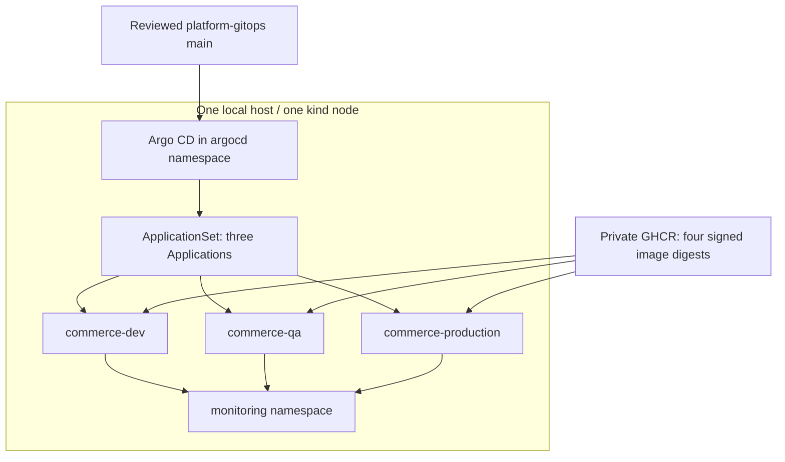
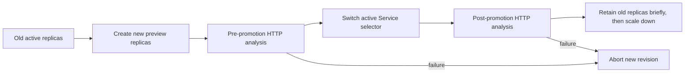

# Narx Commerce — Kubernetes, Helm and Argo CD explained

This is the code-reading and operating guide for the **local** Narx Commerce platform. It follows a request into Kubernetes and a reviewed Git commit through Argo CD, explaining the manifests and controllers involved. It complements [OPERATIONS.md](OPERATIONS.md), which owns the complete fresh-host installation sequence, and [MONITORING.md](MONITORING.md), which explains telemetry and notifications. The separate [GitHub Actions guide PR](https://github.com/Narx-Space-Prod/platform-infrastructure/pull/24) explains source CI and promotion orchestration.

Reviewed against tracked local-project code on 7 November 2026. Commands here are instructions, not a claim that a new installation or recovery drill was executed while writing. No AWS, Jenkins or Original Boutique resource is part of this guide. Current credentials and live health must be checked privately at operation time.

## Contents

1. [Architecture and vocabulary](#1-architecture-and-vocabulary)
2. [Ownership and installation order](#2-ownership-and-installation-order)
3. [The cluster and Cilium files](#3-the-cluster-and-cilium-files)
4. [Namespaces, credentials and RBAC](#4-namespaces-credentials-and-rbac)
5. [Read the Helm chart from the outside in](#5-read-the-helm-chart-from-the-outside-in)
6. [Every service template](#6-every-service-template)
7. [Data, settings, network and smoke templates](#7-data-settings-network-and-smoke-templates)
8. [ApplicationSet and AppProject line by line](#8-applicationset-and-appproject-line-by-line)
9. [Sync, health, hooks and drift](#9-sync-health-hooks-and-drift)
10. [Blue-green delivery and rollback](#10-blue-green-delivery-and-rollback)
11. [Resources, HPA and availability](#11-resources-hpa-and-availability)
12. [Networking and permanent browser access](#12-networking-and-permanent-browser-access)
13. [Render and inspect without deploying](#13-render-and-inspect-without-deploying)
14. [Operate and troubleshoot](#14-operate-and-troubleshoot)
15. [Persistence, restart and recovery](#15-persistence-restart-and-recovery)
16. [Code map, exercises and references](#16-code-map-exercises-and-references)

## 1. Architecture and vocabulary

### 1.1 The physical layout

The tracked kind configuration creates one Docker node containing a Kubernetes control plane and schedulable workloads. Argo CD runs in that dedicated cluster. Dev, QA and Production are **three namespaces on the same node**, not three independent clusters or failure domains.



Each environment has six application roles: frontend, catalogue, cart, Orders API, publisher and worker. There are four independently published images because the last three roles use the Orders image with different configuration. Each namespace has its own PostgreSQL, Redis and ElasticMQ endpoints. Environment-specific Services resolve to their own namespace by default.

A common customer request travels through frontend to catalogue/cart/Orders. Orders owns durable business state. The publisher sends committed outbox events to the queue; the worker consumes them with duplicate-handling logic. Kubernetes keeps processes running; it does not supply business transaction correctness by itself.

### 1.2 Concepts you need before reading YAML

| Concept | Plain meaning | Narx example |
| --- | --- | --- |
| API server | Validates/stores requested cluster state | `kubectl apply` sends resources here |
| Controller | Repeatedly moves observed state toward desired state | Deployment, StatefulSet, Argo controllers |
| Scheduler | Selects a node for a Pod based on constraints and requests | Pending Pod may lack capacity |
| Kubelet | Runs/manages containers and probes on a node | Restarts a failed container |
| Pod | Smallest scheduled application unit | One frontend container plus its volumes |
| ReplicaSet | Maintains a count of equivalent Pods | Created by Deployment or Rollout |
| Deployment | Manages stateless replica revisions | Orders API and Dev frontend |
| StatefulSet | Stable Pod/volume identity for stateful workloads | PostgreSQL and ElasticMQ |
| Service | Stable virtual address and endpoint selection | `commerce-orders:80` |
| EndpointSlice | Ready backend addresses behind a Service | Changes as Pods become ready |
| Namespace | Resource naming/policy boundary | `commerce-qa` |
| ConfigMap | Non-secret configuration | Public origin and local queue mode |
| Secret | Sensitive API object; base64 is not encryption | `commerce-runtime`, `ghcr-pull` |
| PVC / PV | Claim for storage / actual provisioned storage | PostgreSQL's database directory |
| CRD | Adds a resource type to Kubernetes | `Rollout`, `AnalysisTemplate` |
| Custom controller | Implements behavior for custom resources | Argo Rollouts controller |
| Helm chart | Parameterized resource templates | Reusable service chart |
| GitOps | Git is reviewed desired state; controller reconciles it | Argo watches main |

`apiVersion` selects the API group/version; `kind` selects the type; `metadata` identifies it; `spec` declares desired behavior; `status` is controller-reported observation. Do not commit a `kubectl get -o yaml` dump including generated status as a source manifest.

Kubernetes is asynchronous. A successful apply means the API accepted a declaration, not that the application is ready. Controllers, image pulls, scheduling, storage attachment and probes happen afterward.

## 2. Ownership and installation order

Two systems must not manage the same resource independently without an explicit boundary.

| Owner | Resources |
| --- | --- |
| Operator/bootstrap | kind, Cilium, Argo installation, CRDs, namespaces, credentials, scoped Argo registration |
| Platform Helm helper | metrics-server, blackbox exporter, kube-prometheus-stack |
| AppProject/ApplicationSet bootstrap | Narx project and generated Applications |
| Argo application reconciliation | Commerce chart resources in each workload namespace |
| HPA | Replica count for enabled scale targets |
| Rollouts controller | Active/preview selectors and progressive replica lifecycle |
| GitHub delivery code | Verified environment release files and promotion PRs |

The practical dependency order is: host/tools → cluster → CNI → Argo and Rollouts CRDs → namespaces/secrets → monitoring → observer/notifications → verified images/releases → AppProject/ApplicationSet → delivery activation → public access.

Monitoring is useful before rollout so failures are observable. **The current frontend analysis uses HTTP-check Jobs, not Prometheus queries.** Prometheus is important operationally, but its query API is not a direct dependency of `analysis.yaml`'s current provider. This clarifies an older shorthand in OPERATIONS.md.

Use OPERATIONS sections 3–14 for the complete executable bootstrap, including checksum verification and secret preparation. The focused commands below explain each component without pretending they form an independently complete unattended installer.

## 3. The cluster and Cilium files

### `platform-infrastructure/local/kind.yaml`

- `name: narx-commerce` gives context `kind-narx-commerce` and node container `narx-commerce-control-plane`.
- `apiServerAddress: 127.0.0.1` binds host API access to loopback rather than publishing an administrator endpoint to the LAN.
- `apiServerPort: 16443` makes the host endpoint predictable across recreation.
- `disableDefaultCNI: true` means Pods need the chosen CNI installation before normal networking is ready.
- One `control-plane` entry pins Kubernetes 1.34.0 and the node image digest. This saves memory but provides no node-failure tolerance.

A context is a kubeconfig selection of cluster, identity and optional namespace. The context name is not a security boundary; the credential in it determines privileges.

```bash
kubectl config get-contexts
kubectl --context kind-narx-commerce cluster-info
kubectl --context kind-narx-commerce get nodes -o wide
kind get clusters
docker inspect narx-commerce-control-plane --format '{{.State.Status}}'
```

The fresh-host creation command is `kind create cluster --config local/kind.yaml` from infrastructure. Do not run it as a repair action against an existing cluster or delete a node to resolve a transient NotReady state.

### `local/cilium-values.yaml`

Cilium implements Pod networking and enforces policies. The profile uses Kubernetes-assigned Pod CIDRs, keeps kube-proxy (`kubeProxyReplacement: false`), runs one operator replica and pins resource budgets. Hubble and Envoy are disabled because L3/L4 policy enforcement does not require their UI/proxy components.

Installing a NetworkPolicy object without an enforcing CNI does not isolate traffic. Conversely, working DNS does not prove every application connection is allowed.

```bash
kubectl --context kind-narx-commerce -n kube-system get daemonset cilium
kubectl --context kind-narx-commerce -n kube-system get pods -l k8s-app=cilium
helm status cilium --kube-context kind-narx-commerce -n kube-system
kubectl --context kind-narx-commerce get ciliumnetworkpolicies --all-namespaces
```

The reviewed Cilium archive is checksum-verified before installation; consult OPERATIONS section 7 for the exact download/hash/upgrade sequence. A chart version and a container image version are related but distinct artifacts.

## 4. Namespaces, credentials and RBAC

### Bootstrap operations

`local/bootstrap.py prepare` creates one of the three allowed namespaces with restricted Pod Security enforcement pinned to v1.34. It creates `commerce-runtime` only if missing, preserving existing database/session credentials. It also declares `commerce-capacity` quota: 1536 Mi memory requests, 3 Gi memory limits, 30 Pods and 4 Gi storage requests per namespace.

Quota is a namespace ceiling, not reserved host memory. Three namespaces can each remain below quota while together exhausting the host. A rejected quota admission differs from a successfully admitted but unschedulable Pod.

`refresh-registry` creates `ghcr-pull`, a `kubernetes.io/dockerconfigjson` Secret. It requires a private token file outside the repository with owner-only permissions. This credential is for private image reads, not publishing. It must be rotated before expiry in all intended namespaces.

`register-cluster` creates the `narx-system/argocd-manager` ServiceAccount, namespaced Roles/RoleBindings, a service-account token Secret and an Argo cluster-registration Secret. It registers alias `narx-local` with CA verification enabled and only the three workload namespaces.

The Roles grant broad namespaced resource verbs, while the AppProject further limits what applications can request. This is namespace administration, not per-resource least privilege. The persistent service-account token is a documented local tradeoff requiring private storage/rotation; it is not a short-lived operator login.

```bash
# Read object names and policy; these commands do not print Secret values.
kubectl --context kind-narx-commerce get namespaces --show-labels
kubectl --context kind-narx-commerce -n commerce-qa get resourcequota commerce-capacity
kubectl --context kind-narx-commerce -n commerce-qa describe resourcequota commerce-capacity
kubectl --context kind-narx-commerce -n commerce-qa get role,rolebinding
kubectl --context kind-narx-commerce -n commerce-qa get secrets -o name
kubectl --context kind-narx-commerce auth can-i create deployments \
  --as=system:serviceaccount:narx-system:argocd-manager -n commerce-qa
kubectl --context kind-narx-commerce auth can-i create namespaces \
  --as=system:serviceaccount:narx-system:argocd-manager
```

The impersonation commands require operator permission to impersonate; failure to impersonate is not a test of the ServiceAccount's own rights. Never print cluster-registration Secret contents into a public diagnostic report.

### Secret and configuration updates

Environment variables are captured at container creation. Editing a Secret does not automatically restart every consuming application. Changing `DATABASE_PASSWORD` also does not alter an initialized PostgreSQL database user; coordinate database and client credential rotation. The chart includes a public-access checksum annotation to roll affected Pods when public origin/cookie settings change, but this is not a generic checksum for every Secret.

Optional payment Secret keys do not guarantee functioning payment integration. Test/live provider mode and proof verification are application concerns; never put live provider keys into chart values.

## 5. Read the Helm chart from the outside in

### File and values hierarchy

`charts/commerce/Chart.yaml` declares six aliases of the same local `commerce-service` dependency. Each alias has an `enabled` condition. `Chart.lock` records dependency resolution; `charts/commerce/charts/commerce-service-0.1.0.tgz` is the packaged dependency consumed by the parent. Editing the sibling service templates without rebuilding/checking the package can leave the umbrella rendering old templates.

The active Application merges values in this order:

```text
commerce-service defaults, per alias
    + commerce/values.yaml role overrides
    + environments/ENV/runtime.yaml
    + environments/ENV/release.json
    = rendered environment resources
```

Later supplied values override earlier values for the same key. `global` values are propagated to subcharts. Arrays such as `env` need particular care because overlay replacement is not element-by-name merging.

`environments/ENV/values.yaml` exists for other chart-validation/capacity configuration paths, but **is not listed in the active local Application's valueFiles**. Do not change that file and assume Argo consumed it. Always inspect the Application source and actual rendered output.

### What belongs in each file

| File | Responsibility |
| --- | --- |
| `charts/commerce-service/Chart.yaml` | Reusable chart identity/version |
| `charts/commerce-service/values.yaml` | Workload defaults and feature toggles |
| `charts/commerce-service/values.schema.json` | Values shape/constraints before rendering |
| `charts/commerce/values.yaml` | Six role definitions, env references, base budgets and local data images |
| `environments/ENV/runtime.yaml` | Local topology, origin, cookies, HPA/rollout choices |
| `environments/ENV/release.json` | Verified immutable component bundle, enabled roles and predecessor |
| `charts/commerce/Chart.lock` | Dependency lock |
| Dependency `.tgz` | Vendored module used during parent rendering |

The default release is not ready and roles default disabled. A bootstrap-empty Application can be Synced/Healthy while no storefront runs. `release.ready`, full release ID and verified image facts are prerequisites for a real release.

The release ID identifies the complete canonical component bundle. It is not the same as the GitOps commit SHA or one component's source commit. A Pod image digest identifies bytes; a GitOps SHA identifies desired-state history; a source SHA identifies code. Correlate all three when diagnosing delivery.

### Read Helm expressions

`{{ ... }}` evaluates template expressions; `.Values` accesses merged input; `.Release` contains rendering identity. `if` conditionally emits a resource; `range` repeats it; `include` calls a named helper; `toYaml | nindent` serializes and indents nested values. `required` and `fail` stop rendering instead of producing a dangerous partial default. Quoting protects scalar interpretation, but does not make untrusted input safe by itself.

`_helpers.tpl` computes a deterministic name capped at 63 characters. The alias becomes the chart name used in labels. `fullnameOverride` sets names such as `commerce-orders`. Changing selectors or names can recreate resources, break traffic or detach storage; review them as identity changes.

## 6. Every service template

### `templates/deployment.yaml`

This emits either an `apps/v1 Deployment` or an `argoproj.io/v1alpha1 Rollout`, depending on `progressive.enabled`. These are alternative owners of replica revisions, not two controllers simultaneously managing one Deployment.

| Field | Meaning in the current chart |
| --- | --- |
| Sync wave | Orders dependency-aware application order |
| `replicas` | Set only when HPA is disabled |
| `revisionHistoryLimit: 3` | Bounds retained replica revisions, not database backups |
| `progressDeadlineSeconds: 600` | Deadline for progression reporting, not ten minutes of guaranteed availability |
| Deployment `maxSurge: 1` | Allows one extra Pod during rolling update |
| Deployment `maxUnavailable: 0` | Requests no planned unavailable replica during update |
| Selector and Pod labels | Bind controller and Service to intended Pods |
| Image `repository@digest` | Immutable runtime identity |
| `imagePullPolicy: IfNotPresent` | Reuse matching local content; safe identity comes from digest |
| `terminationGracePeriodSeconds: 30` | Time for graceful container termination before forced kill |

Zero maxUnavailable does not create spare capacity. With insufficient RAM, the extra Pod can remain Pending and rollout stalls rather than evicting the old healthy instance by design.

The template omits the release ID from Pod annotations while retaining it on the workload metadata. A bundle metadata change alone should not restart unchanged image roles. Public-access configuration is separately hashed for roles consuming those settings, so an origin/cookie change causes the required restart.

The Pod runs UID/GID 10001, requires non-root, uses RuntimeDefault seccomp and disables automatic API-token mounting. The container drops all capabilities, blocks privilege escalation and mounts its root filesystem read-only. A bounded `/tmp` emptyDir provides required writable space. These constraints reduce impact; they do not make application code invulnerable.

### Probes

Startup probes call the liveness path every two seconds with threshold 150, allowing a nominal roughly five-minute startup budget plus timing effects. Readiness/liveness do not run until startup succeeds. Readiness checks every five seconds with three-failure threshold; liveness every ten seconds with three-failure threshold. Each request can wait up to five seconds.

A readiness failure removes the Pod from regular Service traffic; it does not directly restart the container. Liveness/startup failure can restart it. Probes must distinguish “temporarily cannot serve” from “process needs restart.” A dependency outage checked too aggressively by liveness can create a restart storm.

`Running` is a Pod phase, not readiness. A process may be Running but unable to authenticate to the database or answer a request. Always inspect readiness, restart count and events together.

### `templates/service.yaml`

The main Service is ClusterIP and maps a stable service port (normally 80) to named container port `http`. Named target ports let different roles use 8080/8081/8082/8083 without changing consumer URLs. Selector labels must match the Pod labels.

Progressive mode adds a `-preview` Service. The Rollouts controller adds revision-hash selectors to active/preview Services to control traffic. Argo ignores precisely that controller-managed selector field; it must not repeatedly reset it.

### `templates/serviceaccount.yaml`

Each role gets its own ServiceAccount, with optional annotations and `automountServiceAccountToken: false`. An identity object alone grants no useful API permission. Normal application Pods do not need Kubernetes administrator credentials to contact HTTP Services or PostgreSQL.

### `templates/hpa.yaml`

The HPA targets either Deployment or Rollout using `autoscaling/v2`. CPU utilization is measured relative to requested CPU. At a 25m request and 70% target, a sustained average around 17.5m corresponds to that utilization target; this is not 70% of an entire CPU core.

Scale-up permits one Pod per 60 seconds with no stabilization delay. Scale-down permits one per 60 seconds after a 300-second stabilization window. The template rejects maxReplicas below minReplicas. HPA depends on the Metrics API and realistic resource requests, not Grafana availability.

### `templates/pdb.yaml`

A PodDisruptionBudget protects against selected voluntary evictions. Production frontend has `minAvailable: 1`. It does not prevent node failure, OOM kill, every direct deletion or a broken application release. A PDB on one node does not create high availability and may block a drain until capacity is available.

### `templates/analysis.yaml`

This creates an AnalysisTemplate only for progressive workloads. It uses the exact frontend image to run Node assertions against a supplied preview/active URL. It checks readiness, storefront HTML and a nonempty INR catalogue with positive prices, requiring three successful rounds with retries bounded by its deadline.

The analysis has one metric, zero tolerated failures, a Job with no retry, a 120-second active deadline and a one-hour TTL. It is a focused release gate, not a production load test, external synthetic or payment settlement test. See section 10 for pre/post-promotion use.

## 7. Data, settings, network and smoke templates

### `commerce/templates/data.yaml`

This renders only for a ready release with local data enabled. A wave -2 ConfigMap declares ElasticMQ's H2-backed message store and queues. The primary queue has a 60-second visibility timeout, ten-second long poll and DLQ after five receives. These are cluster values; the disposable CI business fixture uses its own settings.

PostgreSQL is a one-replica StatefulSet with a 1 Gi `database` PVC, constrained shared buffers/connections, credentials from `commerce-runtime` and `pg_isready` probes. Initialization credentials apply on an empty data directory; an existing database retains its own users/passwords.

Redis is a Deployment. Inspect its command/volumes before assuming a cart survives process/node recreation: the current template does not provide the same durable PVC contract as PostgreSQL. ElasticMQ is a one-replica StatefulSet with a 1 Gi data claim for its local H2 state. These are local substitutes, not managed highly available database/queue services.

All three have stable Services and wave -1 ordering. `ReadWriteOnce` describes attachment/access constraints, not backup, encryption or replication. kind's `standard` storage is tied to the local node's lifetime.

### `commerce/templates/settings.yaml`

This builds `commerce-settings` at wave -2. Public origin and secure cookie settings come from `global.publicAccess` when supplied, otherwise chart defaults. It also sets local delivery mode, queue endpoint and region.

Managed-data branches reject missing HTTPS/secure-cookie/region/private-CIDR prerequisites. Those retained branches do not mean AWS resources are created by this local chart. A declared `awsRegion` string is configuration, not an AWS deployment.

### `commerce/templates/network.yaml`

The environment-wide policy selects all Pods. It permits same-namespace traffic, monitoring ingress to selected application ports, DNS egress and public HTTPS egress excluding private IPv4 ranges. Optional external data CIDRs allow specific database/cache ports. Cross-environment application traffic is not broadly allowed.

This is useful namespace isolation, but same-namespace traffic remains broad. Public HTTPS is not restricted to an explicit provider-domain allowlist, and IPv6 behavior requires separate review if enabled. A policy is not a complete authentication scheme.

A selected Cilium policy lets namespaced Rollouts controllers reach the Kubernetes API entity on ports 443/6443. This avoids hardcoding an ephemeral API IP in the active local mode. The fallback CIDR path is retained for other reviewed configurations.

### `commerce/templates/rollouts-controller.yaml`

This packages a digest-pinned namespaced Rollouts controller and its ServiceAccount, Role/RoleBinding and Deployment. It starts before ordinary workloads and watches its namespace. QA and Production enable it; Dev does not need it for plain Deployments. CRDs remain cluster bootstrap responsibilities, because AppProject forbids cluster-scoped resources.

Do not apply the upstream full Rollouts installation on top without reviewing controller ownership. Two controllers reconciling the same Rollout can cause confusing races and permissions.

### `commerce/templates/smoke.yaml`

A wave -2 ConfigMap holds a Node smoke script. The PostSync Job uses the exact frontend image, checks readiness of all six roles, catalogue validity and the frontend page, and prints the full release ID on success. It has no retries, a 180-second job deadline and an internal bounded retry loop.

`BeforeHookCreation,HookSucceeded` removes successful jobs and allows the next hook instance. Failed hooks can remain for diagnosis. A successful job may no longer appear in `kubectl get jobs`; inspect Argo operation results for durable sync evidence.

PostSync runs after resources have reached the appropriate healthy sync state. Its success is required by the observer's healthy notification, making “objects applied” different from “release verified.” This smoke is narrower than CI's isolated checkout/payment/refund/queue business suite.

## 8. ApplicationSet and AppProject line by line

Read `platform-gitops/applications/local/commerce.yaml`. The file contains two ordinary YAML documents separated by `---`: an AppProject and an ApplicationSet.

### AppProject `narx-commerce-local`

- `sourceRepos` permits the exact GitOps repository.
- `destinations` permits alias `narx-local` in only the three workload namespaces.
- `clusterResourceWhitelist: []` prevents application charts from creating cluster resources.
- `namespaceResourceWhitelist` enumerates allowed workloads, Services, claims, policies, RBAC, Rollouts and analyses.
- `orphanedResources.warn` exposes unmanaged objects, with narrow exceptions for bootstrap Argo manager Roles/Bindings.

An AppProject is Argo policy, not a Kubernetes Namespace or RBAC Role. It complements the actual ServiceAccount permissions. Expanding it to `*` merely to resolve one denied resource weakens review boundaries.

### ApplicationSet generator

The list generator has `dev`, `qa`, `production`; Go templates require missing keys to fail rather than substitute empty values. It generates `narx-commerce-ENV` Applications labeled with their environment and subscribed to deployment status/Slack notifications.

Each Application points to main, chart `charts/commerce`, release name `commerce`, runtime.yaml followed by release.json, and destination namespace `commerce-ENV`. This is how one reusable chart becomes three desired states.

ApplicationSet policy is `applicationsSync: create-update` with `preserveResourcesOnDeletion: true`. It limits deletion behavior and preserves workloads on relevant generated-Application deletion paths. This is **not** universal protection against explicit namespace/PVC deletion or destructive Git changes. Inspect finalizers and ownership before deleting anything.

Generated Applications should be changed through the generator/template. Editing a generated child directly can be overwritten by ApplicationSet reconciliation.

## 9. Sync, health, hooks and drift

### Sync policy

`automated.prune: true` removes resources no longer in desired manifests. `selfHeal: true` repairs live drift. `allowEmpty: false` guards against automatically deleting an entire application because desired output became empty. Server-side apply uses API field ownership; `PruneLast=true` defers pruning; `RespectIgnoreDifferences=true` respects the narrow ignored controller-owned fields during sync.

The configured sync retry is three retries with ten-second initial backoff, factor two, capped at one minute. This is not unlimited retry until any failure disappears.

Ignored differences include Rollouts' Service hash selector, controller-generated StatefulSet volume-claim status and frontend Rollout replica count. These avoid fighting legitimate controllers. Do not ignore entire specs to conceal a real drift problem.

### Sync versus health

| Sync | Health | Interpretation |
| --- | --- | --- |
| Synced | Healthy | Desired resources match and health checks pass; inspect smoke evidence too |
| Synced | Progressing | Desired revision applied, controllers still progressing |
| Synced | Degraded | Applied desired state is unhealthy |
| OutOfSync | Healthy | Old/live resources may serve, but differ from Git |
| Unknown | Unknown | Comparison/access/rendering failure may prevent assessment |

Argo does not build an image on merge. It renders Git and applies resources. Kubernetes pulls the digest, controllers create Pods, probes/analyses/smoke establish health, then the observer reports evidence to GitHub.

### Waves and webhook

Wave -2 config/RBAC/network prerequisites precede wave -1 data/controller resources; Orders begins at wave 0, catalogue/cart at 1, publisher at 3, worker at 4 and frontend at 5. Waves are ordered within an Application, not a global transaction across all environments.

The signed GitHub push webhook at `/api/webhook` accelerates refresh. Polling still provides reconciliation behavior; the webhook is not itself authorization to deploy unreviewed source. Its secret and public route must be configured properly. A refresh requests comparison; a sync mutates cluster state. Neither is the same as a source CI rerun.

### Deployment evidence

`applications/notifications.yaml` defines pending/success/failure GitHub statuses on the actual operation revision. Success requires a successful operation, Synced/Healthy state and successful PostSync smoke-hook evidence, not just a green health badge. The dedicated observer identity is checked by delivery code.

The pipeline waits for that exact trusted evidence; Jenkins is uninvolved. Slack delivery summaries are separate and their failure must not be mistaken for a healthy Kubernetes proof. See MONITORING.md for trigger/template fields and transport troubleshooting.

## 10. Blue-green delivery and rollback

QA and Production frontend use blue-green, while other roles use rolling Deployments. The lifecycle is:



`autoPromotionEnabled: true` means the controller promotes after successful pre-analysis; GitHub Production approval happened before this release reached Production Git. It does not require a second manual Rollouts promotion.

The chart sets a 180-second old-replica scale-down delay, one retained scale-down revision and a 30-second abort scale-down delay. Extra replicas temporarily increase resource requirements. Pre/post analysis targets preview/active Services respectively.

Controller abort/traffic recovery and GitOps rollback are different layers. The former reacts to rollout analysis while retaining revision state; the latter proposes the previously verified bundle as a reviewed Git change. The recovery workflow automatically proposes QA/Production recovery from current trusted failure evidence; Production review still applies. Do not promise every failed rollout instantly restores every service and database.

Read-only inspection:

```bash
kubectl --context kind-narx-commerce -n commerce-qa get rollouts,analysisruns,analysistemplates
kubectl --context kind-narx-commerce -n commerce-qa describe rollout commerce-frontend
kubectl --context kind-narx-commerce -n commerce-qa get replicasets,pods -o wide
kubectl --context kind-narx-commerce -n commerce-qa get service commerce-frontend commerce-frontend-preview -o yaml
kubectl --context kind-narx-commerce -n commerce-qa get analysisruns --sort-by=.metadata.creationTimestamp
```

Use the inspected AnalysisRun/Job name for logs. A failed analysis needs its Job output and target revision, not just the Rollout phase. Do not manually promote a failed analysis to hide the failure. For a deliberate abort/retry/rollback drill, use an approved procedure and record both live action and resulting desired-state correction.

## 11. Resources, HPA and availability

### Current active frontend settings

| Environment | Controller | HPA | Replicas | PDB |
| --- | --- | --- | --- | --- |
| Dev | Deployment | Disabled | Base chart default 1 | Disabled |
| QA | Rollout | Enabled, CPU 70% | Min 1, max 2 | Disabled |
| Production | Rollout | Enabled, CPU 70% | Min 2, max 3 | Min available 1 |

These values come from active runtime overlays and defaults, not a promise of current live replica counts. HPA controls enabled target replicas; removing a hardcoded `replicas` avoids Argo fighting it. The narrowly scoped ignore field is an additional protection for the frontend Rollout.

CPU requests affect scheduling and CPU utilization percentages; CPU limits can throttle. Memory requests affect scheduling; limits can cause OOM termination. Neither a request nor a quota is a minimum amount of host RAM permanently dedicated to the container.

Orders API and background roles have Java heaps, metaspace, thread stacks and native memory inside their container budgets. A higher CPU limit can reduce startup time but does not create additional memory. Lowering requests to make scheduling green can overcommit the host and worsen actual reliability.

```bash
kubectl --context kind-narx-commerce top nodes
kubectl --context kind-narx-commerce -n commerce-production top pods --containers
kubectl --context kind-narx-commerce -n commerce-production get hpa,pdb
kubectl --context kind-narx-commerce -n commerce-production describe hpa commerce-frontend
kubectl --context kind-narx-commerce get --raw /apis/metrics.k8s.io/v1beta1/nodes
free -h
vmstat 1 5
docker stats --no-stream
```

`<unknown>` HPA metrics means inspect Metrics API, CPU requests and readiness; it does not automatically mean the application has no traffic. Missing metrics can change scaling decisions. HPA scales Pods within existing node capacity; it does not add kind nodes or host RAM.

One node hosting three environments, databases and monitoring is a learning topology. Multiple replicas on that node help process-level failures but all disappear with host/node failure. Adding another Docker worker on the same laptop does not create a second physical failure domain or more total RAM.

## 12. Networking and permanent browser access

There are several distinct hops:

```text
Browser HTTPS hostname
    → Cloudflare Tunnel / access control
    → host loopback forwarded port
    → Kubernetes Service
    → ready Pod endpoint
```

The tracked setup uses port-forward services and a tunnel, not an application Ingress controller/ALB. The absence of an Ingress object is consistent with this chosen local exposure path; it is not evidence of AWS ingress deployment.

`local/access.json` maps Dev/QA/Production to loopback 18080/18081/18082. Grafana uses 13000, Prometheus 19090 and Alertmanager 19093. Argo has its own TLS forward. `local/narx-access@.service` and `local/narx-argocd-forward.service` make forwards restartable; their configured executable/kubeconfig paths must match the host.

Public HTTPS does not imply the loopback origin speaks HTTPS. Grafana/Prometheus/Alertmanager origins are HTTP in this mapping; Argo's TLS endpoint uses HTTPS. A mismatched tunnel origin scheme commonly causes 502. Public hostname DNS, tunnel health, loopback listener and Kubernetes readiness must be diagnosed independently.

```bash
systemctl status narx-access@dev.service --no-pager
systemctl status narx-argocd-forward.service --no-pager
ss -lnt | grep -E ':(18080|18081|18082|13000|19090|19093|8080) '
curl --fail http://127.0.0.1:18080/health/ready
journalctl -u narx-access@dev.service -n 60 --no-pager
```

A secure cookie will not behave like an ordinary cookie over a plain HTTP remote browser origin. Use the configured HTTPS hostname for the normal app journey. `localhost` in your browser means your browsing machine, not the headless Linux host; use SSH forwarding for private access if needed.

Place authentication/access controls in front of administrative UIs. A tunnel establishes connectivity; it is not automatically authorization for every Internet user. Prometheus/Alertmanager must not be treated as public unauthenticated operational APIs.

## 13. Render and inspect without deploying

Run from the GitOps repository. Helm is required; these commands render to a temporary directory and do not contact Kubernetes:

```bash
NARX_RENDER_DIR=$(mktemp -d /tmp/narx-render.XXXXXX)
chmod 700 "$NARX_RENDER_DIR"
helm dependency build charts/commerce
helm lint charts/commerce -f environments/qa/runtime.yaml -f environments/qa/release.json
helm template commerce charts/commerce --namespace commerce-qa --kube-version 1.34.0 \
  -f environments/qa/runtime.yaml -f environments/qa/release.json > "$NARX_RENDER_DIR/qa.yaml"
grep -n '^kind:\|^  name:\|image:' "$NARX_RENDER_DIR/qa.yaml"
git status --short
```

`helm dependency build` can update a local packaged dependency; review `git status` and generated archive changes before committing. To test only the current tracked package without regenerating it, omit that command. Never run a blanket `git add .` after a render without reviewing files.

For local policy tests with an existing Python environment/PyYAML installed:

```bash
python3 -m unittest discover -s tests -p 'test_platform.py' -v
python3 -m unittest discover -s tests -p 'test_rollout_local.py' -v
python3 -m unittest discover -s tests -p 'test_delivery.py' -v
```

Tests can assert template contracts and rejection cases but do not prove real CNI enforcement, startup under load or storage recovery. CI's core schema version currently differs from the kind version; render with the actual Kubernetes version and check API support before adopting new fields.

A server-side dry-run asks the live API/admission stack to validate without persisting. It is not purely offline and needs appropriate credentials. Do it only after reviewing rendered output and context. `kubectl diff` also contacts the cluster and returns exit code 1 for differences, which is not a generic crash.

## 14. Operate and troubleshoot

### First five checks

```bash
kubectl --context kind-narx-commerce get nodes
kubectl --context kind-narx-commerce -n argocd get applications
kubectl --context kind-narx-commerce -n commerce-qa get pods,deployments,statefulsets,rollouts
kubectl --context kind-narx-commerce -n commerce-qa get events --sort-by=.lastTimestamp
kubectl --context kind-narx-commerce -n commerce-qa get pvc,services,endpointslices
```

Then inspect the first failing layer rather than reinstalling everything:

| Symptom | Evidence | Common distinction |
| --- | --- | --- |
| Pod Pending | `describe pod`, node allocatable, quota/PVC events | Scheduling capacity versus storage binding |
| ImagePullBackOff | Pod events, digest, pull Secret metadata/expiry | Missing package access versus nonexistent digest |
| CrashLoopBackOff | Previous container logs and termination reason | Application exception versus OOM versus probe failure |
| Running but unready | Probe events and dependency connectivity | Process exists but cannot serve |
| Service no traffic | Selector, EndpointSlice, readiness, ports | DNS resolution alone is insufficient |
| Argo comparison error | App conditions/repo-server logs | Render/auth/API schema problem before apply |
| Argo Synced/Degraded | Resource tree, Rollout analysis, smoke result | Correct desired revision can still be broken |
| Argo OutOfSync | Desired/live diff, ignored fields, webhook/controller | Drift is not automatically an image-cache problem |
| HPA unknown | Metrics API and requests | Prometheus up does not prove Metrics API |
| DB authentication failure | Client Secret rotation and existing DB users | Reapplying initialization env does not rotate DB user |

Targeted read-only commands (replace `POD_NAME` with an inspected name):

```bash
kubectl --context kind-narx-commerce -n commerce-qa describe pod POD_NAME
kubectl --context kind-narx-commerce -n commerce-qa logs POD_NAME --tail=100
kubectl --context kind-narx-commerce -n commerce-qa logs POD_NAME --previous --tail=100
kubectl --context kind-narx-commerce -n commerce-qa get pod POD_NAME \
  -o jsonpath='{range .status.containerStatuses[*]}{.name}{" "}{.restartCount}{" "}{.lastState.terminated.reason}{"\n"}{end}'
kubectl --context kind-narx-commerce -n argocd get application narx-commerce-qa \
  -o jsonpath='{.status.sync.revision}{"\n"}{.status.sync.status}{"\n"}{.status.health.status}{"\n"}'
kubectl --context kind-narx-commerce -n argocd logs deployment/argocd-repo-server --tail=100
```

Logs can contain customer data or accidental secrets; inspect privately and redact before sharing. `--previous` is meaningful only if a previous container instance exists. Do not execute broad Secret dumps to diagnose an image pull.

### Argo CLI inspection

After private login using the operational guide:

```bash
argocd app list --project narx-commerce-local
argocd app get narx-commerce-qa
argocd app history narx-commerce-qa
argocd app manifests narx-commerce-qa
```

Manifest output can include configuration; treat it appropriately. Argo refresh/sync commands are intentionally not presented as a normal substitute for automatic reconciliation. If automatic operation is broken, find why; repeated manual syncs can mask webhook, permission or health problems.

### Explain what to change

For a runtime image issue, fix source through CI and promotion or use reviewed recovery. For a chart issue, fix GitOps templates/values through PR. For an installer/controller issue, fix tracked infrastructure configuration and perform the approved upgrade. A one-off live edit with self-heal enabled will often be reverted and leave no durable explanation.

## 15. Persistence, restart and recovery

Git stores desired state; GHCR stores images/signatures; Secrets store credentials; PVCs store business data. Rebuilding one does not automatically rebuild the others.

A container restart normally retains attached persistent data. An emptyDir survives container restarts within a Pod but not replacement of that Pod. A StatefulSet PVC has its own lifecycle, and PV reclaim policy plus kind node lifetime matter. Deleting the kind node can lose local storage regardless of Application preservation settings.

Before a session stop, record health/revisions and make validated database backups. OPERATIONS section 17 contains private backup and disposable restore commands; use that procedure rather than redirecting an example restore at Production. PostgreSQL logical backup consistency does not guarantee a consistent snapshot of an actively written ElasticMQ/H2 file. Account for outbox/inbox state and replay semantics.

Read-only storage inventory:

```bash
kubectl --context kind-narx-commerce get storageclass
kubectl --context kind-narx-commerce get pv
kubectl --context kind-narx-commerce -n commerce-production get pvc -o wide
kubectl --context kind-narx-commerce -n commerce-production get statefulsets -o yaml
```

Do not assume the lab has a dynamic AWS CSI driver or off-host replicated volumes. The active local storage class is `standard`. A backup on the same laptop disk is useful for logical mistakes but cannot recover a lost disk.

Application rollback is not database restore. Backward-compatible migrations and expand/contract changes are necessary when old and new application versions overlap. No rollout strategy makes dropping a required database column automatically reversible.

## 16. Code map, exercises and references

### Supporting files not to confuse

- `schemas/argo/*.json`: offline validation schemas, **not** CRD installation manifests.
- `schemas/argo/source.json`: reviewed upstream version/asset provenance for Rollouts APIs.
- `tests/kubernetes/hpa-load.yaml`: deliberate load-drill fixture; applying it generates load, so it is not a harmless health-check command.
- `local/compose.yaml` and `.env.example`: disposable/developer preview definitions, not Kubernetes desired state. A private `.env` is not documentation input.
- `policy/builders.json` and delivery Python: image trust/promotion policy, explained in the CI/CD guide.
- `local/argocd.json`: reviewed Argo manifest pin and webhook route.
- `local/argocd-metrics.yaml`: NodePort metrics Service and ingress policy; see monitoring guide for its legacy target issue.
- `local/access.json` and systemd units: host access mapping and process supervision.

### Learning exercises

1. Render QA and identify every resource created by one frontend alias.
2. Follow one Service selector to its ready EndpointSlice and Pod digest.
3. Explain the difference between source SHA, GitOps SHA, image digest and release ID using one release.
4. Locate the active Application value files and prove why changing a different overlay may do nothing.
5. Calculate HPA CPU target from the frontend request and explain why lowering requests changes scaling behavior.
6. Find an AnalysisRun and distinguish preview failure from PostSync smoke failure.
7. Explain exactly which credential lets Argo create a Deployment but not a CRD.
8. Describe what survives a container restart, Pod replacement, namespace deletion and kind node deletion.
9. Inspect a policy and draw allowed DNS, service, monitoring and API traffic.
10. Plan a backward-compatible database migration before attempting rollback.

Use read-only inspection first. Load, abort, restore, scale-down and failure drills change availability and need a deliberate test window. A learner becomes operationally capable by explaining evidence and handling controlled failures, not by memorizing YAML alone.

### Primary references

- [Kubernetes Pods and lifecycle](https://kubernetes.io/docs/concepts/workloads/pods/pod-lifecycle/)
- [Kubernetes probe semantics](https://kubernetes.io/docs/concepts/workloads/pods/probes/)
- [Horizontal Pod Autoscaling](https://kubernetes.io/docs/tasks/run-application/horizontal-pod-autoscale/)
- [NetworkPolicy](https://kubernetes.io/docs/concepts/services-networking/network-policies/)
- [Persistent volumes](https://kubernetes.io/docs/concepts/storage/persistent-volumes/)
- [Argo automated sync](https://argo-cd.readthedocs.io/en/stable/user-guide/auto_sync/)
- [Argo 3.5 sync waves and hooks](https://argo-cd.readthedocs.io/en/release-3.5/user-guide/sync-waves/)
- [Argo Rollouts blue-green](https://argo-rollouts.readthedocs.io/en/stable/features/bluegreen/)
- [Helm chart structure](https://helm.sh/docs/topics/charts/)

These describe platform semantics. The tracked pins and actual live evidence determine which behavior is deployed in this project.
