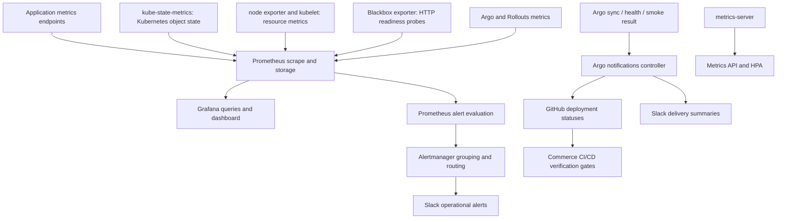

# Narx Commerce — monitoring, alerting and delivery notifications

This guide explains the local project's telemetry architecture, every monitoring configuration file, the Python installer, PromQL, dashboards, alerts and GitHub/Slack delivery evidence. It is designed to teach you how to operate the system and reason about failures, rather than memorize screenshots.

Read alongside [OPERATIONS.md](OPERATIONS.md) for fresh-host installation and private credential handling, and [KUBERNETES_ARGOCD.md](KUBERNETES_ARGOCD.md) for workload/controller behavior. Source CI and promotion orchestration are documented in the separate [GitHub Actions guide PR](https://github.com/Narx-Space-Prod/platform-infrastructure/pull/24).

Scope: the six local Narx Commerce repositories, reviewed 7 November 2026. This documentation change does not install charts, query live health, send Slack messages or operate AWS. Tracked configuration is evidence of intent; installed configuration and actual delivery need separate verification.

## Contents

1. [Architecture and the questions each tool answers](#1-architecture-and-the-questions-each-tool-answers)
2. [Concepts: metrics, logs, labels and alerts](#2-concepts-metrics-logs-labels-and-alerts)
3. [Every configuration file and its owner](#3-every-configuration-file-and-its-owner)
4. [Understand the Python installer](#4-understand-the-python-installer)
5. [Base platform values](#5-base-platform-values)
6. [Every scrape job and relabeling rule](#6-every-scrape-job-and-relabeling-rule)
7. [PromQL through project examples](#7-promql-through-project-examples)
8. [Grafana and every dashboard panel](#8-grafana-and-every-dashboard-panel)
9. [Every Narx alert](#9-every-narx-alert)
10. [Alertmanager to Slack](#10-alertmanager-to-slack)
11. [Argo deployment evidence and delivery Slack](#11-argo-deployment-evidence-and-delivery-slack)
12. [Install, upgrade and validate](#12-install-upgrade-and-validate)
13. [Troubleshooting by layer](#13-troubleshooting-by-layer)
14. [Capacity, retention and security](#14-capacity-retention-and-security)
15. [Known gaps and realistic guarantees](#15-known-gaps-and-realistic-guarantees)
16. [Exercises and primary references](#16-exercises-and-primary-references)

## 1. Architecture and the questions each tool answers



There are three distinct paths:

1. **Observability:** metrics → Prometheus → Grafana/alerts → Alertmanager → Slack.
2. **Delivery evidence:** Argo operation/health/smoke → observer GitHub statuses → master gates, plus separate Slack summaries.
3. **Autoscaling:** kubelet resource data → metrics-server → Kubernetes Metrics API → HPA.

Grafana is not the metrics collector. Alertmanager does not execute PromQL. Prometheus does not approve a Production PR. Metrics-server is not the historical Prometheus database. Distinguishing these prevents ineffective fixes, such as restarting Grafana when HPA cannot read CPU.

A green process metric does not prove checkout succeeds. A readiness probe does not prove payment correctness. The isolated business suite and rollout/smoke gates cover other layers. The current rollout analysis uses HTTP-check Jobs, not a Prometheus-query provider.

## 2. Concepts: metrics, logs, labels and alerts

### Metrics

A metric is a timestamped numeric observation identified by a name and labels. A counter increases until process reset (`..._total`); a gauge can rise/fall (pending outbox events); a histogram records counts in buckets to estimate a distribution (request latency).

Example series identity:

```promql
commerce_outbox_pending{project="narx-commerce",environment="production",service="publisher",role="publisher"}
```

`project` prevents accidentally mixing another lab's data. `environment` distinguishes Dev/QA/Production. `service` identifies the runtime role; `pod` identifies one instance. A metric name containing `boutique_` is a retained application instrumentation prefix, not proof that the metric came from the separate Boutique deployment. The project/namespace/source scrape determines identity.

Labels multiply series count. Never add customer email, payment proof, order ID or request ID as unbounded metric labels. Use appropriately redacted logs/traces for detailed per-request correlation.

### Logs and traces

Logs record discrete events; traces connect spans across a request. This tracked platform chart inventory does **not** install Loki/log shippers or a tracing backend. A dashboard logs panel alone cannot provide centralized logs. Use `kubectl logs` for current local inspection unless an independently verified Narx logging backend is configured.

Pod logs are not automatically retained after Pod/node deletion. A production retention/audit policy cannot be inferred from Kubernetes container logs. No end-to-end distributed tracing guarantee is made here.

### Alert lifecycle

A rule's expression selects problematic series. `for` requires the condition to remain active across evaluations before firing. Pending means the expression is true but the duration has not elapsed; firing means it has. Alertmanager then groups/routes firing alerts and sends notifications.

An empty query result is **not zero**. It can mean no matching targets, a changed label, missing instrumentation or deleted Pods. An alert like `up == 0` detects a known failing target, but may not detect a target that vanished entirely from discovery. Absence detection needs explicit design.

A silence suppresses notifications for matched alerts; it does not repair the service or necessarily remove the firing state. Acknowledgement and incident ownership are human operational responsibilities.

## 3. Every configuration file and its owner

| File | What to read it for |
| --- | --- |
| Infrastructure `local/observability-charts.json` | Three platform chart releases, versions, sources, checksums and value files |
| `local/observability.py` | Chart rendering and installation; Secret handling; ownership and memory checks |
| `local/monitoring-values.yaml` | Prometheus/Grafana/Alertmanager/operator/exporter settings |
| `local/metrics-values.yaml` | Metrics API provider, TLS exception and startup behavior |
| `local/probes-values.yaml` | Blackbox HTTP module and budgets |
| `local/monitoring-network.yaml` | Monitoring isolation and selected API/kubelet access |
| `local/argocd-metrics.yaml` | Argo controller metrics Service and ingress policy |
| GitOps `monitoring/local-values.yaml` | Application scrape jobs, alert rules, dashboard JSON expressed as YAML |
| GitOps `monitoring/rules.test.yml` | Synthetic Prometheus rule tests |
| GitOps `applications/notifications.yaml` | Argo GitHub status and Slack triggers/templates |
| Infrastructure `local/bootstrap.py` | Observer and Slack secret/configuration operations |
| Infrastructure `local/access.json`, systemd units | Permanent loopback/browser access mapping |
| GitOps `applications/local/commerce.yaml` | Application notification subscriptions/environment labels |

Monitoring platform releases are operator-installed through the tracked helper, not reconciled by the three workload Argo Applications. Editing GitOps monitoring integration data does not by itself reinstall the platform Helm release. Rendering/applying the reviewed overlay is a distinct operation.

This is an important ownership boundary: “Git-tracked” does not always mean “automatically reconciled by Argo.” The monitoring runtime needs an explicit upgrade procedure until a separate platform GitOps owner is introduced.

## 4. Understand the Python installer

Read `local/observability.py` in function order.

### `chart_archive(record, cache)`

Downloads the selected reviewed chart archive, using a bounded HTTPS GitHub release download or Helm pull for repository/OCI sources. It always verifies SHA256, including cached archives. A cache hit skips downloading, not integrity verification. The blackbox direct download is bounded to 25 MiB; an unexpected origin/size/checksum fails.

A chart version is a release label; a checksum verifies the downloaded archive bytes. The inventory currently selects:

| Release | Chart | Version | Namespace |
| --- | --- | --- | --- |
| `narx-metrics-server` | metrics-server | 3.14.0 | kube-system |
| `narx-probes` | prometheus-blackbox-exporter | 11.20.3 | monitoring |
| `narx-monitoring` | kube-prometheus-stack | 92.7.0 | monitoring |

These are chart versions, not a claim that every underlying container uses the same version number.

### `monitoring_overlay(integration)`

Requires exactly the three Commerce namespaces and exactly the five reviewed scrape jobs. Pod discovery must remain scoped to those namespaces. It transforms application integration into:

- `prometheus.prometheusSpec.additionalScrapeConfigs`;
- `additionalPrometheusRulesMap`;
- Grafana provisioned dashboard JSON.

The overlay checks the dedicated Argo Service address as well as namespace/job identity. It rejects retired shared-cluster targets. It does not install a logging backend or validate every possible PromQL error; rule and render tests cover separate contracts.

### `require_capacity(...)`

Checks host `MemAvailable`. Fresh installation requires at least 900 MiB available; upgrading an already deployed full set uses a 300 MiB threshold. This prevents obvious overcommit at invocation time but cannot predict every startup peak or background host process.

### `prepare_credentials(...)`

Validates the dedicated Slack HTTPS webhook file. It refuses to adopt an existing monitoring namespace without the Narx ownership label. It labels monitoring with privileged Pod Security because node exporter requires host access; workload namespaces retain their restricted policy.

It preserves an existing Grafana Secret and creates a random admin password only when absent. It creates/updates a separate Slack Secret. It never prints the values as part of normal progress output. Kubernetes Secret storage still requires appropriate access and encryption policy.

### `main()`

It validates arguments, creates a private cache/temp overlay, verifies every archive, lints and renders charts for Kubernetes 1.34 including CRDs. **Rendering is the default.** Optional rendered files are owner-only. Without `--install`, it returns before cluster writes.

Explicit install requires the management context and private Slack file. It checks capacity, refuses to replace another Metrics API owner, prepares Secrets, applies network/Argo metrics resources, then performs Helm upgrades with `--atomic --wait --timeout 10m --history-max 5`.

Atomic Helm rollback addresses a failed release upgrade; it does not undo every separately applied preflight resource or restore database contents. A ten-minute timeout does not mean application startup is guaranteed to finish in ten minutes.

## 5. Base platform values

### Prometheus and the Operator

The Operator watches Prometheus-related custom resources and reconciles their workloads/configuration. Its reloader propagates configuration changes. `defaultRules.create: true` enables upstream Kubernetes rules; selected control-plane monitors are disabled in this kind profile where their endpoints are not provided as expected.

Prometheus has one replica, 30-second scrape/evaluation intervals, six-hour retention, a 1 GB retention-size target and a 2 Gi PVC. Size/time retention and PVC capacity are separate constraints, and WAL/head data needs headroom. This is short-term lab telemetry, not a long-term durable production metrics service.

The Prometheus external URL is for generated links; setting it does not create DNS, TLS or a tunnel. `project: narx-commerce` external labeling is not a substitute for locally attached project labels in dashboard queries; explicit scrape/relabel rules supply those.

### Kubernetes state and host metrics

kube-state-metrics reports object state (replicas, ready conditions, restarts, PVC phases). It does not measure CPU usage. Its metric relabeling attaches project/environment to `commerce-(dev|qa|production)` namespaces, and the collector allowlist limits watched object types.

Node exporter reports host/node resource metrics. In kind, node/container/host perspectives differ; do not assume every reported filesystem or memory value is your laptop's complete physical state. Kubelet/container metrics provide another resource view.

### Metrics-server

`local/metrics-values.yaml` configures one replica and a serving certificate using Helm. Aggregated API verification is not disabled (`insecureSkipTLSVerify: false`), but kubelet scraping explicitly uses `--kubelet-insecure-tls` for the local self-signed certificate. This exception should not be copied into a general production TLS design.

A delayed liveness probe helps startup after laptop stalls; readiness still fails when metrics are unavailable. This avoids claiming healthy metrics while hiding a broken API. HPA reads this API; Grafana does not repair it.

### Blackbox exporter

The `http_ready` module expects HTTP 200, uses GET, prefers IPv4 and has a five-second timeout. Prometheus asks the exporter to probe selected Pod URLs. The exporter reports success/failure plus probe timings; it does not scrape the application's business metrics.

Its ServiceMonitor is disabled because the integration supplies explicit scrape configuration. Enabling a second discovery path without checking can double-scrape targets.

### Grafana

Provisioning defines the `prometheus` data-source UID and dashboard provider. Default dashboards and dashboard/data-source sidecars are disabled; resources come from reviewed configuration rather than arbitrary labeled ConfigMaps.

Grafana has a 1 Gi PVC and an existing admin Secret. Its public domain/root URL and secure cookie settings match the HTTPS hostname. `editable: false` makes provisioned dashboards code-owned. UI edits are not the durable way to change them.

### Network policy

Monitoring namespace policy allows internal monitoring communication, DNS, selected application ports, public HTTPS and direct controller-metrics access in the Argo namespace. Cilium policies grant selected API/kubelet access. `argocd-metrics.yaml` contains only the ingress policy; the upstream Argo installation already owns the `argocd-metrics` ClusterIP Service. The ingress peer requires both the monitoring namespace and Prometheus Pod label. Matching egress selects the Argo namespace/controller and TCP 8082. No Docker bridge CIDR or metrics NodePort is needed.

## 6. Every scrape job and relabeling rule

Read `monitoring/local-values.yaml` from the `scrapeConfigs` list down. A scrape job is a collection strategy, not necessarily one service instance.

### `narx-http`

Discovers Pods only in the three allowed namespaces, selected by `app.kubernetes.io/part-of=narx-commerce`. It keeps frontend/catalogue/cart, named `http` ports and Running Pods. It scrapes `/metrics`.

Relabeling derives `service` from the Pod's app-name label, environment from namespace suffix, namespace/pod from discovery metadata and a fixed project label. Discovery metadata labels beginning `__meta_` are temporary; explicit relabeling promotes what queries need.

### `narx-orders`

Same scoped Pod discovery, but keeps orders/publisher/worker and scrapes `/actuator/prometheus`. These roles share an image yet expose distinct role-labeled runtime metrics. Keeping only named HTTP ports prevents scraping irrelevant discovered ports.

### `narx-rollouts`

Keeps namespaced Rollouts controller Pods and their metrics ports, scrapes `/metrics`, and attaches the same project/environment identity. A missing controller target is different from a Rollout reporting Degraded.

### `narx-readiness`

Discovers application Pods, keeps their HTTP ports and transforms each address into `http://POD_ADDRESS/health/ready`. It puts that address into `__param_target`, sets instance to the target and rewrites `__address__` to `blackbox-exporter.monitoring.svc:9115`.

Prometheus therefore contacts the exporter, which contacts the Pod. `up=1` on this job means Prometheus successfully scraped the exporter response; `probe_success=0` means the actual HTTP target failed. That is why alert/query logic distinguishes exporter availability from application readiness.

These are internal Pod probes. They do not test public DNS, Cloudflare, browser TLS, login cookies or an actual customer checkout.

### `narx-argocd`

The static target is `argocd-metrics.argocd.svc:8082`, the existing upstream Argo controller metrics Service in the dedicated cluster. It keeps selected application/sync metrics and Narx Application names, then derives environment from `narx-commerce-ENV`.

Both ingress and egress are restricted by namespace/Pod identity. The platform overlay rejects a retired shared-node target instead of silently installing it. Changes to integration data need an explicit reviewed monitoring upgrade; merging the configuration alone does not update the operator-owned Helm release.

## 7. PromQL through project examples

PromQL selects and transforms time series. Run these in the Prometheus UI, or its read-only query API after a private loopback forward.

### Is collection working?

```promql
up{project="narx-commerce",environment="production"}
```

One is a successful scrape; zero is a failed known target. This does not test every business function. Check per-job/instance output rather than summing away the failed service.

### Is the application ready?

```promql
probe_success{project="narx-commerce",environment="production"}
```

This tests the configured internal HTTP path. A missing series warrants target-discovery investigation, not a claim of success.

### Requests per second

```promql
sum by (environment,service) (
  rate(boutique_http_requests_total{project="narx-commerce"}[5m])
)
```

`rate` calculates a counter's average per-second increase and handles resets. Apply rate before aggregation so individual Pod resets are handled. `[5m]` is the lookback window, not a five-minute scrape interval.

### Error ratio

```promql
sum by (environment,service) (
  rate(boutique_http_requests_total{project="narx-commerce",status=~"5.."}[5m])
)
/
sum by (environment,service) (
  rate(boutique_http_requests_total{project="narx-commerce"}[5m])
)
```

A ratio of 0.05 is five percent. With almost no traffic, percentages can mislead; the current alert also requires a minimum request rate. Zero/no denominators require interpretation rather than turning missing values into green.

### p95 latency

```promql
histogram_quantile(0.95,
  sum by (le,service) (
    rate(boutique_http_request_duration_seconds_bucket{project="narx-commerce",environment="production"}[5m])
  )
)
```

The `le` bucket boundary must remain in aggregation. This is an estimate from histogram buckets. Do not average per-Pod p95 values to calculate a correct global p95. Sparse traffic and bucket resolution affect interpretation.

### Restarts and backlog

```promql
increase(kube_pod_container_status_restarts_total{project="narx-commerce",environment="production"}[15m])
```

```promql
commerce_outbox_oldest_seconds{project="narx-commerce",environment="production",role="publisher"}
```

`increase` estimates counter growth over a window. A backlog-age gauge identifies delayed delivery; a zero pending count should be interpreted alongside current traffic and publisher health. A paid order stuck in the outbox may matter even when HTTP latency is excellent.

### API example

```bash
curl --fail --get http://127.0.0.1:19090/api/v1/query \
  --data-urlencode 'query=up{project="narx-commerce",environment="production"}' \
  | jq '{status,error,data}'
```

HTTP success is not enough: inspect Prometheus's JSON `status` and results. Use URL encoding for braces/quotes/operators. Do not expose the query API publicly just to avoid establishing a private forward.

## 8. Grafana and every dashboard panel

The dashboard is embedded under `integration.dashboards.narx-commerce` in GitOps monitoring values. Its UID is `narx-commerce`, refresh is 30 seconds, default range one hour, and `environment` is a custom dropdown with `dev,qa,production` plus All (`.*`). Queries use `environment=~"$environment"` so All works as a regex.

A dropdown entry cannot create missing metric labels. If Production is empty, inspect raw series for `environment="production"`, source namespace, discovery filters and active targets before changing panel styling.

| Panel | Query meaning | Operational interpretation |
| --- | --- | --- |
| Application targets | `up`, excluding readiness job | Scrape health per target |
| Readiness probes | `probe_success` | Internal Pod HTTP readiness |
| HTTP requests/second | Rate of custom HTTP counter | Traffic in instrumented non-Java services |
| Orders API requests/second | Micrometer request count rate, API role, excludes health/actuator | Java API business traffic |
| HTTP p95 latency | Histogram quantile | Tail latency for custom histogram instrumentation |
| HTTP 5xx/second | Custom HTTP counter rate filtered to 5xx | Absolute errors, not ratio |
| Unpublished paid order events | Outbox pending gauge | Publisher backlog size |
| Oldest unpublished event | Outbox age gauge | Delivery delay |
| Queue processing/second | Consume counter by result | Worker success/failure activity |
| Container restarts | 15-minute restart increase | Instability, requires cause investigation |
| JVM heap usage | Heap memory gauge | Heap only, not full container RSS/native memory |
| Frontend rollout phase | Rollout phase info series | Progressive-delivery state |
| Active Narx alerts | Firing ALERTS series | Current matching alert state |

Some legend templates mention labels dropped by aggregation (for example `pod` after `sum by(service)`); those labels cannot magically appear. Treat this as a presentation limitation. The custom p95/error panels do not cover all Java metrics simply because Orders appears in another panel.

The dashboard contains only panels backed by the configured Prometheus datasource. There is no placeholder Loki panel. Centralized logging remains a separate platform capability; use private `kubectl logs` for current Pod inspection.

For login, use the private credential procedure in OPERATIONS section 10.3. The initial admin Secret may differ from a password later changed in Grafana's persistent database. Resetting/deleting the PVC to bypass a forgotten password risks dashboards/settings and is not the first diagnostic step.

## 9. Every Narx alert

The integration has 15 project rules. Their durations intentionally avoid firing for every short startup transient, but also delay notification. The effective time-to-notice includes scrape, evaluation, `for`, Alertmanager grouping and transport.

| Alert | Condition | `for` | Severity | First investigation |
| --- | --- | --- | --- | --- |
| NarxMetricsTargetDown | Known non-readiness scrape target has `up=0` | 2m | warning | Target error, endpoint, policy |
| NarxServiceUnready | HTTP probe fails | 2m | critical | Probe details, readiness/dependencies |
| NarxPodRestarting | More than 3 restarts in 15m | 3m | warning | Previous logs/OOM/probe events |
| NarxPodStuck | Pod phase Pending/Unknown | 5m | warning | Scheduler, node, PVC, quota |
| NarxPodUnready | Running Pod not ready | 5m | warning | Readiness reason, dependency health |
| NarxDeploymentUnavailable | Desired deployment replicas exceed available | 5m | warning | Rollout and ready replicas |
| NarxPVCUnbound | Claim remains Pending | 5m | warning | StorageClass/provisioner/capacity |
| NarxHTTPErrorRate | Custom HTTP 5xx ratio >5% and traffic >0.1 req/s | 5m | critical | Error logs and dependency changes |
| NarxOrdersHTTPErrorRate | Orders 5xx ratio >5%, business traffic >0.1 req/s | 5m | critical | API exceptions/DB/provider |
| NarxOutboxStalled | Oldest publisher outbox event >120s | 2m | critical | Publisher, DB, queue connectivity |
| NarxQueueProcessingFailures | More than 3 consume failures in 10m | 2m | critical | Worker exception/DLQ/idempotency |
| NarxQueuePollingFailures | More than 3 poll failures in 5m | 2m | critical | Queue address/health/network |
| NarxRolloutDegraded | Frontend rollout phase Degraded | 1m | critical | AnalysisRun, revision and recovery PR |
| NarxArgoApplicationDegraded | App health Degraded/Missing/Unknown | 3m | critical | Argo operation/controller/resource |
| NarxArgoOutOfSync | App remains OutOfSync | 10m | warning | Render/diff/auth/controller/webhook |

Upstream Kubernetes default rules are additional to these project rules. The Alertmanager route only sends matching project/severity labels to the Narx Slack receiver; enabling a default rule does not prove that it reaches this channel.

Project `runbook_url` annotations point to this guide's troubleshooting section. Rule fixtures assert those links together with alert behavior, so removed documentation paths are not presented as working runbooks.

### Rule testing

`monitoring/rules.test.yml` supplies synthetic input series for sustained outbox backlog, low-volume error noise and degraded rollout. It also includes another project's backlog to prove project isolation in that tested expression. These are three focused scenarios, **not exhaustive tests of all 15 rules**.

The GitOps CI extracts rule groups and executes `promtool test rules` using a pinned Prometheus container with restricted execution. For a local equivalent, run from the GitOps clone with Python/PyYAML and the matching Prometheus `promtool` installed:

```bash
NARX_RULE_DIR=$(mktemp -d /tmp/narx-rule-test.XXXXXX)
export NARX_RULE_DIR
python3 - <<'PY'
import os
from pathlib import Path
import yaml
root = Path(os.environ['NARX_RULE_DIR'])
integration = yaml.safe_load(Path('monitoring/local-values.yaml').read_text())['integration']
(root/'rules.yml').write_text(yaml.safe_dump({'groups': integration['ruleGroups']}))
tests = yaml.safe_load(Path('monitoring/rules.test.yml').read_text())
tests['rule_files'] = [str(root/'rules.yml')]
(root/'rules.test.yml').write_text(yaml.safe_dump(tests))
PY
promtool check rules "$NARX_RULE_DIR/rules.yml"
promtool test rules "$NARX_RULE_DIR/rules.test.yml"
```

This writes temporary test data but does not contact the cluster or send alerts. A successful expression test does not prove discovery, scrape credentials, Alertmanager routing or Slack delivery. Add behavior-focused fixtures when changing thresholds or label logic.

## 10. Alertmanager to Slack

Read `local/monitoring-values.yaml` under `alertmanager.config`.

The root receiver is `null`. A subroute selects `project="narx-commerce"` and severity warning/critical for receiver `narx-slack`. Its Slack URL comes from the mounted Secret file, not committed YAML. `send_resolved: true` requests a resolution message too.

Grouping uses alertname, environment and namespace. `group_wait: 1m` delays the first group notification, `group_interval: 5m` controls later group updates and `repeat_interval: 4h` controls reminders for continuing alerts. These timers are separate from a rule's `for` duration. An alert resolved during initial grouping may never notify, which can be intended noise reduction.

For example, an outbox age crossing 120 seconds must satisfy its two-minute pending period, then grouping can add another minute plus scrape/evaluation/transport timing. Do not promise that “120 seconds” is the final Slack delivery deadline.

The receiver title includes status/alert name, and body iterates alert summaries. Those summaries should tell the operator what is wrong and which environment/service to inspect. Severity is a routing label, not automatic incident prioritization by a human.

Read-only checks after private forwards:

```bash
curl --fail http://127.0.0.1:19093/-/ready
curl --fail http://127.0.0.1:19093/api/v2/alerts \
  | jq '.[] | {labels,status,startsAt,endsAt}'
curl --fail http://127.0.0.1:19093/api/v2/silences \
  | jq '.[] | {id,status,matchers,startsAt,endsAt}'
kubectl --context kind-narx-commerce -n monitoring get pods
```

Inspect the actual Alertmanager Pod name and bounded logs privately for notification errors. A revoked webhook, wrong channel authorization, policy-blocked HTTPS or Slack rejection can fail delivery even when alerts are firing. Do not copy the webhook from a Secret into a command transcript to debug it.

A direct test POST only proves transport to the webhook. A deliberate synthetic rule exercise tests more of the chain, but sends messages and should be performed only in the authorized project channel with a planned test and cleanup. No message is sent by this guide's validation.

## 11. Argo deployment evidence and delivery Slack

These are independent of Prometheus alert evaluation. Read `applications/notifications.yaml` as a ConfigMap manifest. The bootstrap helper merges its project-owned `data` keys into the live ConfigMap so other integrations are preserved.

### GitHub observer templates/triggers

| Keys | Behavior |
| --- | --- |
| `template.narx-pending`, `trigger.narx-pending` | Running sync → pending `narx/deploy-ENV` at actual operation revision |
| `template.narx-healthy`, `trigger.narx-healthy` | Succeeded + Synced + Healthy + succeeded PostSync smoke hook with image evidence → success |
| `template.narx-failed`, `trigger.narx-failed` | Error/Failed operation or Degraded health → failure at known operation revision |

The environment label comes from generated Applications. The healthy predicate requires an actual matching `commerce-smoke-` hook result, not merely a retained Healthy application status. `revisionPath` uses operation/sync-result revision so unrelated latest repository commits are not credited as deployed.

`oncePer` includes operation start and health transition for GitHub evidence, allowing meaningful transition updates while avoiding repeated identical sends. The separate observer App writes statuses; delivery code requires its expected login plus exact context/revision. Anyone with source write access cannot simply supply an unrelated green status and satisfy that trust check.

### Slack templates/triggers

`service.webhook.slack` reads `$narx-slack-webhook` from the notifications Secret and sends JSON HTTP POSTs. `narx-slack-deployed` requires the same successful sync/health/smoke proof. `narx-slack-failed` fires on Error/Failed operation. These Slack triggers deduplicate per operation start.

A later health-only degradation may publish GitHub failure without matching the narrower Slack sync-failed trigger. Prometheus alerts provide another operational path when metrics are working. Do not assume the two notification channels have identical coverage.

### Bootstrap code

`bootstrap.py configure-observer` validates numeric App/installation IDs, reads the private PEM outside source and patches only approved GitHub notification settings. It preserves other Secret fields and refuses to overwrite a conflicting existing GitHub integration silently.

`configure-delivery-notifications` patches only reviewed Slack keys and its dedicated Secret key, preserving observer credentials. It refuses a conflicting webhook service definition. This prevents one configuration operation from erasing the other integration.

Subscriptions are on the ApplicationSet template. Configured triggers with no corresponding Application subscription will not produce the intended per-app message.

Read-only diagnosis:

```bash
kubectl --context kind-narx-commerce -n argocd get deployment argocd-notifications-controller
kubectl --context kind-narx-commerce -n argocd logs deployment/argocd-notifications-controller --tail=100
kubectl --context kind-narx-commerce -n argocd get application narx-commerce-production \
  -o jsonpath='{.metadata.annotations}{"\n"}{.status.operationState.phase}{"\n"}{.status.operationState.syncResult.revision}{"\n"}'
gh api repos/Narx-Space-Prod/platform-gitops/commits/GITOPS_COMMIT/status \
  --jq '.statuses[] | [.context,.state,.creator.login,.target_url] | @tsv'
```

Replace `GITOPS_COMMIT` with the inspected operation revision. Check status creator identity, not just description text. Do not rerun a deployment solely to force another Slack message while the underlying template/authentication error remains.

## 12. Install, upgrade and validate

### Prerequisites and render-only review

Prepare the dedicated cluster/Cilium, Helm/Python tooling and sibling GitOps repo using OPERATIONS.md. Run from infrastructure with a Python environment containing the project's expected PyYAML dependency:

```bash
python3 local/observability.py --context kind-narx-commerce \
  --integration-values ../platform-gitops/monitoring/local-values.yaml \
  --render-dir /tmp/narx-monitoring-render
```

This downloads/checksums/renders but does not install. Inspect the rendered job addresses, namespace labels, network paths, rules and data-source UIDs. Check that the Argo target uses the dedicated internal Service and every panel has a configured datasource before installing.

### Explicit install/upgrade

The following is a **cluster-changing operator command**, not a troubleshooting probe. Use it only during an approved setup/upgrade with the reviewed configuration and a private Slack file already prepared. This guide does not run it:

```bash
python3 local/observability.py --context kind-narx-commerce \
  --management-context kind-narx-commerce \
  --integration-values ../platform-gitops/monitoring/local-values.yaml \
  --slack-webhook-file "$NARX_SLACK_FILE" --install
```

`NARX_SLACK_FILE` must point to the private existing file described in OPERATIONS, never an inline URL. A successful install exit requires Helm's readiness checks, not a proven end-to-end incident response.

### Verify components

```bash
helm list --kube-context kind-narx-commerce --all-namespaces
helm history narx-monitoring --kube-context kind-narx-commerce -n monitoring
kubectl --context kind-narx-commerce -n monitoring get pods,deployments,statefulsets,pvc
kubectl --context kind-narx-commerce get apiservice v1beta1.metrics.k8s.io
kubectl --context kind-narx-commerce top nodes
kubectl --context kind-narx-commerce -n commerce-production top pods
```

Start loopback forwards in separate terminals if systemd forwards are not already listening:

```bash
kubectl --context kind-narx-commerce -n monitoring port-forward --address 127.0.0.1 \
  service/narx-monitoring-prometheus 19090:9090
kubectl --context kind-narx-commerce -n monitoring port-forward --address 127.0.0.1 \
  service/narx-monitoring-alertmanager 19093:9093
kubectl --context kind-narx-commerce -n monitoring port-forward --address 127.0.0.1 \
  service/narx-monitoring-grafana 13000:80
```

A port conflict can mean the permanent forward is already active. Do not kill an unknown process blindly. These foreground commands each block while forwarding; do not paste all three expecting concurrent execution in one shell.

### Verify collection and evaluation

```bash
curl --fail http://127.0.0.1:19090/-/ready
curl --fail http://127.0.0.1:19090/api/v1/targets \
  | jq '.data.activeTargets[] | {labels,health,lastError,scrapeUrl}'
curl --fail http://127.0.0.1:19090/api/v1/rules \
  | jq '.data.groups[] | {name,rules:[.rules[] | {name,health,lastError,state}]}'
curl --fail --get http://127.0.0.1:19090/api/v1/query \
  --data-urlencode 'query=count by(environment,job)(up{project="narx-commerce"})' \
  | jq '.data.result'
```

Confirm all three environments actually have series, then inspect readiness probes, Orders/background metrics, rollout controller metrics and Argo metrics separately. Confirm relevant rules are loaded and healthy. Check dashboard panels and authorized Slack receipt afterward. One successful `up` query is insufficient acceptance.

Infrastructure's `tests/test_local_observability.py` checks configuration/installer contracts; `test_local_notifications.py` checks observer/Slack behavior with mocks. Mocks are not live transport tests. GitOps rule fixtures test selected expressions. Together they reduce errors, but do not replace actual operational checks.

## 13. Troubleshooting by layer

### Missing dashboard data

1. Check Grafana authentication/data-source connectivity.
2. Run the raw query in Prometheus with fixed `environment="production"`.
3. Check target discovery and attached labels.
4. Check endpoint reachability and scrape error.
5. Check instrumentation exposes the expected metric.
6. Check range/traffic; a rate needs samples and traffic.

A Production dropdown fix cannot compensate for missing scraping. Empty request panels during idle periods are not always failures. Missing readiness/state panels are stronger reasons to investigate target coverage.

### Exporter up but service unready

Inspect `probe_success` and probe error/timings. Check Pod readiness events, target URL, named port and network policy. The exporter itself may be perfectly reachable while its target is blocked. The reverse is possible too: application works, exporter scrape fails.

### Alert firing but Slack silent

Verify the rule labels match project/severity route, no silence suppresses it, grouping delay elapsed, receiver is configured, mounted webhook Secret exists and Alertmanager notification logs show successful transport. Confirm the Slack App installation/channel authorization. An old resolved message does not prove current credentials work.

### Delivery green but no GitHub status

Inspect actual Argo operation revision and smoke-hook evidence, Application subscriptions, notification trigger evaluation, observer App installation/commit-status permissions and controller logs. The master requires the trusted observer identity; manually posting a success is not a valid fix.

### Public UI unavailable

Check DNS/tunnel, origin scheme, loopback listener and service readiness independently. Alertmanager's loopback origin is HTTP on 19093; do not point the tunnel at `https://127.0.0.1:19093` unless that origin is deliberately configured for TLS. Public HTTPS and local origin HTTPS are different settings.

### HPA metrics unknown

Check metrics-server Pod logs, APIService availability, kubelet connectivity/TLS and target CPU requests. Prometheus health and Grafana login do not validate the Metrics API. Do not disable more TLS verification merely because the local profile already has one explicit kubelet exception.

### Memory or storage pressure

Inspect host memory/swap, kind container resources, Pod OOM/eviction events, PVC usage and Prometheus retention. JVM heap is only part of process memory. A full Prometheus volume or killed collector can create a monitoring gap precisely during an incident; note the gap instead of assuming all missing samples were healthy.

## 14. Capacity, retention and security

The platform is intentionally small: single Prometheus/Alertmanager instances, short retention and local PVCs. Resource limits cap container memory but cannot guarantee smooth operation under host pressure. A scrape interval of 30 seconds and a complex dashboard refresh can add work; change intervals/cardinality based on measured needs, not just prettier graphs.

Limit metric labels and unnecessary collectors. Avoid a service/job label change without reviewing dashboards, rules and relabeling because it can silently split time series and remove alert coverage. Treat alerts as code with expected positive, negative and missing-data cases.

Grafana/Alertmanager PVCs contain operational state. A chart uninstall/reinstall, resource-policy annotation or retained PVC does not automatically provide a verified backup. No off-host telemetry backup or highly available alerting is claimed by this local setup.

Keep Slack webhooks, observer keys, Grafana credentials and image-pull credentials separate. Restrict Secret reads; do not commit rendered Secret manifests or dump Helm values containing private material into a PR. Some operational configuration endpoints expose sensitive details, so use private access.

Node exporter needs privileged host visibility, which is why monitoring has a different Pod Security policy than application namespaces. That exception should be bounded to the monitoring installation, not applied to all namespaces.

The public hostnames are access conveniences, not proof of authentication. Protect administrative endpoints with an explicit access policy. Alertmanager APIs can alter silences; Grafana supports administration; Prometheus exposes operational internals.

## Failure-only recovery dispatch

The local dispatcher and systemd timer in `local/recovery_dispatcher.py` and `local/narx-recovery-dispatch.*` move failure filtering outside Actions. After the ordered migration in OPERATIONS.md, successful deployment statuses no longer start empty Recovery runs. The producer reads Argo failures, requires the exact latest observer failure, deduplicates delivered events and sends only `recovery-requested`. GitOps revalidates it under the mutation lock before proposing rollback. No polling Actions workflow is introduced.

The timer itself must be operationally checked; it is a local host dependency and does not supply off-host recovery if the laptop is unavailable. This producer addition alone does not change the GitOps trigger: install/verify it before merging the consumer migration. Historical skipped runs remain visible.

## 15. Known gaps and realistic guarantees

The current code supports useful production patterns: scoped discovery, versioned charts, reviewable rules/dashboards, resource budgets, runtime probes, business queue metrics, grouped alerts and independent deployment evidence. It is not an exhaustive production observability platform.

These concrete limitations are visible in tracked code:

- Internal readiness probes do not test public DNS/TLS/tunnel/user journeys.
- `up == 0` does not cover every disappeared target; complete absence detection needs additional design.
- Project rule tests cover selected scenarios, not every rule/label/missing-data case.
- Deployment-unavailable rules target Deployments; frontend Rollouts use separate rollout alerts, whose metrics must actually be collected.
- Short local retention and single-node failure domain cannot provide durable, independent monitoring during laptop failure.
- No complete SLO/error-budget policy, distributed tracing or independently hosted dead-man notification path is defined here.

The audit removed the stale shared-node target, broken runbook links and unsupported log panel in tracked configuration. Apply/verify the reviewed monitoring upgrade separately. The remaining limitations above require their own scoped platform work; code cleanup does not turn a single-node lab into highly available monitoring.

A useful acceptance record includes versions, installed chart revisions, target coverage per environment, rule health, dashboard screenshots without secrets, one authorized alert-and-resolution delivery, observer status identity/revision and resource headroom. Record the date because a green snapshot is not permanent proof.

## 16. Exercises and primary references

### Hands-on learning progression

1. Query one counter, gauge and histogram; explain their different units and operations.
2. Trace a frontend Pod through discovery metadata, relabeling, stored labels and one panel.
3. Show why `up=1` and `probe_success=0` can coexist.
4. Explain the HPA Metrics API path without mentioning Grafana as a dependency.
5. Compare custom HTTP and Orders/Micrometer error queries; identify which excludes health endpoints.
6. Calculate approximate alert delay including `for` and grouping, and state why it is not an exact SLA.
7. Add a negative/missing-data fixture on a feature branch before changing a rule.
8. Inspect a Production deployment status and prove its observer identity and Git revision.
9. Explain why a healthy App without smoke evidence should not satisfy the delivery gate.
10. Trace the Argo metrics Service through ingress/egress policy to Prometheus and verify no panel refers to an unconfigured datasource.

After read-only learning, perform a planned test alert and recovery drill in the authorized channel/window. Review what fired, who received it, what evidence guided diagnosis and how the system recovered. That operational reasoning matters more than the number of dashboards installed.

### Primary references

- [Prometheus metric types](https://prometheus.io/docs/concepts/metric_types/)
- [Prometheus query basics](https://prometheus.io/docs/prometheus/latest/querying/basics/)
- [Prometheus query functions](https://prometheus.io/docs/prometheus/latest/querying/functions/)
- [Alerting rules](https://prometheus.io/docs/prometheus/latest/configuration/alerting_rules/)
- [Rule unit testing](https://prometheus.io/docs/prometheus/latest/configuration/unit_testing_rules/)
- [Alertmanager configuration](https://prometheus.io/docs/alerting/latest/configuration/)
- [Grafana provisioning](https://grafana.com/docs/grafana/latest/administration/provisioning/)
- [Argo notification triggers](https://argo-cd.readthedocs.io/en/stable/operator-manual/notifications/triggers/)
- [Argo GitHub notifications](https://argo-cd.readthedocs.io/en/stable/operator-manual/notifications/services/github/)
- [Kubernetes resource metrics pipeline](https://kubernetes.io/docs/tasks/debug/debug-cluster/resource-metrics-pipeline/)

Use official documentation to understand platform semantics, then inspect the pinned project code and live state to establish what actually operates here.
