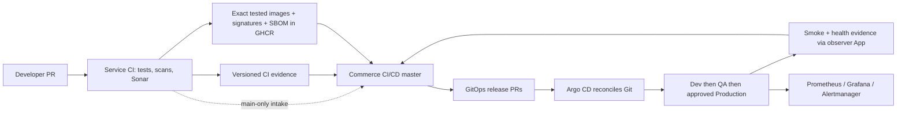

# Narx local Commerce — build, operate and recover the delivery platform

This is an operational learning wiki, not a list of unexplained installation commands. Work through the numbered phases in order. Each phase explains what you are building, why it is needed, how to configure it and what successful completion looks like.

**Scope:** the six `Narx-Space-Prod` repositories and the dedicated local `narx-commerce` Kubernetes cluster. Original Boutique/Jenkins and the separate AWS project are outside this guide. Do not execute Terraform apply/destroy for this rebuild. No AWS credentials are needed.

**Source of truth:** the checked-out code, its pinned dependencies and your reviewed Git history. This guide describes the current local design reviewed on 7 November 2026. It is not a claim that all commands below were executed against a freshly erased host: the existing platform completed an end-to-end release, while installation instructions are reconstructed from the tracked configuration and upstream installation guidance. Do not erase the working cluster to practise a rebuild.

The explicit Production-PR approval stage and subsequent rollout verification completed in master run 42454990488 on 8 November 2026. That is historical evidence; new changes require their own checks.

## Contents

1. [Understand the system before building it](#1-understand-the-system-before-building-it)
2. [Choose the correct starting point](#2-choose-the-correct-starting-point)
3. [Prepare a fresh Linux operator host](#3-prepare-a-fresh-linux-operator-host)
4. [Recover or create the six repositories](#4-recover-or-create-the-six-repositories)
5. [Configure GitHub ownership and credentials](#5-configure-github-ownership-and-credentials)
6. [Configure source quality and security](#6-configure-source-quality-and-security)
7. [Create Kubernetes and networking](#7-create-kubernetes-and-networking)
8. [Install Argo CD and progressive-delivery APIs](#8-install-argo-cd-and-progressive-delivery-apis)
9. [Prepare namespaces and runtime credentials](#9-prepare-namespaces-and-runtime-credentials)
10. [Install monitoring before application delivery](#10-install-monitoring-before-application-delivery)
11. [Configure deployment evidence and Slack](#11-configure-deployment-evidence-and-slack)
12. [Build the first trusted release](#12-build-the-first-trusted-release)
13. [Activate Argo applications and delivery](#13-activate-argo-applications-and-delivery)
14. [Provide persistent browser access](#14-provide-persistent-browser-access)
15. [Run the normal developer-to-Production flow](#15-run-the-normal-developer-to-production-flow)
16. [Operate, diagnose and recover](#16-operate-diagnose-and-recover)
17. [Back up, restore and restart sessions](#17-back-up-restore-and-restart-sessions)
18. [Understand the operational code](#18-understand-the-operational-code)
19. [Prove that you understand the platform](#19-prove-that-you-understand-the-platform)
20. [References and maintenance](#20-references-and-maintenance)

## 1. Understand the system before building it

A developer gives you application source. Source does not run by itself: it needs a repeatable build, tests, a place to store the resulting image, deployment configuration, infrastructure, runtime credentials and a way to verify that the deployed application works.

Our platform makes those responsibilities explicit:

| Repository | Owner/responsibility | Main contents |
| --- | --- | --- |
| `commerce-frontend` | Frontend team | Node backend-for-frontend, browser assets, Dockerfile and tests |
| `commerce-catalogue` | Catalogue team | Go product-read API, metrics, Dockerfile and tests |
| `commerce-orders` | Orders team | Java commerce API, outbox publisher, receipt worker, SQL migrations, Python Cart and payment fixture |
| `platform-ci` | Platform team | Reusable testing, scanning, evidence, publication and source-policy workflows |
| `platform-gitops` | Platform/release team | Master pipeline, Helm charts, exact release bundles, Argo applications and recovery policy |
| `platform-infrastructure` | Platform team | Dedicated kind/Argo bootstrap, local platform Helm configuration and access units |

Orders, publisher and worker are three processes using the **same Java image**. Cart has a separate Python image. There are four application images, not six image builds.



Important vocabulary:

- **Image:** a packaged application filesystem plus its startup settings.
- **Digest:** a content-addressed image identifier such as `sha256:...`; unlike a tag, it identifies exact content.
- **CI:** tests and validates a source revision and builds an artifact.
- **CD:** promotes and verifies the artifact in environments.
- **GitOps:** Git describes desired deployment state; a controller reconciles the cluster to it.
- **Reconciliation:** repeatedly comparing desired and observed state and applying the permitted differences.
- **Namespace:** an isolation and ownership boundary inside Kubernetes; not a separate physical cluster.
- **Helm chart:** a parameterized generator of Kubernetes manifests.
- **AppProject:** Argo's allowed repositories, destinations and resource kinds for an application group.
- **ApplicationSet:** a generator producing the three environment Applications from one template.
- **SBOM:** an inventory of software in an artifact; it does not itself prove that the software is safe.
- **Provenance:** evidence linking the image to the source/build that produced it.
- **Rollout:** the progressive-delivery resource used for the QA/Production frontend.

Dev, QA and Production are separate namespaces on one local kind node. They have independent databases, Redis instances and local queue state. This teaches delivery boundaries, but is not multi-node or high-availability infrastructure.

CI runs on GitHub-hosted runners. The laptop runs Kubernetes, Argo and monitoring; it is not a Jenkins build agent or a self-hosted Actions runner. CI does not receive the laptop kubeconfig. The master verifies results and writes GitOps changes; Argo performs cluster deployment.

## 2. Choose the correct starting point

### Starting point A: a fresh host, existing organization and Git history

Clone all six repositories, restore the privately held credentials, create a new dedicated cluster and restore database data if required. Existing signed image releases can be reused only if GHCR packages, signatures, source Git history and trusted-builder records remain accessible.

Do **not** reset release JSON simply because the host is new. Git can recover configuration; the registry stores artifacts; database backups recover business data. These are different recovery sources.

### Starting point B: only developer source and no platform configuration

The three application repositories alone cannot recreate the platform. You must author or restore the three platform repositories too. Build them in this order:

1. Add application tests, health endpoints, metrics and Dockerfiles.
2. Add the shared CI library: source policy → build/test/coverage → source analysis → signed publication → release facts/evidence.
3. Add the service callers pinned to a reviewed library commit.
4. Add the shared service chart, commerce chart and environment values.
5. Add trusted release validation, master orchestration and recovery.
6. Add local cluster/bootstrap, networking, monitoring and access configuration.
7. Configure external identities and first publish all four images.
8. Activate GitOps and verify each environment.

The current platform repositories are the executable reference for those files. The code map in section 18 explains what you would write in each module. Reading this guide does not make it possible to infer missing credentials, recreate a deleted database from source, or reproduce an unavailable container digest.

### Never import identities blindly into a different organization

This implementation intentionally binds several controls to `Narx-Space-Prod`, the reviewed App/bot identity and exact repository names. A new organization needs reviewed changes to workflow guards, policy, CODEOWNERS, source project identities, image prefixes, webhook destination, App installation IDs and provenance expectations. A global search-and-replace is not a security migration.

List bindings before changing them:

```bash
git -C platform-ci grep -n 'Narx-Space-Prod'
git -C platform-gitops grep -n 'Narx-Space-Prod'
git -C platform-infrastructure grep -n 'Narx-Space-Prod'
```

For this operational rebuild, use the existing organization. Repository creation commands below are only for a genuinely empty organization you own; do not create duplicate repositories beside working ones.

## 3. Prepare a fresh Linux operator host

### Shell execution rules

Use Bash. Examples omit the shell prompt so you can copy commands without copying `$` or `root@host`. Run one phase at a time and read its checkpoint. Re-enter these options in each new operator terminal before configuration/install blocks:

```bash
set -euo pipefail
```

These options stop a failed command/pipeline and reject unset variables. Without fail-fast execution, pasting a whole install block can continue after a checksum error. If your terminal session exits on an error, reopen it, restore the section4 path variables and diagnose the failed command; do not blindly repeat the whole rebuild. Placeholder names such as `PR_NUMBER`, `MASTER_RUN_ID` and `GOOD_REVISION` must be replaced with inspected values. Configuration console steps are intentional checkpoints, not missing commands.

### 3.1 Host assumptions

Commands target Debian 12/13 or Ubuntu 24.04 on Linux amd64. Use a sudo-capable operator account. Do not run package installation on a shared production host without its normal change process.

The deployed lab has about 7.5 GiB RAM and 4 CPUs and has experienced memory pressure. Prefer 12–16 GiB for a comfortable rebuild and failure exercises. Disk must accommodate the kind node, application/monitoring PVCs, image layers, backups and tool caches; check free space before installation. Do not start other lab clusters to satisfy this guide.

The existing systemd units use `/root/.kube/config` and root-owned forwarding. If using a different operator home, review the `User`, kubeconfig path and service hardening settings together before installing units. Do not change `$HOME` to make a command appear to work.

```bash
uname -m
cat /etc/os-release
free -h
df -h /
nproc
sudo apt-get update
sudo apt-get install -y ca-certificates curl git jq openssl python3 python3-venv gnupg
```

### 3.2 Install Docker Engine and Compose

**Why:** kind nodes are Docker containers. Compose is also used by the isolated developer/business-test stack. Docker access is effectively host-administrator access; grant it deliberately.

On a new host, configure the official repository for the installed distribution:

```bash
. /etc/os-release
case "$ID" in debian|ubuntu) ;; *) echo 'Use the Docker instructions for this distribution'; exit 1 ;; esac
sudo install -m 0755 -d /etc/apt/keyrings
curl -fsSL "https://download.docker.com/linux/$ID/gpg" -o /tmp/narx-docker.asc
sudo install -m 0644 /tmp/narx-docker.asc /etc/apt/keyrings/docker.asc
printf 'deb [arch=%s signed-by=/etc/apt/keyrings/docker.asc] https://download.docker.com/linux/%s %s stable\n' "$(dpkg --print-architecture)" "$ID" "$VERSION_CODENAME" | sudo tee /etc/apt/sources.list.d/docker.list
sudo apt-get update
sudo apt-get install -y docker-ce docker-ce-cli containerd.io docker-buildx-plugin docker-compose-plugin
sudo systemctl enable --now docker
```

Use root or grant the operator Docker access and log in again:

```bash
sudo usermod -aG docker "$(id -un)"
# Log out and back in before continuing as a non-root operator.
docker version
docker compose version
docker run --rm hello-world
```

Do not remove an existing Docker/containerd installation with running unrelated projects just to follow these fresh-host instructions. Resolve conflicting packages through the upstream distribution-specific installation guide.

### 3.3 Install pinned kind, matching kubectl and Helm

Version pins here match the project, not a recommendation to follow the newest upstream release automatically. The existing host had an older kubectl client; a rebuild should install a client matching Kubernetes 1.34 rather than copy that version skew.

```bash
mkdir -p "$HOME/narx-tools"
cd "$HOME/narx-tools"
curl -fL https://github.com/kubernetes-sigs/kind/releases/download/v0.30.0/kind-linux-amd64 -o kind-linux-amd64
curl -fL https://github.com/kubernetes-sigs/kind/releases/download/v0.30.0/kind-linux-amd64.sha256sum -o kind-linux-amd64.sha256sum
sha256sum --check kind-linux-amd64.sha256sum
sudo install -m 0755 kind-linux-amd64 /usr/local/bin/kind

curl -fL https://dl.k8s.io/release/v1.34.0/bin/linux/amd64/kubectl -o kubectl
curl -fL https://dl.k8s.io/release/v1.34.0/bin/linux/amd64/kubectl.sha256 -o kubectl.sha256
printf '%s  kubectl\n' "$(cat kubectl.sha256)" | sha256sum --check
sudo install -m 0755 kubectl /usr/bin/kubectl

curl -fL https://get.helm.sh/helm-v3.22.0-linux-amd64.tar.gz -o helm.tar.gz
curl -fL https://get.helm.sh/helm-v3.22.0-linux-amd64.tar.gz.sha256sum -o helm.sha256sum
# Upstream checksum records its original filename.
mv helm.tar.gz helm-v3.22.0-linux-amd64.tar.gz
sha256sum --check helm.sha256sum
tar -xzf helm-v3.22.0-linux-amd64.tar.gz
sudo install -m 0755 linux-amd64/helm /usr/local/bin/helm
kind version
kubectl version --client
helm version --short
```

A checksum downloaded over HTTPS detects corruption and ties the file to the published checksum. It is not a substitute for reviewing the upstream publisher or your organization's stronger artifact-verification policy.

### 3.4 Install GitHub CLI and Python tooling

```bash
curl -fsSL https://cli.github.com/packages/githubcli-archive-keyring.gpg -o /tmp/narx-githubcli.gpg
sudo install -m 0644 /tmp/narx-githubcli.gpg /etc/apt/keyrings/githubcli.gpg
printf 'deb [arch=%s signed-by=/etc/apt/keyrings/githubcli.gpg] https://cli.github.com/packages stable main\n' "$(dpkg --print-architecture)" | sudo tee /etc/apt/sources.list.d/github-cli.list
sudo apt-get update
sudo apt-get install -y gh
gh --version
gh auth login --hostname github.com --git-protocol https --web
gh auth setup-git
gh auth status
```

Browser/device login authenticates the human operator. It is **not** the Jenkins identity, CI's `GITHUB_TOKEN`, or the release App. If team administration, repository settings or secret configuration return403, inspect the user's organization role and token permissions; do not disable protection to avoid the error.

Create a Python venv later inside the local workspace. Application SDKs need not be installed on this host: Docker and hosted runners provide Node, Go, Java and Python application-build environments.

**Checkpoint:** Docker/Compose, kind, kubectl, Helm, gh and Python run; gh identifies the intended human account. No Kubernetes cluster has been created yet.

## 4. Recover or create the six repositories

Choose a workspace path explicitly. All six repositories must be siblings because the developer Compose file uses relative build/fixture paths.

```bash
export NARX_WORKSPACE="$HOME/narx-local"
export NARX_ORG='Narx-Space-Prod'
mkdir -p "$NARX_WORKSPACE"
cd "$NARX_WORKSPACE"
for repo in platform-ci platform-gitops platform-infrastructure commerce-frontend commerce-catalogue commerce-orders; do
  gh repo clone "$NARX_ORG/$repo" "$repo"
done
python3 -m venv "$NARX_WORKSPACE/.venv"
"$NARX_WORKSPACE/.venv/bin/python" -m pip install 'PyYAML==6.0.3'
export NARX_PYTHON="$NARX_WORKSPACE/.venv/bin/python"
export NARX_PRIVATE="$HOME/.local/share/narx-credentials"
install -d -m 0700 "$NARX_PRIVATE"
```

On the current lab host, the existing sibling workspace is `/root/devops-boutique/codex/narx-space-prod`; set `NARX_WORKSPACE` to that path for operations instead of cloning a second copy. The `$HOME/narx-local` path above is the fresh-host example.

If repositories already exist locally, inspect `git status` and fetch them instead of cloning over files. Do not reset someone else's work to match a guide.

Record the revisions used for your rebuild:

```bash
for repo in platform-ci platform-gitops platform-infrastructure commerce-frontend commerce-catalogue commerce-orders; do
  printf '%s ' "$repo"
  git -C "$NARX_WORKSPACE/$repo" rev-parse HEAD
done
```

For an empty organization **only**, create public repositories using `gh repo create "$NARX_ORG/NAME" --public`. Public visibility matches this project's protection/features arrangement; do not publish private developer code without permission. Push each reviewed repository's initial code and history. Then configure ownership/settings before normal development. This guide does not ask you to move, delete or recreate the existing organization.

## 5. Configure GitHub ownership and credentials

### 5.1 Roles and independent reviews

A developer creates a branch and PR. An authorized reviewer reviews it. A DevOps engineer operates shared CI and Kubernetes. Production release authorization belongs to designated reviewers, not the automation that opened the release PR.

The current reviewer team is `code-reviewers`; the independent reviewer is `Code-S-12`. Do not add every developer to that team merely to unblock their PRs.

```bash
gh api "orgs/$NARX_ORG/teams/code-reviewers" --jq '{name,slug,id}'
gh api "orgs/$NARX_ORG/teams/code-reviewers/members" --jq '.[].login'
```

On a new organization, create the team and invite the reviewer in the organization UI, or use the authenticated administration API:

```bash
# New organization only; skip if the team exists.
printf '%s\n' '{"name":"Code reviewers","privacy":"closed"}' > /tmp/narx-team.json
gh api --method POST "orgs/$NARX_ORG/teams" --input /tmp/narx-team.json
# The person must already be eligible to join the organization.
gh api --method PUT "orgs/$NARX_ORG/teams/code-reviewers/memberships/Code-S-12" -f role=member
```

Retain each repo's `.github/CODEOWNERS` and PR template. For source/platform-library/infrastructure repositories, configure main to require: PRs, one independent CODEOWNER approval, stale-approval dismissal, latest-push approval, strict current checks, resolved conversations, linear history and administrator enforcement. Block force-push and deletion.

Do not install required check names before a workflow has emitted them. A typo creates an indefinitely Expected check. The current source contexts are:

```text
Application / 01 - Source policy / Workflow lint
Application / 02 - Build test and scan / Build and test
Application / 03 - Sonar quality gate / Source quality gate
```

Orders additionally requires `Application / 02 - Cart build test and scan / Build and test`.

Inspect actual protection and observed checks:

```bash
gh api "repos/$NARX_ORG/commerce-orders/branches/main/protection"
# Replace PR_NUMBER with a real source PR number, without angle brackets.
gh pr checks PR_NUMBER --repo "$NARX_ORG/commerce-orders"
```

GitOps is intentionally different: only dedicated-bot changes to Dev/QA release JSON may merge without a human. All other paths, including Production release JSON, require independent review through the native path-scoped ruleset. The tracked `policy/review-settings.json` alone is **not** sufficient: its generic review count is zero. Pair it with the active `policy/review-ruleset.json` and CODEOWNERS.

For a new organization, replace the public team ID in a private temporary copy with the new team ID; do not copy another organization's ID:

```bash
cd "$NARX_WORKSPACE/platform-gitops"
TEAM_ID=$(gh api "orgs/$NARX_ORG/teams/code-reviewers" --jq .id)
jq --argjson team "$TEAM_ID" '.rules[0].parameters.required_reviewers[0].reviewer.id=$team' policy/review-ruleset.json > /tmp/narx-review-ruleset.json
# New ruleset only: inspect existing IDs before POST to avoid duplicates.
gh api "repos/$NARX_ORG/platform-gitops/rulesets" --jq '.[]|{id,name,enforcement}'
# POST once for a new setup; PATCH the existing ruleset ID when updating it.
gh api --method POST "repos/$NARX_ORG/platform-gitops/rulesets" --input /tmp/narx-review-ruleset.json
```

If GitHub rejects a policy feature for your plan, stop and resolve plan/visibility/policy design. Do not silently replace independent Production review with bot auto-approval.

### 5.2 Three different credential paths

| Credential | Used by | Purpose |
| --- | --- | --- |
| Human gh login | Operator terminal | Review/setup/diagnosis within assigned permissions |
| Ephemeral `GITHUB_TOKEN` | Actions jobs | Repository-scoped builds, image publish/read and release evidence |
| Release GitHub App | Main-only intake and GitOps mutation | Dispatch master and create/update GitOps release PRs |
| Observer GitHub App | Argo notifications | Publish trusted deployment statuses |
| GHCR read-only credential | Kubernetes image pulls | Pull private packages; cannot publish |
| Sonar token | Source-analysis jobs | Analyze the three configured projects |
| Slack webhook | Narx monitoring/notifications | Send to the dedicated project channel |

Tokens, private keys, runtime secrets and backup dumps are not source code. Keep them outside the six repos, mode600 for files and mode700 for their directory. Do not paste their contents into issues, docs, chat or command arguments that log them.

### 5.3 Create the two GitHub Apps — console step

GitHub has no ordinary `gh app create` command that replaces App registration and installation. In Organization Settings → Developer settings → GitHub Apps, create or reuse the dedicated **local** Apps. Do not reuse the separate AWS release App.

1. Release App: repository Contents read/write, Pull requests read/write, Metadata read. Install on `platform-gitops`; source repos are public for evidence reads. Its private key belongs in `gitops-release` environments in the three source repos and GitOps.
2. Observer App: Commit statuses read/write, Metadata read. Install on `platform-gitops`. It cannot update source or merge PRs. Its private key belongs in Argo's notifications secret, not CI.
3. Webhooks for these Apps need not be enabled; the project uses explicit dispatch and Argo notifications. The separate repository push webhook for Argo is configured later.
4. Generate/download a private key in each App's settings and save it directly to `$NARX_PRIVATE`. The App ID, installation ID and bot account ID are distinct identifiers.

Current public reference identities are release App 5613524 and observer App 5613724. Current installation IDs are 178600148 and 178604312. **Look them up in your installation before use; do not assume a recreated App retains these IDs.**

```bash
export NARX_RELEASE_APP_ID='5613524'
export NARX_OBSERVER_APP_ID='5613724'
export NARX_OBSERVER_INSTALLATION_ID='178604312'
export NARX_RELEASE_KEY_FILE="$NARX_PRIVATE/release.private-key.pem"
export NARX_OBSERVER_KEY_FILE="$NARX_PRIVATE/observer.private-key.pem"
chmod 600 "$NARX_RELEASE_KEY_FILE" "$NARX_OBSERVER_KEY_FILE"
# Bot identity is public metadata, not a private key.
gh api 'users/narx-local-commerce-release%5Bbot%5D' --jq '{login,id}'
gh api 'users/narx-local-commerce-observer%5Bbot%5D' --jq '{login,id}'
```

If the downloaded PEM is encrypted, decrypt it **in your own terminal**, with its passphrase entered interactively:

```bash
openssl pkey -in "$NARX_PRIVATE/observer.encrypted.pem" -out "$NARX_OBSERVER_KEY_FILE"
chmod 600 "$NARX_OBSERVER_KEY_FILE"
```

Do not type PEM body lines as shell commands. App identity changes also require reviewed changes to the hard-bound author check in `scripts/delivery.py` and observer login variable. Installing the App alone is not that policy migration.

### 5.4 Configure main-only release environments and variables

Create a `gitops-release` environment in the three source repos and GitOps. Restrict deployments to main. It stores a secret; it is not an additional human Production approval gate.

```bash
for repo in commerce-frontend commerce-catalogue commerce-orders platform-gitops; do
  gh api --method PUT "repos/$NARX_ORG/$repo/environments/gitops-release" --input - <<'JSON'
{"deployment_branch_policy":{"protected_branches":false,"custom_branch_policies":true}}
JSON
  # New environment only: create the main branch policy once.
  gh api --method POST "repos/$NARX_ORG/$repo/environments/gitops-release/deployment-branch-policies" -f name=main -f type=branch
  gh secret set NARX_RELEASE_APP_PRIVATE_KEY --repo "$NARX_ORG/$repo" --env gitops-release < "$NARX_RELEASE_KEY_FILE"
  gh variable set NARX_RELEASE_APP_ID --repo "$NARX_ORG/$repo" --body "$NARX_RELEASE_APP_ID"
  gh variable set DELIVERY_ENABLED --repo "$NARX_ORG/$repo" --body false
done
gh variable set NARX_DEPLOYMENT_BOT_LOGIN --repo "$NARX_ORG/platform-gitops" --body 'narx-local-commerce-observer[bot]'
```

On an existing setup, list branch policies before creating one; update the matching policy instead of accepting duplicate/422 errors. Secret values cannot be read back from GitHub; only names and timestamps can be listed:

```bash
gh secret list --repo "$NARX_ORG/commerce-orders" --env gitops-release
gh variable list --repo "$NARX_ORG/platform-gitops"
```

After the environment-scoped credentials are verified, remove obsolete **repository-level** copies of the same App key if any exist. This reduces exposure to ordinary branch workflows. Never delete the environment copy by confusing the two scopes.

### 5.5 Install required checks after their first successful PR run

This is the protection configuration reference: on a new organization, return to apply it after section 6 has produced the first successful PR checks. Keep that PR open until publication is enabled in section 12. On the existing organization, inspect the existing protections rather than replacing them.

Use the UI for individual settings, or the following **new-setup** payload generator. Review the generated JSON before PUT. It replaces main's classic protection document, so on an existing setup first export its settings and preserve any additional organization controls. The GitOps native path ruleset from 5.1 must already be active.

```bash
cd "$NARX_WORKSPACE"
"$NARX_PYTHON" - <<'PY'
import json
from pathlib import Path
source=['Application / 01 - Source policy / Workflow lint',
        'Application / 02 - Build test and scan / Build and test',
        'Application / 03 - Sonar quality gate / Source quality gate']
checks={
 'commerce-frontend':source,
 'commerce-catalogue':source,
 'commerce-orders':source+['Application / 02 - Cart build test and scan / Build and test'],
 'platform-ci':['workflows / Workflow lint'],
 'platform-infrastructure':['terraform / Terraform validation','registry / Terraform validation','workflows / Workflow lint','Local bootstrap checks'],
 'platform-gitops':['helm / Helm validation','workflows / Workflow lint','Local preview configuration','narx/release-verification']}
for repo,names in checks.items():
    reviews={'dismiss_stale_reviews':True,'require_code_owner_reviews':True,
             'require_last_push_approval':repo!='platform-gitops',
             'required_approving_review_count':0 if repo=='platform-gitops' else 1}
    value={'required_status_checks':{'strict':True,'checks':[{'context':n,'app_id':15368} for n in names]},
           'enforce_admins':True,'required_pull_request_reviews':reviews,'restrictions':None,
           'required_linear_history':True,'allow_force_pushes':False,'allow_deletions':False,
           'required_conversation_resolution':True}
    Path('/tmp/narx-protection-'+repo+'.json').write_text(json.dumps(value,indent=2)+'\n')
PY
# Inspect each JSON. Apply only after observing the named checks on a successful PR.
for repo in platform-ci platform-infrastructure platform-gitops commerce-frontend commerce-catalogue commerce-orders; do
  gh api --method PUT "repos/$NARX_ORG/$repo/branches/main/protection" --input "/tmp/narx-protection-$repo.json"
done
gh repo edit "$NARX_ORG/platform-gitops" --enable-auto-merge
```

15368 is the GitHub Actions integration used by the current checks; verify the emitting integration for your installation. Native rulesets may add requirements beyond this document. Test the resulting behavior with an ordinary source PR, an owned GitOps change, a bot Dev release and a Production release. A settings response200 is not proof that separation of duties works.

## 6. Configure source quality and security

### 6.1 Understand what runs and where

Source PRs run actionlint, fetched-history Gitleaks, language tests/coverage, loaded-runtime component integration, a non-root check, Trivy HIGH/CRITICAL blocking vulnerability checks, an SBOM and Sonar analysis. A failed blocking gate prevents publication/promotion. Signing is not a substitute for passing security checks.

Dockerfiles provide an `analysis` target exporting reports from the same cached test stage required by `runtime`. That avoids recompiling Java merely for Sonar. The publisher transfers the tested image rather than rebuilding it in another job.

The current application callers pin a reviewed shared-library commit. In the library, some helper references intentionally pin other reviewed commits, including the stable publisher path used in signature certificates. Do not replace every SHA with the latest branch name.

```bash
cd "$NARX_WORKSPACE"
for repo in commerce-frontend commerce-catalogue commerce-orders; do
  grep 'uses: Narx-Space-Prod/platform-ci' "$repo/.github/workflows/ci.yml"
done
cat platform-gitops/policy/builders.json
```

### 6.2 Provision SonarQube Cloud — console step

1. Sign in to SonarQube Cloud, bind the GitHub organization and import the three application repos.
2. Use the intended region; the helper accepts `https://sonarcloud.io` or `https://sonarqube.us`.
3. Confirm the project keys. Current keys are `Narx-Space-Prod_commerce-frontend`, `Narx-Space-Prod_commerce-catalogue` and `Narx-Space-Prod_commerce-orders` under organization `narx-space-prod`.
4. Disable automatic analysis for these projects; GitHub Actions owns analysis. A greyed-out switch usually requires checking project-admin rights or the project's analysis configuration, not adding a second scanner.
5. Generate an appropriate analysis token using the account/project token UI permitted by your plan. Save it privately, not in a committed properties file.
6. Bind the quality gate and new-code definition deliberately. Do not exclude uncovered code merely to turn the gate green. Check plan support for PR analysis before changing organizations/plans.

Configure non-secret identities:

```bash
for repo in commerce-frontend commerce-catalogue commerce-orders; do
  gh variable set SONAR_ORGANIZATION --repo "$NARX_ORG/$repo" --body narx-space-prod
  gh variable set SONAR_PROJECT_KEY --repo "$NARX_ORG/$repo" --body "Narx-Space-Prod_$repo"
  gh variable set SONAR_SERVER_URL --repo "$NARX_ORG/$repo" --body https://sonarcloud.io
done
# Save the analysis token to this private file in your editor first.
chmod 600 "$NARX_PRIVATE/sonar-token"
gh secret set SONAR_TOKEN --org "$NARX_ORG" --visibility selected --repos commerce-frontend,commerce-catalogue,commerce-orders < "$NARX_PRIVATE/sonar-token"
```

**Checkpoint:** a reviewed source PR emits all required contexts. Sonar reports actual coverage; a deliberately failing test/quality check blocks merge. Do not activate deployment while source quality is silently skipped.

## 7. Create Kubernetes and networking

### 7.1 Create only the dedicated kind cluster

**Why:** a Kubernetes API schedules Pods, Services and storage. kind provides the API/control plane inside a Docker container. Cilium supplies pod networking and network-policy enforcement. This is one node with no worker-node redundancy.

```bash
cd "$NARX_WORKSPACE/platform-infrastructure"
cat local/kind.yaml
kind get clusters
# Fresh host only; if narx-commerce already exists, inspect it rather than recreate it.
kind create cluster --config local/kind.yaml
kubectl --context kind-narx-commerce get nodes -o wide
```

Before Cilium is installed, NotReady/CoreDNS Pending can be expected because `disableDefaultCNI: true` deliberately leaves networking uninstalled. Do not remove that setting to hide a CNI installation failure.

The API endpoint is loopback port 16443 on this host. Containerized Argo uses the internal `https://narx-commerce-control-plane:6443` endpoint after registration; it cannot use the host's 127.0.0.1 as though it were its own host namespace.

### 7.2 Install checksum-pinned Cilium

```bash
mkdir -p "$NARX_WORKSPACE/.cache/charts"
helm pull oci://quay.io/cilium/charts/cilium --version 1.20.4 --destination "$NARX_WORKSPACE/.cache/charts"
printf '%s  %s\n' 505abff8385811df1a949776fc42e9f10697989a332acc86d6e8933efcb855ed "$NARX_WORKSPACE/.cache/charts/cilium-1.20.4.tgz" | sha256sum --check --strict
helm upgrade --install cilium "$NARX_WORKSPACE/.cache/charts/cilium-1.20.4.tgz" --kube-context kind-narx-commerce --namespace kube-system --values local/cilium-values.yaml --wait --timeout 10m
kubectl --context kind-narx-commerce wait --for=condition=Ready node --all --timeout=300s
kubectl --context kind-narx-commerce -n kube-system get pods
kubectl --context kind-narx-commerce get storageclass
```

Expected: node Ready, Cilium/operator and CoreDNS ready, and kind's `standard` storage class present. The profile retains kube-proxy; Hubble/Envoy are not enabled merely for a demo UI.

The local Argo scrape uses its internal Kubernetes Service and namespace/Pod selectors. It does not depend on a fixed Docker bridge subnet. Inspect node networking and the actual policies before changing connectivity:

```bash
docker network inspect kind --format '{{json .IPAM.Config}}'
docker inspect narx-commerce-control-plane --format '{{json .NetworkSettings.Networks}}'
cat local/argocd-metrics.yaml
cat local/monitoring-network.yaml
```

Retained managed-data chart settings may include reviewed CIDRs for their own purpose. Do not use an old shared-cluster node-reconnection plan to repair this standalone cluster.

## 8. Install Argo CD and progressive-delivery APIs

### 8.1 Install Argo from the tracked immutable manifest

**Why:** Argo reconciles the application GitOps repo. Argo's own initial installation is an operator bootstrap responsibility; its workload Applications do not need permission to create the platform's CRDs.

```bash
cd "$NARX_WORKSPACE/platform-infrastructure"
mkdir -p "$NARX_WORKSPACE/.cache/manifests"
ARGO_MANIFEST_URL=$(jq -r .manifest local/argocd.json)
ARGO_MANIFEST_SHA=$(jq -r .sha256 local/argocd.json)
curl -fL "$ARGO_MANIFEST_URL" -o "$NARX_WORKSPACE/.cache/manifests/argocd-install.yaml"
printf '%s  %s\n' "$ARGO_MANIFEST_SHA" "$NARX_WORKSPACE/.cache/manifests/argocd-install.yaml" | sha256sum --check --strict
kubectl --context kind-narx-commerce create namespace argocd
kubectl --context kind-narx-commerce apply --server-side -n argocd -f "$NARX_WORKSPACE/.cache/manifests/argocd-install.yaml"
kubectl --context kind-narx-commerce -n argocd rollout status deployment/argocd-server --timeout=600s
kubectl --context kind-narx-commerce -n argocd get deploy,statefulset,pods
```

On an existing cluster use `kubectl get namespace argocd` rather than treating AlreadyExists as an installation failure. Do not reinstall Argo to reset an admin password.

Keep the upstream TLS server enabled. The recorded profile does not set `server.insecure=true`. Set the public UI URL, without putting any secret into this ConfigMap:

```bash
kubectl --context kind-narx-commerce -n argocd patch configmap argocd-cm --type merge -p '{"data":{"url":"https://argocd.narx.space"}}'
```

Get the initial admin credential **only on your private operator terminal**, log in through a loopback forward and change it. Do not put the output in a screenshot, transcript or document:

```bash
kubectl --context kind-narx-commerce -n argocd get secret argocd-initial-admin-secret -o jsonpath='{.data.password}' | base64 -d
printf '\n'
kubectl --context kind-narx-commerce -n argocd port-forward --address 127.0.0.1 service/argocd-server 8080:443
```

Open `https://localhost:8080`. With a remote headless host, forward it from your workstation using `ssh -N -L 8080:127.0.0.1:8080 OPERATOR@LAB_HOST`. `localhost` always refers to the machine where the browser runs. Initial self-signed-certificate warnings do not justify disabling public HTTPS or changing kubeconfig CA verification.

### 8.2 Install only the Argo Rollouts CRDs at cluster scope

The commerce chart installs namespaced Rollouts controllers in QA/Production. Do not additionally install the upstream cluster-wide controller, which would duplicate ownership.

Download and verify the reviewed upstream bundle, then extract just CRDs:

```bash
cd "$NARX_WORKSPACE/platform-gitops"
ROLLOUT_VERSION=$(jq -r .version schemas/argo/source.json)
ROLLOUT_SHA=$(jq -r '.assets["install.yaml"]' schemas/argo/source.json)
curl -fL "https://github.com/argoproj/argo-rollouts/releases/download/$ROLLOUT_VERSION/install.yaml" -o "$NARX_WORKSPACE/.cache/manifests/rollouts-install.yaml"
printf '%s  %s\n' "$ROLLOUT_SHA" "$NARX_WORKSPACE/.cache/manifests/rollouts-install.yaml" | sha256sum --check --strict
"$NARX_PYTHON" - <<'PY'
import os
from pathlib import Path
import yaml
root=Path(os.environ['NARX_WORKSPACE'])/'.cache/manifests'
objects=[v for v in yaml.safe_load_all((root/'rollouts-install.yaml').read_text()) if v and v.get('kind')=='CustomResourceDefinition']
assert objects, 'No CRDs in the reviewed bundle'
(root/'rollouts-crds.yaml').write_text(yaml.safe_dump_all(objects))
PY
kubectl --context kind-narx-commerce apply --server-side -f "$NARX_WORKSPACE/.cache/manifests/rollouts-crds.yaml"
kubectl --context kind-narx-commerce wait --for=condition=Established crd/rollouts.argoproj.io --timeout=120s
kubectl --context kind-narx-commerce get crd | grep argoproj.io
```

Do not apply files in `schemas/argo/` as CRDs: they are JSON schemas for CI validation, not Kubernetes resources. A CRD defines a new resource type; a controller reconciles instances of that type. Installing one does not install the other.

### 8.3 Understand the bootstrap ownership boundary

The operator installs cluster-wide APIs/CNI and monitoring platform resources. Argo's `narx-local` registration is namespace-scoped to the three commerce namespaces, with `clusterResources=false`. The AppProject also restricts resource kinds and sources. Do not “fix” denied CRD creation by giving the application cluster-admin.

**Checkpoint:** Argo server/controller/notifications/ApplicationSet components are ready. Kubernetes recognizes Rollout/AnalysisTemplate. AppProject/ApplicationSet installation waits until credentials and platform dependencies are ready.

## 9. Prepare namespaces and runtime credentials

### 9.1 Create independent runtime credentials

The helper creates each namespace, labels it, adds quotas and generates the `commerce-runtime` Secret only if it does not already exist. This preserves database/session keys when rerun.

```bash
cd "$NARX_WORKSPACE/platform-infrastructure"
for env in dev qa production; do
  "$NARX_PYTHON" local/bootstrap.py prepare --context kind-narx-commerce --environment "$env"
done
kubectl --context kind-narx-commerce get namespaces commerce-dev commerce-qa commerce-production
kubectl --context kind-narx-commerce -n commerce-dev get secret commerce-runtime -o name
```

Do not print all Secret values to verify presence. Kubernetes Secret data is base64-encoded, not inherently encrypted by that encoding. Control who can read Secrets and who can access the host/kubeconfig.

### 9.2 Create private GHCR pull credentials

In GitHub, create a dedicated classic PAT with **read:packages** and an expiration. Its user must be authorized to read the private packages. Authorize organization SSO if required. Do not give this credential publish/delete scopes.

Store it directly in `$NARX_PRIVATE/ghcr-read-token`, mode600. Set the owning GitHub username:

```bash
export NARX_REGISTRY_USER='subhankar12-spec'
export NARX_REGISTRY_TOKEN_FILE="$NARX_PRIVATE/ghcr-read-token"
chmod 600 "$NARX_REGISTRY_TOKEN_FILE"
for env in dev qa production; do
  "$NARX_PYTHON" local/bootstrap.py refresh-registry --context kind-narx-commerce --environment "$env" --registry-user "$NARX_REGISTRY_USER" --registry-token-file "$NARX_REGISTRY_TOKEN_FILE"
done
```

This writes a separate image-pull Secret to each namespace. It does not log in CI or mint source publication credentials. Repeat the command on rotation before expiry. Never overwrite `commerce-runtime` merely because `ghcr-pull` expired.

### 9.3 Register the same dedicated cluster with namespace-scoped Argo permissions

```bash
"$NARX_PYTHON" local/bootstrap.py register-cluster --context kind-narx-commerce --management-context kind-narx-commerce
kubectl --context kind-narx-commerce -n argocd get secret narx-local-cluster -o name
kubectl --context kind-narx-commerce -n narx-system get serviceaccount argocd-manager
kubectl --context kind-narx-commerce -n commerce-dev get role narx-argocd-manager
```

Both contexts are intentionally Narx. The option describes where Argo runs; it is not permission to use the retired Boutique management cluster. The helper's printed legacy word “shared” does not override the enforced dedicated-context choice.

The helper creates a service-account credential and an Argo cluster registration with CA verification and explicit namespaces. Its current implementation uses a persistent service-account token Secret, not a short-lived token-refresh controller; treat host/Argo access and token rotation as sensitive operational responsibilities.

## 10. Install monitoring before application delivery

**Why before delivery?** QA/Production frontend analyses query monitoring, and application health without an observable platform is not enough to prove the release gates. Metrics-server supplies the Kubernetes Metrics API for HPA; Prometheus is a different metrics system for scraping/querying/alerting.

The tracked releases are metrics-server, blackbox exporter and kube-prometheus-stack. The latter provides Prometheus, Grafana, Alertmanager and Kubernetes-state monitoring. It is installed by the platform helper, not by the application Argo Applications.

### 10.1 Create the Slack integration — console step

Use the Narx workspace and a dedicated project channel. Create/reuse the Narx Slack App, enable Incoming Webhooks, install/authorize it to the intended channel and save its webhook to a private file. Do not reuse Boutique's credential or send the URL through a PR.

```bash
export NARX_SLACK_FILE="$NARX_PRIVATE/slack-webhook"
chmod 600 "$NARX_SLACK_FILE"
```

No Slack message is sent by writing this guide. During a rebuild, an explicit test message should be sent only to the authorized project channel; then confirm receipt, rather than treating HTTP 200 as proof that a human saw it.

### 10.2 Render first, then explicitly install

```bash
cd "$NARX_WORKSPACE/platform-infrastructure"
"$NARX_PYTHON" local/observability.py --context kind-narx-commerce --integration-values "$NARX_WORKSPACE/platform-gitops/monitoring/local-values.yaml" --cache "$NARX_WORKSPACE/.cache/charts" --render-dir "$NARX_WORKSPACE/.cache/platform-render"
```

Expected: checksum verification, strict Helm lint and rendered-resource counts, then a render-only message. No cluster write occurs without `--install`.

Inspect the values and the previously checked network CIDRs. Installation reads the private webhook, preserves existing credentials, creates reviewed network resources and performs atomic Helm upgrades:

```bash
"$NARX_PYTHON" local/observability.py --context kind-narx-commerce --management-context kind-narx-commerce --integration-values "$NARX_WORKSPACE/platform-gitops/monitoring/local-values.yaml" --cache "$NARX_WORKSPACE/.cache/charts" --slack-webhook-file "$NARX_SLACK_FILE" --install
helm list --kube-context kind-narx-commerce --all-namespaces
kubectl --context kind-narx-commerce -n monitoring get deploy,statefulset,pods,pvc
kubectl --context kind-narx-commerce get apiservice v1beta1.metrics.k8s.io
kubectl --context kind-narx-commerce top nodes
```

The helper has a host-memory precheck and refuses to take over another project's monitoring namespace or Metrics API. A successful memory precheck is not a capacity guarantee. Helm `--atomic` rolls back a failed upgrade; inspect `helm history` before retrying after a deadline.

```bash
helm history narx-monitoring --kube-context kind-narx-commerce --namespace monitoring
kubectl --context kind-narx-commerce -n monitoring get events --sort-by=.lastTimestamp
kubectl --context kind-narx-commerce -n kube-system logs deployment/narx-metrics-server --tail=100
```

The local metrics-server profile verifies its own API-serving TLS but uses `--kubelet-insecure-tls` for kind's self-signed kubelet certificate. This is an explicit local exception, not a general production TLS pattern. Do not set aggregated API verification to insecure to hide an unrelated certificate failure.

### 10.3 Verify targets and alerts

Start loopback forwards in separate terminals:

```bash
kubectl --context kind-narx-commerce -n monitoring port-forward --address 127.0.0.1 service/narx-monitoring-grafana 13000:80
kubectl --context kind-narx-commerce -n monitoring port-forward --address 127.0.0.1 service/narx-monitoring-prometheus 19090:9090
kubectl --context kind-narx-commerce -n monitoring port-forward --address 127.0.0.1 service/narx-monitoring-alertmanager 19093:9093
```

From another terminal:

```bash
curl --fail http://127.0.0.1:19090/-/ready
curl --fail http://127.0.0.1:19093/-/ready
curl --fail --get http://127.0.0.1:19090/api/v1/query --data-urlencode 'query=up' | jq '.data.result[]|{metric,value}'
curl --fail http://127.0.0.1:19090/api/v1/rules | jq '.status'
curl --fail http://127.0.0.1:19093/api/v2/alerts | jq 'length'
```

Application targets are expected to be absent/down before application activation. After activation, check all three `namespace` labels, not just an aggregate `up` value. Grafana's Narx dashboard must offer dev, qa and production. Inspect actual queries and labels if a dashboard is empty; adding a dropdown option cannot create missing metrics.

Initial Grafana admin credentials are provisioned in `narx-monitoring-grafana`. Retrieve a password only in your private terminal:

```bash
kubectl --context kind-narx-commerce -n monitoring get secret narx-monitoring-grafana -o jsonpath='{.data.admin-password}' | base64 -d
printf '\n'
```

On an existing installation, Grafana's database password may have been changed through the UI and differ from that original Secret. A 401 does not mean monitoring is down. Do not reset credentials or delete Grafana's PVC to resolve an unknown password.

**Checkpoint:** platform workloads ready, Metrics API available, Prometheus/Alertmanager ready, Argo metrics service/network objects installed, and the intended dashboard configuration provisioned. Alert delivery should also be tested deliberately after the channel is authorized.

## 11. Configure deployment evidence and Slack

A green Argo screen is not the master's evidence API. The master reads statuses named `narx/deploy-dev`, `narx/deploy-qa` and `narx/deploy-production`, published only by the expected observer App for the correct deployment revision.

The Argo notifications patch is data, not a standalone Kubernetes resource. Configure it through the helper so unrelated configuration and existing signing/admin keys are preserved:

```bash
cd "$NARX_WORKSPACE/platform-infrastructure"
"$NARX_PYTHON" local/bootstrap.py configure-observer --context kind-narx-commerce --app-id "$NARX_OBSERVER_APP_ID" --installation-id "$NARX_OBSERVER_INSTALLATION_ID" --private-key-file "$NARX_OBSERVER_KEY_FILE" --notifications-file "$NARX_WORKSPACE/platform-gitops/applications/notifications.yaml"
"$NARX_PYTHON" local/bootstrap.py configure-delivery-notifications --context kind-narx-commerce --notifications-file "$NARX_WORKSPACE/platform-gitops/applications/notifications.yaml" --slack-webhook-file "$NARX_SLACK_FILE"
kubectl --context kind-narx-commerce -n argocd rollout restart deployment/argocd-notifications-controller
kubectl --context kind-narx-commerce -n argocd rollout status deployment/argocd-notifications-controller --timeout=180s
```

The one-time restart here ensures a freshly configured controller reloads credentials during bootstrap. Routine releases do not require manual controller restarts, status refreshes or Argo sync commands.

Pending, healthy and failed deployment notifications use the actual operation sync revision. Unrelated repository commits must not be mistaken for the deployed revision. The healthy trigger also requires succeeded operation, Synced/Healthy state and successful smoke-hook evidence; do not simplify it to `health == Healthy`.

Check subscriptions/configuration names without dumping secrets:

```bash
kubectl --context kind-narx-commerce -n argocd get configmap argocd-notifications-cm -o go-template='{{range $key,$value := .data}}{{$key}}{{"\n"}}{{end}}'
kubectl --context kind-narx-commerce -n argocd get secret argocd-notifications-secret -o name
kubectl --context kind-narx-commerce -n argocd logs deployment/argocd-notifications-controller --tail=100
```

A 403 on status publication usually means wrong App permissions/installation or repository access. A 401 may mean an invalid/decrypted key or expired App token. A webhook 500 may be Slack-side or a malformed payload. Diagnose the actual service; never publish a forged success status from the operator account to unblock delivery.

## 12. Build the first trusted release

### 12.1 Understand the two bootstrap tracks

**Existing signed release available:** retain the reviewed release JSON and builder allowlist. Grant package read access, restore data where necessary and proceed to application registration. If old images/signatures or source history are missing, treat this as an artifact rebuild, not a transparent restore.

**No images/releases exist:** an empty release state must be deliberately committed **before** enabling delivery. Do this only in a genuinely new setup, never on the active project to “start fresh”. The disabled bundle contains no image references and prevents Helm from creating deployable application workloads.

On a new setup branch, generate the canonical bootstrap state:

```bash
cd "$NARX_WORKSPACE/platform-gitops"
git switch -c bootstrap/empty-release-state
"$NARX_PYTHON" - <<'PY'
import json
from pathlib import Path
value={'release':{'ready':False,'id':'','components':{},'previous':None}}
for name in ('frontend','catalogue','orders','cart','publisher','worker'):
    value[name]={'enabled':False}
for environment in ('dev','qa','production'):
    Path('environments',environment,'release.json').write_text(json.dumps(value,indent=2)+'\n')
PY
python3 scripts/delivery.py validate
git add environments/*/release.json
git commit -m 'Initialize non-deployable release state for new platform'
git push -u origin bootstrap/empty-release-state
gh pr create --repo "$NARX_ORG/platform-gitops" --title 'Bootstrap empty release state' --body 'New platform only: no application images exist yet; deployment remains disabled.'
```

Have the designated independent reviewer review/merge it. Existing active releases cannot be returned to empty state by the candidate verifier. That guard is intentional.

### 12.2 Publish images while GitOps delivery remains disabled

Keep `platform-gitops`'s `DELIVERY_ENABLED=false`. Enable it only in the three source repos to permit trusted publication:

```bash
for repo in commerce-frontend commerce-catalogue commerce-orders; do
  gh variable set DELIVERY_ENABLED --repo "$NARX_ORG/$repo" --body true
done
```

These source workflows trigger on PR/push, not arbitrary `workflow_dispatch`. A source workflow with no manual trigger cannot be started with `gh workflow run ci.yml`.

For first publication, create a real reviewed source/Dockerfile change. If source is already correct, an explicit bootstrap comment in the Dockerfile is a harmless way to establish the initial trusted build, while still exercising normal review:

```bash
cd "$NARX_WORKSPACE/commerce-frontend"
git switch -c bootstrap/first-trusted-image
printf '\n# Establish the reviewed local-platform release build.\n' >> Dockerfile
git add Dockerfile
git commit -m 'Establish first trusted frontend image'
git push -u origin bootstrap/first-trusted-image
gh pr create --repo "$NARX_ORG/commerce-frontend" --reviewer "$NARX_ORG/code-reviewers" --title 'Establish first trusted image' --body 'Exercise reviewed build, tests, scanning, quality and signing for the new platform.'
```

Repeat the process for Catalogue and Orders. For Orders, ensure both Orders and Cart get an initial image: a caller-workflow change is meaningful to both builds under the change-detection policy, or explicitly include their Dockerfiles. Do not assume changing only Java source publishes Cart.

Use `gh pr checks NUMBER --repo ORG/REPO`, get independent approval, then merge each source PR using the normal UI or `gh pr merge NUMBER --repo ORG/REPO --squash`. Do not auto-approve your own PR. The source workflow's main run must finish successfully, including release recording and versioned evidence. If you already created the validation PR in section 6, reuse it; do not create another copy of the bootstrap branch.

Because the GitOps variable is false, initial master requests do not deploy applications. That temporary bootstrap mode is intentional; it is not the normal operating state.

### 12.3 Grant cross-repository access to the private packages

After first publication, open Organization → Packages for **each** of the four images:

- `commerce-frontend`
- `commerce-catalogue`
- `commerce-orders`
- `commerce-cart`

Keep the intended visibility private. Under **Manage Actions access**, grant `platform-gitops` Read access to every package. Merely linking a package to its source repository is not this grant. The source repository's `GITHUB_TOKEN` publishes its package; the GitOps repository's token must independently be allowed to verify/pull it for master/business jobs.

The Kubernetes read-only credential's human account also needs package read access. Package permissions, source-repository permissions and Kubernetes Secret creation are three different checks.

A package403 in the GitOps verifier is not fixed by making the source repo public again. Inspect package Actions access and the consuming job's `packages: read` permission.

### 12.4 Verify release facts and signing-policy pins

```bash
for repo in commerce-frontend commerce-catalogue commerce-orders; do
  gh run list --repo "$NARX_ORG/$repo" --branch main --limit 3
  gh release list --repo "$NARX_ORG/$repo" --limit 6
done
cat "$NARX_WORKSPACE/platform-gitops/policy/builders.json"
```

Release assets contain exact component, image, digest, source repository, commit and CI run ID. The master verifies successful protected-main CI, source-bound image provenance, trusted publisher identity and signed SBOM. Do not manually invent a digest or use the `fixtures` helper's dummy images as a deployable release.

If rebuilding in an organization with new Git history, publish the reviewed shared CI first, update service callers to that final SHA, and update the reviewed signer allowlist for the actual `service.yml` revision in use. Retain old trusted builders for existing rollback images. A wrapper revision and a publisher revision are not necessarily the same commit.

## 13. Activate Argo applications and delivery

### 13.1 Validate Helm before handing it to Argo

```bash
cd "$NARX_WORKSPACE/platform-gitops"
helm dependency build charts/commerce
DUMMY_DIGEST="sha256:$(printf '%064d' 0)"
helm lint charts/commerce-service --values environments/dev/values.yaml --set image.repository=registry.invalid/validation-only/service --set "image.digest=$DUMMY_DIGEST"
helm lint charts/commerce --values environments/dev/runtime.yaml --values environments/dev/release.json
helm template commerce charts/commerce --kube-version 1.34.0 --namespace commerce-dev --values environments/dev/runtime.yaml --values environments/dev/release.json > "$NARX_WORKSPACE/.cache/dev-rendered.yaml"
"$NARX_PYTHON" -m unittest discover -s tests -p 'test_delivery*.py' -v
"$NARX_PYTHON" -m unittest discover -s tests -p 'test_platform.py' -v
```

An icon recommendation from Helm is informational; a schema failure, invalid image or template error is not. Review the rendered YAML to understand the relationship between values and resources. Generated `charts/` dependency archives/rendered files are not replacements for reviewed source or release JSON. The dummy service image exists only for linting and must never be committed into a release.

The current shared schema validator is pinned to Kubernetes 1.35.0 schemas while the local kind profile is1.34.0. The render above explicitly targets1.34.0; schema validation alone does not prove a newer API field is supported by the older live server. Treat that as a validation limitation to review before adding new API usage, not permission to silently upgrade the cluster.

### 13.2 Apply the AppProject and ApplicationSet

```bash
kubectl --context kind-narx-commerce apply --server-side -f applications/local/commerce.yaml
kubectl --context kind-narx-commerce -n argocd get appproject narx-commerce-local
kubectl --context kind-narx-commerce -n argocd get applicationset narx-commerce-local
kubectl --context kind-narx-commerce -n argocd get applications -o custom-columns=NAME:.metadata.name,SYNC:.status.sync.status,HEALTH:.status.health.status
```

The manifest is a Kubernetes List containing both resources. The project permits only the Narx GitOps repo and the named three namespaces. The ApplicationSet produces `narx-commerce-dev`, `narx-commerce-qa` and `narx-commerce-production`, each using its own runtime/release values. Auto-sync/self-heal/pruning are controller policies; do not routinely apply rendered application manifests with kubectl alongside Argo.

Bootstrap-empty environments may be Synced/Healthy with no application workloads. That is not a working storefront. Existing ready bundles deploy after prerequisites are available. For a rebuild with retained ready releases, all environments may begin recovering immediately; restore required data/credentials before offering public access.

### 13.3 Enable the master after all prerequisites pass

```bash
gh variable set DELIVERY_ENABLED --repo "$NARX_ORG/platform-gitops" --body true
```

A main-only source merge now automatically starts the end-to-end master. For initial bootstrap after all source runs have already completed, submit one explicit maintenance intake using a **real successful main run**:

```bash
cd "$NARX_WORKSPACE"
# Choose an actual successful source main run from the preceding list.
export NARX_SOURCE_RUN='REPLACE_WITH_NUMERIC_RUN_ID'
"$NARX_PYTHON" - <<'PY'
import json,os,subprocess
from pathlib import Path
repo='Narx-Space-Prod/commerce-orders'
run_id=int(os.environ['NARX_SOURCE_RUN'])
data=json.loads(subprocess.check_output(['gh','api',f'repos/{repo}/actions/runs/{run_id}'],text=True))
assert data['conclusion']=='success' and data['event']=='push' and data['head_branch']=='main'
assert data['path']=='.github/workflows/ci.yml'
payload={'event_type':'ci-started','client_payload':{'repository':repo,'commit':data['head_sha'],'runId':run_id,'evidenceVersion':1}}
Path('/tmp/narx-first-intake.json').write_text(json.dumps(payload))
PY
gh api --method POST "repos/$NARX_ORG/platform-gitops/dispatches" --input /tmp/narx-first-intake.json
gh run list --repo "$NARX_ORG/platform-gitops" --workflow commerce.yml --limit 5
```

Use the latest eligible Orders/Cart source run, not an older superseded commit. This maintenance command does not publish an image, approve a PR, forge evidence or bypass the source checks. Normal releases must start automatically; don't turn manual dispatch into the daily developer workflow.

### 13.4 Verify the whole graph

The current graph is:

```text
01 source test/security evidence
02 Sonar evidence
03 signed publication + complete source CI evidence
04 prepare immutable Dev release PR
05 Dev rollout and smoke verification
   isolated business E2E with exact Dev images, simulated payment and disposable data
06 QA promotion PR
07 QA rollout and smoke verification
08 request Production release PR
09 await that Production PR's independent approval AND merge
10 Production rollout and smoke verification
   final release summary
```

The approval job is a **read-only running observer** named for the pending PR. GitHub's native “Waiting” status would require an environment-review gate; this project retains PR approval instead. It cannot approve/merge and fails if the PR is declined, belongs to a fork, changes unexpected files or merges a different bundle. Its wait is bounded; timeout does not authorize deployment.

Main GitOps mutation jobs share a bounded multi-entry queue; the whole master is not locked while a person reviews Production. Parallel masters may be superseded by newer verified state and fail closed. This is coordinated bundle delivery, not a promise that every intermediate merge will deploy independently to Production.

Expected first-release behavior: Dev/QA bot PRs auto-merge only after required checks; Argo performs real syncs; smoke evidence arrives through the observer; the business sandbox is removed; Production stops for human review/merge; then the same run verifies actual Production state. A PR being created is not proof that its environment deployed.

## 14. Provide persistent browser access

### 14.1 First understand the three network hops

```text
browser → Cloudflare HTTPS hostname → outbound cloudflared tunnel
        → host loopback forward → Kubernetes Service → Pod
```

A Kubernetes Service name is not a public DNS record. A loopback port-forward is not an ingress controller. Cloudflare Tunnel gives the remote browser a route to this lab without depending on a changing laptop LAN IP. The host and cluster still have to be running.

Current mapping:

| Browser hostname | Tunnel origin on lab host | Kubernetes destination |
| --- | --- | --- |
| `argocd.narx.space` | `https://127.0.0.1:8080` | `argocd/argocd-server:443` |
| `narx-dev.narx.space` | `http://127.0.0.1:18080` | `commerce-dev/commerce-frontend:80` |
| `narx-qa.narx.space` | `http://127.0.0.1:18081` | `commerce-qa/commerce-frontend:80` |
| `narx-prod.narx.space` | `http://127.0.0.1:18082` | `commerce-production/commerce-frontend:80` |
| `narx-grafana.narx.space` | `http://127.0.0.1:13000` | `monitoring/narx-monitoring-grafana:80` |
| `narx-prometheus.narx.space` | `http://127.0.0.1:19090` | `monitoring/narx-monitoring-prometheus:9090` |
| `narx-alerts.narx.space` | `http://127.0.0.1:19093` | `monitoring/narx-monitoring-alertmanager:9093` |

Use the HTTP/HTTPS origin schemes exactly. Alertmanager does not become HTTPS because its public hostname is HTTPS. A wrong origin scheme causes502 even when the Pod is healthy.

### 14.2 Install restartable systemd forwards

The tracked units use root and `/root/.kube/config`. On the current root-managed host, install them as reviewed. On a fresh non-root-operator host, the following variation creates a **Narx-only** private service kubeconfig and rewrites only the kubeconfig path in the new service files. It does not overwrite an existing root kubeconfig containing other projects.

```bash
cd "$NARX_WORKSPACE/platform-infrastructure"
sudo install -d -m 0755 /etc/narx-access
umask 077
kubectl --context kind-narx-commerce config view --raw --minify > "$NARX_PRIVATE/narx-access-kubeconfig"
sudo install -m 0600 "$NARX_PRIVATE/narx-access-kubeconfig" /etc/narx-access/kubeconfig
sed 's|/root/.kube/config|/etc/narx-access/kubeconfig|g' local/narx-access@.service > /tmp/narx-access@.service
sed 's|/root/.kube/config|/etc/narx-access/kubeconfig|g' local/narx-argocd-forward.service > /tmp/narx-argocd-forward.service
sudo install -m 0644 /tmp/narx-access@.service /etc/systemd/system/narx-access@.service
sudo install -m 0644 /tmp/narx-argocd-forward.service /etc/systemd/system/narx-argocd-forward.service
"$NARX_PYTHON" - <<'PY'
import json
from pathlib import Path
# Generate non-secret namespace/service/port settings into a staging directory.
folder=Path('/tmp/narx-forward-env');folder.mkdir(exist_ok=True)
for name,item in json.loads(Path('local/access.json').read_text()).items():
    (folder/(name+'.env')).write_text('NAMESPACE={namespace}\nSERVICE={service}\nLOCAL_PORT={localPort}\nSERVICE_PORT={servicePort}\n'.format(**item))
PY
sudo install -m 0644 /tmp/narx-forward-env/*.env /etc/narx-access/
sudo systemctl daemon-reload
sudo systemctl enable --now narx-argocd-forward.service
sudo systemctl enable --now narx-access@dev.service narx-access@qa.service narx-access@production.service narx-access@grafana.service narx-access@prometheus.service narx-access@alertmanager.service
systemctl list-units 'narx-access@*' --no-pager
systemctl status narx-argocd-forward.service --no-pager
```

Stop any temporary manual forward using the same ports first. Otherwise the systemd unit cannot bind its port. The service is restarted after failures, but it is not a substitute for a healthy cluster. This host-managed lab forward uses an administrator kubeconfig and root-owned units; a multi-user production design should use purpose-scoped access rather than treating this as least-privilege application access. If you regenerate the cluster, refresh the scoped kubeconfig; old CA/client credentials do not magically work against the new cluster.

```bash
curl --fail http://127.0.0.1:18080/health/ready
curl --fail http://127.0.0.1:19093/-/ready
journalctl -u narx-access@dev.service -n 50 --no-pager
ss -ltn | grep -E ':8080|:18080|:18081|:18082|:13000|:19090|:19093'
```

### 14.3 Configure Cloudflare Tunnel — console and host steps

In Cloudflare Zero Trust, create/reuse the dedicated lab tunnel, select a Linux connector and obtain its token. Save the token directly in a private file. Do not paste it into Git or this wiki. Install `cloudflared` from the official release for the reviewed version (the current host uses 2026.10.0).

A reproducible amd64 package download using GitHub release asset metadata:

```bash
cd "$NARX_WORKSPACE/.cache"
gh api repos/cloudflare/cloudflared/releases/tags/2026.10.0 > cloudflared-release.json
CLOUDFLARED_URL=$(jq -r '.assets[]|select(.name=="cloudflared-linux-amd64.deb")|.browser_download_url' cloudflared-release.json)
CLOUDFLARED_DIGEST=$(jq -r '.assets[]|select(.name=="cloudflared-linux-amd64.deb")|.digest' cloudflared-release.json)
printf '%s\n' "$CLOUDFLARED_DIGEST" | grep -E '^sha256:[a-f0-9]{64}$'
curl -fL "$CLOUDFLARED_URL" -o cloudflared-linux-amd64.deb
printf '%s  cloudflared-linux-amd64.deb\n' "${CLOUDFLARED_DIGEST#sha256:}" | sha256sum --check
sudo apt-get install -y ./cloudflared-linux-amd64.deb
cloudflared --version
```

If the upstream release has no digest metadata, do not pass `null` to the checker or remove verification; use the official installation repository or obtain and review the publisher's verification material. The package can change version only through a deliberate tooling update.

Install a token-file service on a new host, avoiding the token in ExecStart/process arguments:

```bash
sudo install -d -m 0700 /etc/cloudflared
sudo install -m 0600 "$NARX_PRIVATE/cloudflare-tunnel-token" /etc/cloudflared/token
sudo tee /etc/systemd/system/cloudflared.service > /dev/null <<'UNIT'
[Unit]
Description=Narx outbound Cloudflare Tunnel
After=network-online.target
Wants=network-online.target
[Service]
Type=simple
ExecStart=/usr/bin/cloudflared --no-autoupdate tunnel run --token-file /etc/cloudflared/token
Restart=always
RestartSec=5
[Install]
WantedBy=multi-user.target
UNIT
sudo systemctl daemon-reload
sudo systemctl enable --now cloudflared
systemctl status cloudflared --no-pager
```

Do not overwrite another project's existing `cloudflared.service` or tunnel token on a shared host. Reuse the authorized connector/routing configuration or install a separately named reviewed service for Narx.

In the tunnel's Published application routes, add the hostnames/origins from the table. DNS and connector setup are console-managed in the current local profile; the Git repositories track the intended mapping, not the Cloudflare account credentials or API-managed tunnel state.

For Argo's self-signed loopback origin, use an origin trust configuration appropriate to that certificate. If the lab connector uses No TLS Verify, scope that exception to this loopback Argo route, not public browser TLS or the Kubernetes API. Prefer a trusted origin certificate when moving beyond the lab.

Protect administration/monitoring routes with Cloudflare Access restricted to the intended operators **before** making them available. Keep normal Argo/Grafana login too. Prometheus/Alertmanager have no ordinary user-login screen; a tunnel alone is not user authorization. Public storefront routes instead use the app's own session/admin authorization. Cloudflare Access configuration has not been independently audited by this document.

The runtime values set exact HTTPS origins and secure cookies. Browsing the loopback HTTP forward directly may pass a health check while login fails because the intended browser origin/cookie transport is HTTPS. Use the configured public hostname for normal authenticated browsing.

### 14.4 Enable the signed GitOps push webhook

Once `https://argocd.narx.space/api/webhook` is reachable by GitHub, configure its signed push webhook:

```bash
cd "$NARX_WORKSPACE/platform-infrastructure"
"$NARX_PYTHON" local/bootstrap.py configure-repository-webhook --context kind-narx-commerce
gh api "repos/$NARX_ORG/platform-gitops/hooks" --jq '.[]|{id,active,events,url:.config.url}'
```

The helper pins repository/URL/events, preserves other Argo secret fields, stores the webhook shared key privately and updates the matching existing webhook rather than duplicating it. An existing webhook without a corresponding local key requires deliberate rotation/review.

Argo can poll Git without the webhook, but the webhook reduces detection delay. Do not manually sync every release to compensate for a misconfigured webhook. GitHub needs reachability to this endpoint; an operator-only Access rule that blocks GitHub also blocks the webhook. Configure the exact webhook exception/service boundary deliberately while keeping browser-admin routes protected.

## 15. Run the normal developer-to-Production flow

### 15.1 Developer workflow

Developers push small changes throughout the day. Opening/updating a PR runs source checks; a bare feature-branch push without an open PR does not trigger this project's main-only push workflow. Independent PR checks run concurrently. A later push to the same PR cancels obsolete PR CI; main runs are not casually cancelled while publishing releases.

```bash
cd "$NARX_WORKSPACE/commerce-catalogue"
git switch main
git pull --ff-only
git switch -c feature/product-read-improvement
# Edit code and tests, then review the diff.
git diff --check
git add main.go main_test.go
git commit -m 'Describe the specific product-read improvement'
git push -u origin feature/product-read-improvement
gh pr create --repo "$NARX_ORG/commerce-catalogue" --reviewer "$NARX_ORG/code-reviewers"
gh pr checks PR_NUMBER --repo "$NARX_ORG/commerce-catalogue"
```

The reviewer examines behavior, tests and risk. Green tests do not replace code review; a bot is not an independent reviewer. After approval/merge, the source's main run publishes the tested image and starts the master automatically. No developer needs to invoke Dev, QA and Production jobs by hand.

### 15.2 Operator release view

```bash
gh run list --repo "$NARX_ORG/platform-gitops" --workflow commerce.yml --limit 10
gh run view MASTER_RUN_ID --repo "$NARX_ORG/platform-gitops"
# Optional foreground observation; it ends when the run ends.
gh run watch MASTER_RUN_ID --repo "$NARX_ORG/platform-gitops" --exit-status
```

Open the run URL from the CLI for the graphical view. Source evidence jobs link to service CI; deployment jobs link to release PRs. The operator owns diagnosis and safe recovery, not automatic approval of everyone else's work.

If Production awaits review, open the numbered PR, inspect the immutable bundle, source CI and QA evidence, obtain Code-S-12 review, and merge only once required checks pass. The wait job's label is not a new approval mechanism; the PR protection is what enforces the human gate.

### 15.3 Verify exact environment state

```bash
kubectl --context kind-narx-commerce -n argocd get applications -o custom-columns=NAME:.metadata.name,SYNC:.status.sync.status,HEALTH:.status.health.status
for env in dev qa production; do
  printf '%s ' "$env"
  gh api "repos/$NARX_ORG/platform-gitops/contents/environments/$env/release.json" --jq .content | base64 -d | jq -r '.release.id'
done
kubectl --context kind-narx-commerce -n commerce-production get deployments,rollouts,pods
```

At the end of a coordinated release, the three bundle IDs should match. During promotion they can legitimately differ. A completed master plus trusted smoke results is stronger evidence than merely seeing Running Pods. A clean no-change master may skip deployment/E2E because the same healthy bundle is already everywhere; report that honestly.

### 15.4 Update shared CI safely

1. Change/test `platform-ci` in a branch; get independent review/merge.
2. Record its final merged SHA, not the pre-merge candidate SHA.
3. Update service callers through PRs and rerun their checks.
4. If publisher implementation/identity changes, update `policy/builders.json` in the correct reviewed order while retaining trusted older builders.
5. Verify one complete release before declaring the migration finished.

```bash
gh pr view LIBRARY_PR --repo "$NARX_ORG/platform-ci" --json state,mergeCommit
# In each intended caller, edit only the reviewed workflow SHA, inspect the diff,
# commit/push a feature branch and open its normal PR.
git -C "$NARX_WORKSPACE/commerce-orders" diff -- .github/workflows/ci.yml
```

Reusable workflows must remain directly in `.github/workflows`, not subfolders. The `Reusable -` display prefix identifies library helpers; GitOps uses `reusable-` filenames. Preserve published paths—especially `service.yml`—rather than renaming certificate identities for cosmetic consistency.

## 16. Operate, diagnose and recover

### 16.1 The five-layer diagnostic order

When something fails, identify the first failing layer rather than restart everything:

1. Host: memory/disk/Docker/node availability.
2. Kubernetes: scheduling, image pull, storage, startup/readiness and permissions.
3. Application: dependency readiness, database migrations, queue/payment behavior.
4. GitOps: desired bundle, sync operation, smoke hooks, health evidence.
5. Delivery: source/run identity, signatures, PR state, required checks and approval.

```bash
free -h
df -h /
docker ps --format 'table {{.Names}}\t{{.Status}}'
kubectl --context kind-narx-commerce get nodes -o wide
kubectl --context kind-narx-commerce -n commerce-dev get pods,pvc,events
kubectl --context kind-narx-commerce -n commerce-dev describe pod POD_NAME
kubectl --context kind-narx-commerce -n commerce-dev logs deployment/commerce-orders --tail=100
kubectl --context kind-narx-commerce -n commerce-dev logs POD_NAME --previous --tail=100
kubectl --context kind-narx-commerce -n argocd logs statefulset/argocd-application-controller --tail=100
```

Use actual Pod names where placeholders appear. Some frontend resources are Rollouts/ReplicaSets rather than Deployments; inspect `get rollouts,pods` before choosing a log target. Avoid attaching full unredacted logs or Secret/ConfigMap dumps to public issues.

### 16.2 Common failure decisions

| Symptom | Check first | Correct response |
| --- | --- | --- |
| Required check Expected forever | Emitted context vs branch-protection context | Correct the reviewed check configuration; don't remove the gate |
| Build/Sonar fails | First failing test/scan and actual reports | Fix code/configuration in a PR; don't relabel failure as success |
| Package403 | Package Actions access + consumer permission | Grant the intended read access; don't reuse a publish token in Kubernetes |
| ImagePullBackOff | Pod events, digest and ghcr-pull presence/expiry | Rotate the pull credential or restore the exact available artifact |
| Pod Pending | Requests, quotas, storage binding, node capacity | Fix the capacity/claim cause; lowering every request to zero hides it |
| CrashLoopBackOff | Previous logs, exit reason, migration/config | Fix the application/config; inspect OOM/probe evidence before tuning |
| Argo OutOfSync/Progressing during rollout | Current operation and waves | Wait within the bounded gate; verify why it is progressing |
| Synced/Healthy but master blocks | Trusted observer status and relevant configuration boundary | Repair notifications/evidence logic, not a manual success status |
| CI succeeds but no image publishes | Meaningful-change result and DELIVERY_ENABLED | A docs-only no-op can be legitimate; investigate unexpected skips |
| PR closed without merge | Human/supersession decision | Treat as declined; ask before reopening it |
| Production awaiting approval | Numbered PR in the main graph | Authorized reviewer reviews and merges; observer cannot approve |
| Public hostname502 | Local origin health, scheme, service/tunnel | Fix the failing hop; do not reinstall Kubernetes |
| Public hostname NXDOMAIN | DNS/route creation | Fix DNS; changing Pod replicas cannot repair a missing DNS record |
| Grafana401 | Actual stored login, not only initial Secret | Recover credentials deliberately; don't erase its database |

### 16.3 Inspect smoke and progressive rollout

```bash
kubectl --context kind-narx-commerce -n commerce-qa get jobs,pods
kubectl --context kind-narx-commerce -n commerce-qa get rollouts,analysisruns,analysistemplates
kubectl --context kind-narx-commerce -n commerce-qa describe rollout commerce-frontend
kubectl --context kind-narx-commerce -n commerce-qa get analysisruns -o wide
kubectl --context kind-narx-commerce -n commerce-qa logs deployment/narx-rollouts --tail=100
kubectl --context kind-narx-commerce -n commerce-qa logs job/SMOKE_JOB_NAME --tail=100
```

A smoke Job may have a generated name or be deleted by hook policy; inspect the Argo operation result when the Job is already gone. Do not regard a failed pre/post analysis as an optional chart warning. The new release must remain held/recovered according to its policy.

Read the relevant Git revision and observer statuses:

```bash
REVISION=$(kubectl --context kind-narx-commerce -n argocd get application narx-commerce-qa -o jsonpath='{.status.operationState.syncResult.revision}')
gh api "repos/$NARX_ORG/platform-gitops/commits/$REVISION/statuses?per_page=100" --jq '.[]|{context,state,creator:.creator.login}'
```

The observer's creator identity matters. The verifier follows relevant environment/chart/application history, not every unrelated commit. It ignores only proven cosmetic AppProject description/format changes; real configuration or policy changes still invalidate stale success. If the deployment is actually healthy but this logic fails, fix/test the logic rather than forcing a new status.

### 16.4 Recover a failed application release

Automatic recovery is restricted to trusted QA/Production failure signals and verified previous bundles. QA recovery PRs can auto-merge after checks; Production rollback remains independently reviewed. This does not automatically reverse schema migrations or reconstruct old data.

For an explicit operator-requested rollback:

```bash
gh workflow run recovery.yml --repo "$NARX_ORG/platform-gitops" --ref main -f environment=qa
gh run list --repo "$NARX_ORG/platform-gitops" --workflow recovery.yml --limit 5
gh pr list --repo "$NARX_ORG/platform-gitops"
```

Choose `production` only after assessing schema/data compatibility and obtaining the normal release authorization. The workflow verifies previous successful deployment evidence and image signatures before proposing a PR. It never approves Production on your behalf.

Avoid `kubectl rollout undo` as the routine recovery mechanism: Argo can reconcile back to the Git-desired image. Recover Git desired state through the reviewed release workflow. For a genuine incident requiring an imperative action, record it, reconcile the desired state and preserve data; don't leave unexplained drift.

Manual CLI operations exist but require the same authentication, registry/cosign verification and reviewed configuration as the hosted recovery workflow:

```bash
cd "$NARX_WORKSPACE/platform-gitops"
python3 scripts/delivery.py --help
# Prefer the hosted Recovery workflow; don't run a bare rollback CLI without its prerequisites.
```

### Failure-only recovery dispatch: activation and operation

The failure-only dispatcher replaces the broad GitHub `status` trigger after the GitOps consumer migration. Until that consumer change merges, legacy status-triggered recovery remains active. The producer refuses to dispatch or mark an event delivered before main supports `recovery-requested`.

It runs on the Narx host every two minutes, reads only the dedicated cluster's Argo Applications and selects failed/degraded QA/Production operations. It requires the latest matching commit status to be a failure from the exact observer login/account ID. Healthy checks make no GitHub API calls and create no Actions runs. Duplicate status IDs are persisted locally. Missing observer evidence is retried on the next tick; API failures never bypass validation.

This is a local-systemd dependency, not a GitHub-hosted monitor. If this host/timer is down, dispatch is delayed; Argo/Rollouts' own mechanisms remain separate. Check the timer/journal during operations. Existing skipped run history is not deleted.

**Activation order:** merge the infrastructure dispatcher PR, install/verify its timer while legacy recovery is still enabled, then merge the GitOps consumer PR that removes `on: status`. Do not reverse that order. No new App permissions or personal token are needed. The existing release App key is used only to mint short-lived contents-write tokens scoped to platform-gitops. Observer identity remains separate. Production review and the shared writer lock remain mandatory.

From infrastructure main after its reviewed merge (the variables below refer to existing private key paths, never key contents):

```bash
set -euo pipefail
# Set this to the existing owner-only Narx release App PEM outside all repositories.
export NARX_RELEASE_KEY_FILE=/home/subhankar/boutique-credentials/narx-local-commerce-release.2026-11-04.private-key.pem
install -d -m 700 /etc/narx-recovery /opt/narx-recovery /var/lib/narx-recovery
install -m 600 "$NARX_RELEASE_KEY_FILE" /etc/narx-recovery/release-app.pem
install -m 644 local/recovery_dispatcher.py /opt/narx-recovery/recovery_dispatcher.py
python3 - <<'PYRECOVERY'
import json, os
from pathlib import Path
path = Path('/etc/narx-recovery/config.json')
path.write_text(json.dumps({'appId': 5613524, 'installationId': 178600148,
                           'privateKeyFile': '/etc/narx-recovery/release-app.pem'}) + '\n')
os.chmod(path, 0o600)
PYRECOVERY
# Dry-run never mints a writer token, sends an event or records delivery.
python3 local/recovery_dispatcher.py --state /var/lib/narx-recovery/state.json
install -m 644 local/narx-recovery-dispatch.service local/narx-recovery-dispatch.timer /etc/systemd/system/
systemctl daemon-reload
systemctl enable --now narx-recovery-dispatch.timer
systemctl start narx-recovery-dispatch.service
systemctl status narx-recovery-dispatch.timer --no-pager
journalctl -u narx-recovery-dispatch.service -n 30 --no-pager
```

Use this organization's current App/installation IDs; a different organization needs its own installation. The copied PEM is a second private credential copy: rotate it together with its source key and restrict root/operator access. Keep kubeconfig and this state/config out of Git and backups shared publicly.

A successful healthy check is silent. The service is oneshot and normally inactive between timer ticks; inspect the timer plus last service result, rather than interpreting inactive as failure:

```bash
systemctl list-timers narx-recovery-dispatch.timer --all
systemctl show narx-recovery-dispatch.service -p Result -p ExecMainStatus
journalctl -u narx-recovery-dispatch.service --since '1 hour ago' --no-pager
```

Recovery dispatch has an additional roughly two-minute detection delay plus runner/observer delays. Its payload binds environment, operation revision and failure status ID. Under the writer lock, GitOps rechecks the dispatcher identity, current relevant revision, latest observer status and predecessor. A stale event exits without proposing a rollback; no request can force rollback of a now-healthy release.

Do not disable the timer after removing the legacy trigger unless deliberately transferring recovery ownership. For a rollback of this **migration**, restore the reviewed legacy trigger first, then stop the timer; restoring only the producer does not restore GitHub event consumption.

### 16.5 Recover a platform Helm upgrade

Application rollback and platform Helm rollback are different ownership paths. For a failed monitoring upgrade inspect Helm history, PVC state and events. On the dedicated lab, select an explicitly known good revision before a manual platform recovery:

```bash
helm history narx-monitoring --kube-context kind-narx-commerce --namespace monitoring
# Replace GOOD_REVISION only after review of history and the intended values.
helm rollback narx-monitoring GOOD_REVISION --kube-context kind-narx-commerce --namespace monitoring --wait --timeout 10m
```

Then reconcile the tracked values through a PR; otherwise the next helper invocation can reinstall the bad configuration. Do not assume rollback restores database contents or expired credentials.

### 16.6 Rotate credentials without losing application data

| Credential | Rotation action | What to verify |
| --- | --- | --- |
| GHCR read token | Update private file, rerun refresh-registry in all three namespaces | New image pulls; application DB Secret untouched |
| Release App key | Generate new key, update all four environment secrets, validate, retire old key | Source intake and GitOps PR creation |
| Observer App key | Update Argo secret through helper, reload controller deliberately | Trusted pending/success/failure statuses |
| Sonar analysis token | Update restricted org Secret | Actual PR/main analysis and gate |
| Slack webhook | Reauthorize dedicated channel, update monitoring and delivery integrations | Both authorized delivery and alert test messages |
| Tunnel token | Replace root-private token file, restart only its connector | Hostnames and Access policy |
| Database password | Coordinate DB role password and application Secret | Existing PVC data retained and application reconnects |

`prepare` preserves an existing runtime Secret. Deleting it to regenerate a password leaves the existing PostgreSQL volume using the old password. Password rotation is a coordinated database operation, not a Secret recreation trick.

### 16.7 Run the developer preview and business suite independently

This is a disposable **Compose** test, not Kubernetes dev/QA. The sections assume the exported `NARX_WORKSPACE`, `NARX_ORG`, `NARX_PRIVATE` and `NARX_PYTHON` variables from section 4 are present in this terminal; re-export them after opening a new terminal. On a fresh workspace with enough free memory, create a separate test-only environment. It uses port 28080 so it does not collide with the persistent Dev forward on 18080.

```bash
cd "$NARX_WORKSPACE/platform-gitops"
export NARX_COMPOSE_PROJECT="narx-manual-$(date +%s)-validation"
export NARX_TEST_URL='http://127.0.0.1:28080'
"$NARX_PYTHON" - <<'PY'
import os,secrets
from pathlib import Path
path=Path('local/.env')
assert not path.exists(), 'Existing preview settings found; preserve/review them rather than overwrite'
os.umask(0o077)
path.write_text(''.join(name+'='+secrets.token_hex(32)+'\n' for name in
    ('DATABASE_PASSWORD','SESSION_SECRET','FIXTURE_PAYMENT_SECRET','FIXTURE_WEBHOOK_SECRET'))+
    'APP_BIND_ADDRESS=127.0.0.1\nAPP_PORT=28080\nPUBLIC_ORIGIN=http://127.0.0.1:28080\nDELIVERY_VISIBILITY_SECONDS=15\n')
PY
docker compose --project-name "$NARX_COMPOSE_PROJECT" --env-file local/.env -f local/compose.yaml up --build --wait --wait-timeout 600
curl --fail "$NARX_TEST_URL/health/ready"
NARX_LOCAL_TEST=1 NARX_QUEUE_TEST=1 "$NARX_PYTHON" -m unittest discover -s tests -p test_local_stack.py -v
# This removes only this disposable project's containers/network/volumes.
docker compose --project-name "$NARX_COMPOSE_PROJECT" --env-file local/.env -f local/compose.yaml down --volumes --remove-orphans
rm -f local/.env
```

If the test fails, inspect its unique project's logs before cleaning it, and still clean it afterward. Do not run `docker system prune --volumes` or `docker compose down` against an unrelated project. Do not point `NARX_TEST_URL` at a public deployment; the suite changes test database state and simulates queue failures.

The manual preview builds local runtime images because this is application development. The **master's** business gate instead pulls the exact Dev image digests and forbids rebuilding. Distinguish the two when explaining build-once/promote-many.

## 17. Back up, restore and restart sessions

### 17.1 What Git cannot recover

Git stores code/configuration and reviewed release facts. It does not contain:

- PostgreSQL business data or queue persistence;
- generated database/session keys;
- GitHub App private keys, Sonar/Slack/tunnel credentials;
- a registry's deleted image layers/signatures;
- external GitHub/Sonar/Cloudflare account state.

Maintain a private credential inventory with owner, purpose, storage location and expiry—not secret values in Git. Keep backup access separate from ordinary source write access. The lab currently uses local backup/restore; a backup on the same disk does not protect against losing that disk.

### 17.2 Make a PostgreSQL backup per environment

These are read-only database exports. Verify pod readiness first. Keep the dump directory private:

```bash
export NARX_BACKUPS="$HOME/.local/share/narx-backups"
install -d -m 0700 "$NARX_BACKUPS"
umask 077
STAMP=$(date -u +%Y%m%dT%H%M%SZ)
for env in dev qa production; do
  kubectl --context kind-narx-commerce -n "commerce-$env" exec commerce-postgres-0 -- pg_dump --username=commerce --dbname=commerce --format=custom > "$NARX_BACKUPS/$env-$STAMP.dump"
  test -s "$NARX_BACKUPS/$env-$STAMP.dump"
done
sha256sum "$NARX_BACKUPS"/*-"$STAMP".dump > "$NARX_BACKUPS/checksums-$STAMP.txt"
```

Check each command's exit status. An empty file created by shell redirection is not a backup. If authentication differs from this local profile, use the container's credential environment or an approved private pgpass method; do not paste the password into a command line.

Record configuration alongside data:

```bash
for repo in platform-ci platform-gitops platform-infrastructure commerce-frontend commerce-catalogue commerce-orders; do
  printf '%s ' "$repo"
  git -C "$NARX_WORKSPACE/$repo" rev-parse HEAD
done > "$NARX_BACKUPS/revisions-$STAMP.txt"
kubectl --context kind-narx-commerce get pvc --all-namespaces -o wide > "$NARX_BACKUPS/pvcs-$STAMP.txt"
helm list --kube-context kind-narx-commerce --all-namespaces -o json > "$NARX_BACKUPS/platform-releases-$STAMP.json"
```

PVC names/claims are an inventory, not a copy of the volume contents. Queue persistence needs its own consistent backup plan: copying an actively written ElasticMQ/H2 file is not automatically a consistent database backup. The outbox/inbox design helps message recovery but does not replace backing up the application database and understanding replay/DLQ state.

### 17.3 Test a dump by restoring into a disposable database

A backup becomes credible when restored. This drill creates only a named disposable namespace/database. It does not stop or overwrite a commerce database.

```bash
# Choose one actual existing dump, not a wildcard matching multiple files.
export NARX_RESTORE_DUMP="$NARX_BACKUPS/qa-$STAMP.dump"
test -s "$NARX_RESTORE_DUMP"
# create fails if the namespace exists; do not adopt someone else's test namespace.
kubectl --context kind-narx-commerce create namespace narx-restore-validation
kubectl --context kind-narx-commerce -n narx-restore-validation apply -f - <<'YAML'
apiVersion: networking.k8s.io/v1
kind: NetworkPolicy
metadata:
  name: deny-network
spec:
  podSelector: {}
  policyTypes: [Ingress, Egress]
YAML
kubectl --context kind-narx-commerce -n narx-restore-validation run restore-db --restart=Never --image=postgres:16@sha256:1a6ab3f5345eb6dbe04a1349529caabdb0ab09293a09590fad07b2246bfa4b54 --env=POSTGRES_USER=commerce --env=POSTGRES_DB=commerce --env=POSTGRES_HOST_AUTH_METHOD=trust
kubectl --context kind-narx-commerce -n narx-restore-validation wait --for=condition=Ready pod/restore-db --timeout=180s
# Pod readiness does not guarantee Postgres is accepting connections yet.
for attempt in $(seq 1 60); do
  kubectl --context kind-narx-commerce -n narx-restore-validation exec restore-db -- pg_isready -U commerce -d commerce && break
  sleep 2
done
kubectl --context kind-narx-commerce -n narx-restore-validation exec restore-db -- pg_isready -U commerce -d commerce
kubectl --context kind-narx-commerce -n narx-restore-validation exec -i restore-db -- pg_restore --username=commerce --dbname=commerce --exit-on-error < "$NARX_RESTORE_DUMP"
kubectl --context kind-narx-commerce -n narx-restore-validation exec restore-db -- psql -U commerce -d commerce -c 'SELECT count(*) FROM orders;'
kubectl --context kind-narx-commerce -n narx-restore-validation exec restore-db -- psql -U commerce -d commerce -c 'SELECT version,description,success FROM flyway_schema_history ORDER BY installed_rank;'
kubectl --context kind-narx-commerce delete namespace narx-restore-validation
```

This disposable pod uses local socket trust only inside an ingress/egress-isolated namespace with no Service or published port. It is a restore drill, not the authentication model for commerce databases. A SQL count proves basic readability, not complete business consistency; also inspect representative orders/outbox/inbox constraints and record the outcome privately.

For a **real environment restore**, plan the maintenance window, application writers, schema compatibility, credentials, queue replay and validated recovery point. Do not redirect this drill at `commerce-production` or add `--clean` to a live restore merely to suppress “already exists”. Retain the current data until the replacement has been verified.

### 17.4 End a local session without destroying state

For a short pause, stop only the dedicated Narx node and let systemd forwards reconnect after it returns. First check that the kind node name is exactly the expected one:

```bash
kind get nodes --name narx-commerce
# After confirming the dedicated node and recording any active release:
docker stop narx-commerce-control-plane
```

The same container retains its local data while stopped. This is not an HA maintenance strategy. Do not delete it or prune its volumes to “save memory”. Other projects remain outside the command.

Restart:

```bash
docker start narx-commerce-control-plane
kubectl --context kind-narx-commerce wait --for=condition=Ready node --all --timeout=300s
kubectl --context kind-narx-commerce -n argocd get applications
kubectl --context kind-narx-commerce -n monitoring get pods
kubectl --context kind-narx-commerce top nodes
systemctl status narx-argocd-forward.service --no-pager
```

If the node fails after a Docker IP change, compare Docker's network address and Kubernetes InternalIP, inspect control-plane logs and preserve state/backups before attempting network repair. The retired cross-project node-reconnection planner is not a recovery prerequisite for this standalone layout.

Stopping Docker/host pauses availability; it does not remove GitHub settings or registry images. The local deployment creates no AWS runtime cost. It still consumes local storage and external service quotas/plan allowances.

### 17.5 Destructive rebuild is a different operation

`kind delete cluster --name narx-commerce` destroys the local cluster and its node-local application data. It is **not** the ordinary end-of-day command.

Use a deletion/rebuild only after checking backups, private credentials, registry evidence and a restore plan. Recreate using sections 7–14, restore data safely and verify before allowing user traffic. Deleting Argo Applications/PVCs has separate pruning/reclaim consequences; never assume deleting a controller preserves data.

## 18. Understand the operational code

You do not need to memorize every Python line. You do need to trace inputs, permissions, checks, external effects and failure exits. Read a small operation, run its unit tests, then identify which workflow invokes it.

### 18.1 Application Dockerfiles: the first contract you establish

Open the Dockerfiles side by side:

```bash
cd "$NARX_WORKSPACE"
sed -n '1,180p' commerce-frontend/Dockerfile
sed -n '1,180p' commerce-catalogue/Dockerfile
sed -n '1,180p' commerce-orders/Dockerfile
sed -n '1,180p' commerce-orders/cart/Dockerfile
```

Explain each stage aloud:

1. A pinned build image supplies the language toolchain.
2. Dependency manifests are copied early for cache reuse.
3. Tests run before runtime artifacts are produced.
4. `analysis` exports coverage/Java analysis inputs from that test stage.
5. The final `runtime` stage contains only what serves the application and runs as a non-root user.

A Docker layer cache is a performance mechanism, not evidence that a changed commit passed tests unless the dependency graph/cache inputs are correct. Changing `FROM` or lockfiles invalidates the relevant build dependencies. The default final stage must remain runtime; otherwise an ordinary build can accidentally produce only coverage files.

Orders' retained `certs/` directory is copied by the Dockerfile. Its public certificate bundle/checksum is not a private key; do not delete Docker inputs simply because local PostgreSQL does not use an RDS trust path.

### 18.2 Shared CI: composition instead of copy/paste

| File in `platform-ci/.github/workflows` | What to understand |
| --- | --- |
| `application.yml` | `needs` graph, optional Cart build, explicit success/skipped guards and main-only publication |
| `workflows.yml` | Pinned lint/secret-scanner binaries and fetched-history scanning |
| `build.yml` | Relevant-change decision, cached test/runtime build, runtime integration, coverage, image transfer and blocking scan |
| `sonar.yml` | Project/repository binding, correctly downloaded reports and blocking server quality gate |
| `service.yml` | Tested-image identity, immutable commit tag, final digest verification, OIDC signatures/provenance/SBOM |
| `intake.yml` | Protected main environment, narrowly scoped App token, early master dispatch with source run identity |
| `release.yml` | Source release facts; no second dispatch or cross-repository App key required |
| `evidence.yml` | Typed/schema-bound stage data, run-attempt binding and validated publication identities |
| `helm.yml` | Generated manifests, schema/image validation and library consumers |
| `terraform.yml` | Retained mocked IaC validation; not local cluster provisioning |
| `ci.yml` | Library's own policy and frozen integration-harness contract tests |

A service caller uses `jobs.pipeline.uses`, not a step invoking a reusable workflow. GitHub requires reusable workflow files directly in `.github/workflows`. A composite action instead groups steps within a job and lives in its own action directory.

The optional Cart dependency previously exposed GitHub's skipped-dependency propagation: an apparently successful later job can still be skipped unless its `if` explicitly handles the relevant success/skipped states. Read the `!cancelled()` and direct-success guards rather than deleting them as verbosity.

`integration/runner.py` is a component test harness: unique labelled containers/network, constrained runtimes, real PostgreSQL/Redis where appropriate, loopback HTTP calls, JUnit output and cleanup. `integration/upstream.py` is its explicit fixture, not a duplicate production service.

### 18.3 GitOps: one master, separate trust boundaries

| File | Responsibility |
| --- | --- |
| `.github/workflows/commerce.yml` | Main visible CI-through-Production graph |
| `.github/workflows/reusable-verify.yml` | Read-only source/approval/rollout verification; no release App secret |
| `.github/workflows/reusable-release-stage.yml` | Main-only, credential-scoped, queued release mutation |
| `.github/workflows/recovery.yml` | Manual/automatic recovery and narrow Production merge observer |
| `.github/workflows/release-verification.yml` | Trusted base-code validation of candidate PR data |
| `.github/workflows/ci.yml` | Repository lint, Helm, monitoring-rule and policy tests |
| `.github/actions/business/action.yml` | Exact-image disposable sandbox, matching fixture, tests and cleanup |
| `scripts/source_gate.py` | Read versioned CI artifacts, enforce identity/schema/archive bounds, wait for successful complete CI |
| `scripts/delivery.py` | Canonical bundles, image trust, deployment evidence, PR generation, approval observation and rollback |

The master reports source CI; it does not rerun every source unit test. Its separate business gate tests the assembled release, which is a different boundary.

The trusted PR verifier uses `pull_request_target` only to execute reviewed base code. It downloads candidate release JSON as data. It never checks out or executes PR Python, shell, Helm hooks or application source using privileged credentials.

Read `delivery.py` by responsibility:

- `facts_valid`, `bundle`, `validate`: enforce the exact shape/identity of release state. `publisher` and `worker` resolve to the Orders image.
- `successful_run`: accept successful push-to-main CI for the expected source/commit/path.
- `verify_image`: bind image digest, source/run identity, reviewed publisher and SBOM through signatures. Its positive cache lives only within one process and never caches failed checks.
- `released_facts`: discover signed source records and compare source ancestry rather than trusting build completion order.
- `deployment_revisions`, `healthy`: bound relevant configuration history and require the expected observer identity. An unrelated commit cannot manufacture a fresh deployment.
- `next_bundle`, `verify_candidate`: preserve verified previous-state rollback evidence and exact upstream promotion requirements.
- `open_pr`, `enable_release_auto_merge`: update generated release branches without force pushes, require exact PR head and enable lower-environment auto-merge only after checks.
- `advance_stage`: perform one graph stage, reading fresh desired state independently of the pinned control-code checkout.
- `wait_for_deployment`: require expected bundle plus trusted successful rollout/smoke evidence; timeout/failure is not success.
- `wait_for_approval`: observe the intended Production release-only PR; independently reviewed merge must contain the expected bundle.
- `recover_stage`, `rollback`: propose a verified previous image bundle, preserving Production review and excluding automatic schema/data rollback.

The delivery verifier uses pinned PyYAML to compare reviewed YAML manifests with historical JSON manifests; release metadata remains JSON. Read `source_gate.py` next. Note the repository/commit/run/attempt checks, artifact size/path constraints, exact v1 schema and image identities. Only missing artifact indexing gets a bounded grace period; invalid v1 evidence never falls back to job display names.

### 18.4 Helm: application modules rather than six copied deployments

`charts/commerce-service` defines shared probes, non-root settings, resources, Services, HPA/PDB and optional progressive rollout. `charts/commerce` composes it under six aliases plus local data/network/smoke/controller templates. Orders/publisher/worker are aliases with different runtime roles, not unrelated Java codebases.

`runtime.yaml` selects the environment's runtime behavior; `release.json` supplies exact deployable images and release identity. Capacity examples in `values.yaml` are not an independent competing release source. Look at the AppSet's actual `valueFiles` before editing a similarly named file.

```bash
cd "$NARX_WORKSPACE/platform-gitops"
"$NARX_PYTHON" - <<'PYARGO'
from pathlib import Path
import yaml
for resource in yaml.safe_load_all(Path('applications/local/commerce.yaml').read_text()):
    if resource and resource.get('kind') == 'ApplicationSet':
        print(resource['spec']['template']['spec']['source']['helm']['valueFiles'])
PYARGO
cat charts/commerce/Chart.yaml
cat environments/qa/runtime.yaml
jq '.release|{ready,id,previous}' environments/qa/release.json
```

HPA raises pod replicas within configured bounds; it does not add node RAM/CPU. PDB affects voluntary disruption availability, not every node failure. `maxSurge` and progressive previews can temporarily require extra pods; a1-node lab must have headroom for them.

### 18.5 Infrastructure helpers: explicit operator effects

`local/bootstrap.py` has focused operations:

- `prepare`: namespace/security labels/quota and create-only runtime credentials.
- `refresh-registry`: replace only the image-pull Secret from a private external token file.
- `register-cluster`: namespace-scoped Argo service-account roles and TLS-verified registration.
- `configure-observer`: independent GitHub status App credentials/templates.
- `configure-delivery-notifications`: dedicated Slack webhook/templates, preserving other fields.
- `configure-repository-webhook`: signed push webhook and matching private Argo shared key.

`local/observability.py` defaults to render-only. It validates archive hashes, namespace/metric ownership, memory preconditions and integration namespaces before explicit install. It uses the tracked chart inventory and values; it does not allow deployment into the retired management cluster.

The same Narx context is required for workloads and Argo. The old four-node/shared-cluster planner is retired. Do not bring another project's kubeconfig, Slack key or service account into this helper to make a read error disappear.

The retained `bootstrap/` and `delivery/` Terraform roots are inactive scaffolding, not part of this local rebuild. Their mocked validation may still run in infrastructure CI; no instruction here authorizes provisioning or deleting cloud resources.

## 19. Prove that you understand the platform

### 19.1 Read-only daily checklist

```bash
kubectl --context kind-narx-commerce get nodes
kubectl --context kind-narx-commerce -n argocd get applications
kubectl --context kind-narx-commerce -n monitoring get pods
kubectl --context kind-narx-commerce -n commerce-qa get hpa,rollouts,analysisruns
kubectl --context kind-narx-commerce get pvc --all-namespaces
gh run list --repo "$NARX_ORG/platform-gitops" --workflow commerce.yml --limit 5
gh pr list --repo "$NARX_ORG/platform-gitops"
```

A healthy snapshot is useful, not proof of long-term capacity or security. Check recent restarts, Pending Pods, alert delivery, backup freshness and credential expiry as part of operation.

### Source readability conventions

Each local repository has an `.editorconfig`: UTF-8, LF, final newline, two-space declarative/JavaScript/Java indentation, four-space Python indentation and Go tabs. The audit used Ruff 0.14.4, Prettier 3.6.2, prettier-plugin-java 2.7.1 and @prettier/plugin-xml 3.4.2. These are development tools, not new runtime dependencies. Do not format applied Flyway migrations, certificates, dependency locks or upstream-generated schemas as ordinary source; their checksums/provenance have a different purpose.

Application identifiers use Narx naming: frontend package `narx-commerce-frontend`, Go module `github.com/Narx-Space-Prod/commerce-catalogue`, and Java package `space.narx.commerce.orders`. Existing `boutique_*` metric names are retained as telemetry contracts and remain scoped by the `project` label.

### 19.2 Local policy-test commands

These do not create a cluster or send Slack messages. The infrastructure render test can require pre-rendered chart files; a skipped optional render test is not a live install test.

```bash
cd "$NARX_WORKSPACE/platform-ci"
"$NARX_PYTHON" -m unittest discover -s tests -v
cd "$NARX_WORKSPACE/platform-gitops"
"$NARX_PYTHON" -m unittest discover -s tests -p 'test_delivery*.py' -v
"$NARX_PYTHON" -m unittest discover -s tests -p 'test_platform.py' -v
cd "$NARX_WORKSPACE/platform-infrastructure"
"$NARX_PYTHON" -m unittest discover -s tests -v
```

Run actionlint using the checksum-pinned setup in `platform-ci/.github/workflows/workflows.yml`, rather than using an unreviewed action/binary merely to validate another workflow. GitOps has a narrowly scoped compatibility exception for the linter's unsupported documented `concurrency.queue` field; tests enforce the exact shared queue value. That is not a blanket ignore of workflow errors.

### 19.3 Exercises, from low risk to deliberate failure

1. Read a source PR's graph and identify the first failing gate without restarting a cluster.
2. Render the same chart for Dev and Production and explain every intended replica/progressive/storage difference.
3. Trace one source commit to its release asset, exact image digest, bundle, GitOps PR, Argo operation and trusted smoke status.
4. Make a failing unit-test PR; demonstrate that it cannot merge or publish. Fix it normally.
5. Complete a small approved release and wait at the explicit Production PR stage; observe that no bot self-approval occurs.
6. Restore one backup into the disposable validation namespace and prove schema plus representative data can be read.
7. Run the isolated Compose business suite and explain each queue outage/replay/DLQ assertion.
8. In an authorized disposable exercise, test bad-preview rejection and post-switch traffic recovery. Use `tests/test_rollout_local.py` only after inspecting its namespace/image safeguards and capacity requirements; never repoint it at an application namespace.
9. Schedule controlled overlapping releases and a recovery drill. Verify supersession rejects stale candidates and no recovery can silently undo a newer successful release.

Do not claim an unexecuted drill passed. Record source/config revisions, expected failure, actual result and cleanup. An old successful test is not proof that a later refactor preserved a UI behavior or recovery corner case.

### 19.4 Explain these without looking at a dashboard

- Why can a PR be green but main publication still fail?
- Why does private GHCR need both package Actions grants and Kubernetes pull credentials?
- Why can a healthy Pod still be the wrong release?
- Why does Source CI wait for Sonar but the master wait for whole source CI completion?
- Why are a review approval and a merged Production release PR distinct events?
- Why is an image rollback not a database restore?
- Why can changing a human-readable project description differ from changing allowed source repositories?
- Why is a GitOps metadata recorder no longer given the release App key?
- What does a no-change master prove, and what does it skip?
- What would have to change before separating every service into independent Production releases?

Being able to answer and demonstrate these is more useful than memorizing the number of workflow files.

## 20. References and maintenance

Operational files in this repo: [bootstrap helper](local/bootstrap.py), [monitoring helper](local/observability.py), [kind profile](local/kind.yaml), [Argo pin](local/argocd.json), [chart inventory](local/observability-charts.json), [access map](local/access.json).

Primary upstream references:

- [Docker Engine on Debian](https://docs.docker.com/engine/install/debian/)
- [Docker Engine on Ubuntu](https://docs.docker.com/engine/install/ubuntu/)
- [kind installation and quick start](https://kind.sigs.k8s.io/docs/user/quick-start/)
- [Install kubectl on Linux](https://kubernetes.io/docs/tasks/tools/install-kubectl-linux/)
- [Helm installation](https://helm.sh/docs/intro/install/)
- [GitHub CLI installation](https://github.com/cli/cli/blob/trunk/docs/install_linux.md)
- [Argo CD getting started](https://argo-cd.readthedocs.io/en/stable/getting_started/)
- [Argo CD automated sync and rollback constraints](https://argo-cd.readthedocs.io/en/stable/user-guide/auto_sync/)
- [Argo Rollouts installation](https://argo-rollouts.readthedocs.io/en/stable/installation/)
- [Reusable workflows: location, inputs and secrets](https://docs.github.com/en/actions/how-tos/reuse-automations/reuse-workflows)
- [GitHub deployment environments and native approval](https://docs.github.com/en/actions/concepts/workflows-and-actions/deployment-environments)
- [GitHub Actions concurrency](https://docs.github.com/en/actions/how-tos/write-workflows/choose-when-workflows-run/control-workflow-concurrency)
- [GHCR authentication and package access](https://docs.github.com/en/packages/working-with-a-github-packages-registry/working-with-the-container-registry)
- [SonarQube Cloud documentation](https://docs.sonarsource.com/sonarqube-cloud/)
- [Cloudflare Tunnel documentation](https://developers.cloudflare.com/cloudflare-one/networks/connectors/cloudflare-tunnel/)
- [PostgreSQL pg_dump](https://www.postgresql.org/docs/16/app-pgdump.html) and [pg_restore](https://www.postgresql.org/docs/16/app-pgrestore.html)

Maintenance rule: when an operational command, context guard, workflow path, required context, pinned component or credential boundary changes, review the corresponding section in the same PR. Keep current operation separate from historical evidence. Public IDs/URLs in this guide are configuration examples; retrieve current values before administering a recreated installation.

This guide deliberately excludes cloud provisioning, original Boutique/Jenkins operation, and claims of production HA/certification. It is the first operational wiki; deeper CI and Kubernetes/tooling code guides can build on it without duplicating setup state.
